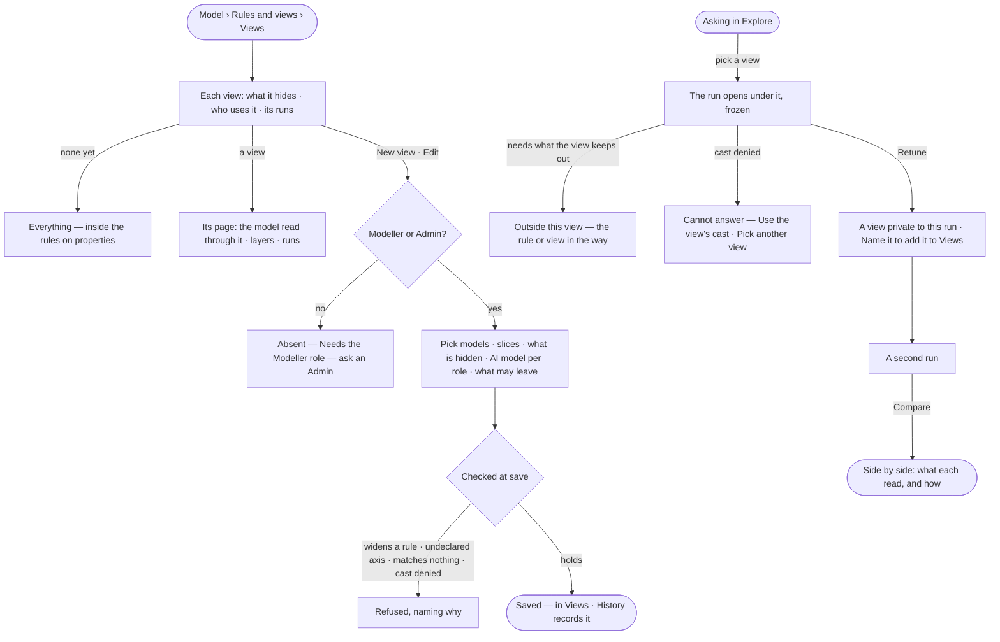

# SE-10 · Pick a view and compare two runs

**As** a modeller or an analyst **I want** to keep named views of Graph Data — what an answer may rest on — pick one
when I ask, and compare two runs of one question side by side **so that** I know what each answer was allowed to read,
and choose the view I can defend.

Tasks: [task.md](task.md) · Feature: [SE-F09](../../feature.md)

## Who can

Reading, picking and comparing are every signed-in person's; naming and authoring a view need the Modeller role
([SE-F09 › Access](../../feature.md#access)).

| Lens | Can | Otherwise sees |
|---|---|---|
| Admin | Read every view; pick one for a question; compare two runs; retune from their own run; name, create, edit, duplicate and delete views | — |
| Operator | Read every view; pick one for a question; compare two runs; retune from their own run into a view private to that run. A Modeller also names and authors views, as Admin | Authoring acts absent; under the list *Needs the Modeller role — ask an Admin* |

## Flow

## Acceptance criteria

| # | Given | When | Then |
|---|---|---|---|
| SE-10.1 | The deployment's views | a person opens Model › Rules and views › Views | each view lists with what it hides, who uses it and its runs in 30 days, as the engine counts them |
| SE-10.2 | No view yet | Views opens | it reads *Everything — inside the rules on properties*, with *New view* for a Modeller or an Admin |
| SE-10.3 | A view | a person opens it in Views | the model reads through it — hidden kinds dimmed, protected properties shielded — beside *Sees · Answers go · Used by* |
| SE-10.4 | Views in the deployment | a person picks one in the composer and asks | the run opens under that view and keeps it; a later edit of the view reaches only the next run |
| SE-10.5 | A Modeller or an Admin | they save a new view | its models, slices, hidden kinds and properties, AI model per role and what may leave are each picked from what the deployment declares, never typed, and the view lists in Views |
| SE-10.6 | A view that would widen a rule on a property | it is saved | it is refused — *{view} would widen {rule}.* |
| SE-10.7 | A slice on an axis the model never declared | the view is saved | it is refused — *{model} declares no {axis} axis.* |
| SE-10.8 | A run the person started | they pick *Retune* | a narrower view private to that run opens, named *this run only*, its name field reading *Name it to add it to Views* |
| SE-10.9 | A view private to a run | a Modeller or an Admin names it | it joins Views; a later rename changes its name and keeps the schedules that pinned it working |
| SE-10.10 | A name already used by a view | a view is named with it | it is refused — *A view named {name} already exists.* |
| SE-10.11 | Two runs of one question | the person picks *Compare* from a run | both show side by side — what each read, what both read, what only one read, and how a shared read differed in slice, hidden properties, projection and models |
| SE-10.12 | A view | its own page opens | its tiles read rules · closed layers · in force · runs in 30 days · last used, with the five layers and the agents whose runs asked under it |
| SE-10.13 | A view a schedule or an agent uses | a Modeller deletes it | it is refused — *{view} is used by {schedules and agents}.* |
| SE-10.14 | A view naming a model version that is not published | it is listed, then picked | it lists with a warning naming the version; picking it is refused before a run opens — *{view} names {model} v{n}, which is not published.* |
| SE-10.15 | A view created, edited, named or deleted | History is read | each is an event with its before and after |
| SE-10.16 | An Operator without the Modeller role | they reach Views | *New view*, *Edit*, *Duplicate*, *Delete* and naming are absent and a line reads *Needs the Modeller role — ask an Admin*; the engine refuses the same with 403 |
| SE-10.17 | No outside service configured | a person picks what may leave | it reads *No third-party endpoints are configured* where the matches would be |
| SE-10.18 | A run under a view | the person opens *How it got here* | it shows its steps and sources, and names the view and the rules it ran under |
| SE-10.19 | A view whose cast names an AI model its rules deny for a role | a run opens in it | the run reads *Cannot answer: {rule} in {denied_in} denies {address} for {role}.*, with *Use the view's cast* · *Pick another view* |
| SE-10.20 | A view that matches nothing, or whose cast names an AI model its rules deny | it is saved | it is refused — *{view}: {why}.* |
| SE-10.21 | A view casting an AI model whose provider is gone | a run starts in it | it is refused before the run is written — *{provider} is gone — {role} cannot be cast.* |
| SE-10.22 | A view file whose rule sets properties or a slice on a layer other than Graph Data | it is applied | it is refused — *A {layer} participant carries no {field}; it is allowed or denied whole.* |
| SE-10.23 | A question that needs what the view keeps out | the run settles | it reads *outside this view*, naming what it was grounded in and the rule or view in the way — never *cannot answer* |

## Screens

| Surface | Lens | First use | Empty after a filter | Loading | Has data | Failed | Agent working or proposing | No access |
|---|---|---|---|---|---|---|---|---|
| Views | Admin | model.rules.views · Everything | model.rules.views · No view matches | model.rules.views · Loading | model.rules.views | model.rules.views · Could not load | — | — |
| Views | Operator | model.rules.views · Everything | model.rules.views · No view matches | model.rules.views · Loading | model.rules.views | model.rules.views · Could not load | — | model.rules.views · Read only |
| A view | Admin | — | — | model.rules.views · View · Loading | model.rules.views · View | model.rules.views · View · Unpublished version | — | — |
| A view | Operator | — | — | model.rules.views · View · Loading | model.rules.views · View | model.rules.views · View · Unpublished version | — | model.rules.views · View · Read only |
| New view · Edit | Admin | model.rules.views · New view | — | — | model.rules.views · Edit | model.rules.views · Edit · Refused | — | — |
| New view · Edit | Operator | — | — | — | — | — | — | model.rules.views · Read only |
| A view in the composer | Admin | explore.board · View · Everything | — | — | explore.board · View picked | explore.board · View · Cannot be cast | explore.board · View · Outside this view | — |
| A view in the composer | Operator | explore.board · View · Everything | — | — | explore.board · View picked | explore.board · View · Cannot be cast | explore.board · View · Outside this view | — |
| Compare | Admin | — | — | explore.compare · Loading | explore.compare | explore.compare · Could not load | explore.compare · Second run running | — |
| Compare | Operator | — | — | explore.compare · Loading | explore.compare | explore.compare · Could not load | explore.compare · Second run running | explore.compare · Content withheld |
