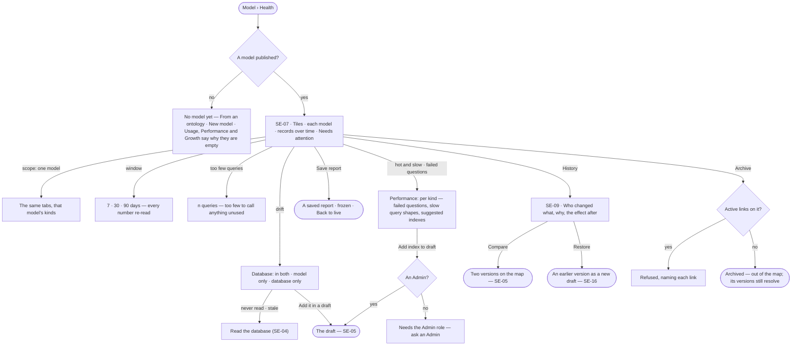

# Health and history

> Whether each model is used, how fast it answers, which questions fail on each kind, how its records grow and where
> it has drifted from the database — beside who changed it, why, and what the change did after. The decision it helps make: *which model do I fix,
> index, retire or roll back?*

## User journey

## Stories

| ID | Story | Status |
|---|---|---|
| SE-07 | [See each model's health](stories/SE-07-see-each-models-health/story.md) | idea |
| SE-09 | [Read a model's history](stories/SE-09-read-a-models-history/story.md) | idea |

## Access

| Act | Role ([the role table](../../../../os/access/features/AC-F02-access-policies/feature.md#the-role-table)) | Everyone else sees |
|---|---|---|
| Read health — Overview, Database, Usage, Performance, Growth — and history | Every signed-in person — Operator, Modeller, Admin | — |
| Save a report · open saved reports | Every signed-in person — Operator, Modeller, Admin | — |
| Read the database · *Add it in a draft* | Modeller · Admin | Absent; the reading stays — *Needs the Modeller role — ask an Admin* on the drift rows |
| *Add index to draft* — apply a suggested index | Admin | Absent; the suggestion reads — *Needs the Admin role — ask an Admin* |
| Archive, restore or delete a model | Modeller · Admin | Absent from the model's `⋯`; *Needs the Modeller role — ask an Admin* |

## States

| State | What the person sees |
|---|---|
| First use | No published model: Overview says so with *From an ontology* and *New model*; Usage, Performance and Growth say why they are empty. Published but nothing loaded: Growth and Usage name the model and *Bring records in* — no charts of zeros |
| Empty after a filter | A scope or window with nothing in it: *Nothing in the last 7 days for Routes* · *30 days* |
| Loading | Tiles and tables hold their shape; scope and window stay live |
| Has data | Tiles, each model or kind as a row with its signals, records over time, Needs attention, history |
| Failed | A reading that cannot load says which and why; a reading the engine does not measure yet reads *Not measured yet*, naming what it reads from; a database that cannot list indexes says so |
| Agent working or proposing | — |
| No access | Every reading shows; acts that change a model are absent |

## Rules

| Rule | Detail |
|---|---|
| One page, the model a filter | Overview · Database · Usage · Performance · Growth, read for all models or one; changing scope keeps the tab. History opens from *Versions* |
| One window | 7 · 30 · 90 days, read by every number on the page; Database ignores it and says so |
| Signals are fixed rules, not a score | *Unused* — records and no query touched it. *Empty* — published, no records. *Cold property* — never filtered, returned or ordered on, where the database can explain a query. *Hot* — touched by a quarter of the window's queries. *Hot and slow* — hot, with p95 at or above the Graph's. *Supernode* — a kind whose most connected record has at least a hundred times the median and at least 1,000. Nothing is called with fewer than 50 queries in the window |
| Every use is split by who called | Agent · plan · Explore · API, read off the run, never guessed from the query |
| Queries are grouped by shape | A query with its values taken out; a thousand calls of one generated query are one row, with p50 · p95 · rows · callers |
| Drift is matched by what a row covers | A kind, relationship, index or constraint is *in both*, *model only* or *database only* by what it covers, never by its name |
| Growth moves only when something writes | Records are counted after every read of the database, load and link commit, each mark naming the run that wrote; never sampled on a timer |
| Query performance per kind | Performance reads, per kind, the questions that failed — *cannot answer*, refused or erroring, each with its reason — the slow query shapes, and the indexes the engine suggests from them |
| Advice is a draft change, never a write | A suggested index is offered as *Add index to draft*, to an Admin alone; the next publish adds it. Explore's memory may suggest the same index (AG-F09); it lands here, never applied by an agent |
| Archive, not delete | A published model is archived — out of the map, its versions still resolve for every answer and load that used them; only a never-published model is deleted. A model with active links cannot be archived |
| The engine counts every number | Studio formats; history's effect after is stored when the version publishes and never recomputed |
| Leans on | SE-F01 — reading the database · SE-F02 — the draft, the comparison, the review · SE-F06 — links · RC-F02 — loads into a model · AG-F09 — suggestions from memory · Agents › Runs — each run a number links to |

## Data touched

| Record | Read or write |
|---|---|
| Model versions and what each changed | Read |
| What the database holds and when it was read | Read |
| Record counts per kind, written by every act that writes records | Read |
| Query log — shape, caller, timing, rows, kinds touched, failed and why | Read |
| Suggested indexes — kind, properties, the shapes behind them | Read |
| Saved report — the tab, its scope and window, frozen | Read · write |
| A version's effect after — each kind it touched and the records failing | Read |
| Model status — active, archived | Write |

## Engine

The low-level design: what this feature stores, serves and refuses. Conventions — naming, errors, lists, events — are
[system-design.md](../../../../system-design.md) §§ 6–8; this section only fills them in.

### Records

| Table | Columns | Notes |
|---|---|---|
| `model_type_counts` | `graph_id` · `at` · `source` (`introspect` · `load` · `link_commit`) · `source_id` (the run) · `kind` · `count` · `max_degree` · `median_degree` | A snapshot per kind each time something writes. Degree only at a read of the database and the end of a load |
| `model_query_log` | `graph_id` · `at` · `shape_hash` · `shape_text` · `language` · `caller_kind` (`agent` · `plan` · `explorer` · `api`) · `caller_id` · `run_id` · `duration_ms` · `rows` · `ok` · `types_touched` · `properties_touched` (filtered · returned · ordered · scanned) · `touched_from` (`plan` · `results`) | One row per graph query that answered or failed. Rows older than 90 days are pruned by its writer |

### Reads

| Record | Owner |
|---|---|
| Models, their status and versions · the review and its runs behind each publish | [SE-F01](../SE-F01-start-a-model/feature.md#engine) · [SE-F02](../SE-F02-change-and-publish-a-model/feature.md#engine) |
| The statements pushed for each version | [SE-F02](../SE-F02-change-and-publish-a-model/feature.md#engine) |
| Links between models, and the relationship each declares | [SE-F06](../SE-F06-links-and-mappings/feature.md#engine) |
| The connector's indexes, constraints, `EXPLAIN` and `lists_schema` | [CP-F05](../../../../os/control/features/CP-F05-graph-databases/feature.md#engine) |
| Runs, their caller and `triggered_by` | [CP-F10](../../../../os/control/features/CP-F10-runs-and-how-the-agents-are-doing/feature.md#engine) |
| History — every version and act | [AC-F06](../../../../os/access/features/AC-F06-history/feature.md#engine) |

### Routes

| Route, after `/api/v1/u/{u}/{g}/model` | Does | Story |
|---|---|---|
| `GET /models/insights?model=&window=` | Overview · usage · performance · growth · `catalog` — every number the page shows | SE-07 |
| `GET /models/insights/shapes/{hash}` | One shape: `plan[]` · `slowest[]` · `advice[]` · `explains` | SE-07 |
| `GET /schema/physical?model=` | Drift: `captured_at` · `stale` · each row `in_both` · `model_only` · `database_only` · tallies | SE-07 |

| Read | Fields |
|---|---|
| Overview | `queries_a_day` · `p50` · `p95` · `by_caller_by_day[]` · `rows[]` · `attention[]` (the first six) · `attention_total` · `signals_total` |
| Usage | `total` · `too_few` · `callers` · `caller_share` · `per_day` · `rows[]` · `stitches[]` · `properties[]` · `unused_types` · `hot_types` · `cold_properties` |
| Performance | `p95_by_day[]` · `error_rate` · `slow` · `missing_indexes` · `shapes[]` |
| Growth | `labels` · `series` · `marks` · `rows` · `writes` · `counted` · `change_rate` · `fastest` · `unchanged` |
| `catalog` | `models` · `published` · `drafts` · `node_types` · `edge_types` · `types` |
| Physical | `connector` · `lists_schema` · `declared_indexes` · `declared_constraints` · `labels_tally` · `relationship_types_tally` · `drift` {`total` · `types` · `rules` · `unmodelled_types` · `model_only_rules` · `by_model`} |

### Events

| Event | When |
|---|---|
| `model.queries.run` | A logged query's span |

### Refusals

| Status | When | Sentence | Criterion |
|---|---|---|---|
| — | No refusal of its own: archive and delete refuse on [SE-F01](../SE-F01-start-a-model/feature.md#engine)'s routes | — | — |

### CLI

| Command | Does |
|---|---|
| — | No command of its own |

### Mechanisms

| Mechanism | How |
|---|---|
| The query log is off the query path | A run sets its caller (`calling_as`) when it starts; the connector calls `observe` once a query answers or fails; a writer queues the row in its own session. A full queue drops the row and a failing insert is logged — neither slows nor fails the query |
| What is not logged | A query with no caller — a read of the database, counts, the page's own reads; the plans that write data (a load, a bulk load, a link commit, a link withdrawal) and platform runs (`triggered_by = system`) set no caller: their effect is Growth's |
| The caller is read off the run | A canvas run is `explorer`; a query typed in a query language is `api`, whichever agent carried it; any other run with an agent, or a question in language, is `agent`; any other plan is `plan` |
| A shape | Strings and numbers become `$p0`, `$p1` … in order, parameters stay, whitespace collapses; `shape_hash` is SHA-256 cut to 16 hex. A traversal's shape is its bytecode's text. A shape is explained once, with its first call's parameters |
| Advice explains, never profiles | Over the window's slowest shapes by total time, `EXPLAIN` — never `PROFILE` — against the indexes the database reports now. `missing_index` is a property filtered after a label scan with no index on that label and property, naming the model whose active version declares the label; Neo4j and Memgraph only |
| A connector that cannot explain | The shape returns `explains = false` and no advice; nothing is refused |
| Counts move when something writes | A `model_type_counts` snapshot after every read of the database, load and link commit, naming its run; a count that errors is logged and dropped, never failing the act. Degree is read as a histogram; growth is stepped by day |
| Drift matching | Labels and relationship types match by name, exactly. An index or constraint matches by label and properties, and a constraint's kind, never by name. A label no model declares is `database_only` and reads only at all models. A link's relationship is `in_both`. Rows come from the mirror; counts are live. A model counts as published once any version was |
| Listing the schema is the connector's | `get_indexes` and `get_constraints`, with the `lists_schema` flag the connector states, never inferred |
| Every number is the engine's | Percentiles are computed in the engine; a kind two models declare counts toward both; signals are computed when read; a slice not measured is `null` |
| A query crossed a link | When it touched the link's relationship and both end kinds |

## System impact

| HLD section | Change | NFRs |
|---|---|---|
| § 6 Data and storage | `model_type_counts` and `model_query_log` in Invana's own store; the log kept 90 days | — |
| § 8 APIs and events | The routes and event above, under `model` | — |
| § 12 Qualities | The query log is written off the query path: a full queue drops a row rather than slow a query | — |

## Decisions

| Decision | Detail |
|---|---|
| Health is a tab of the map | Map · Health · History; Health's tiles read *Models in use · Unused kinds · Slowest kind · Records*, then each model with its health, use, p95 and growth, records over time, and History beside them |
| Needs attention is capped | Six rows, then `+n more` counted by the engine; a model's signal shows three and `+n` |
| Drift says what to do | A model-only or database-only row names the next act — *Add it in a draft* or *Read the database*; a read older than the last load turns to the warning tone |
| A saved report is the tab, frozen | *Save report* keeps the tab's tiles and tables at its scope and window; it reopens reading *Saved report · <what> · kept by <who> on <date> · it will not change* with *Back to live* |
| History reads effect after | Each version: when · by · what changed · why · effect after — *1 kind now warns · 6 records* or *2 kinds hold*, else the runs and tokens while it was published. *Compare vA and vB* and each row's *Compare* open the map's Comparing bar |
| All models, all history | At all models, History lists every model's versions with a model column, newest first |
| The query log keeps 90 days | The widest window; older rows are pruned by the engine |

## Open questions

| Question | Who answers |
|---|---|
| — | — |

## Not building

| Item | Why not |
|---|---|
| A health score | Signals are fixed rules a person can argue with |
| Running an index from the page | Advice lands in a draft; publishing adds it |
| An agent applying an index | An index changes the database for every reader; an Admin applies it |
| Numbers from telemetry | The query log is Invana's own, so the page works with telemetry off |
| Recomputing a past version's effect | What a publish affected is stored when it publishes |
