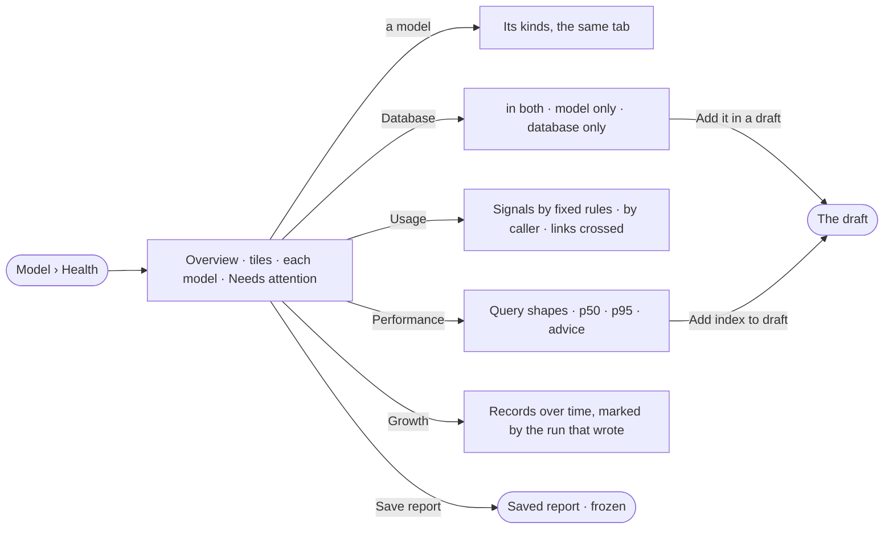

# SE-07 · See each model's health

**As** a modeller **I want** each model's use, speed, growth and drift from the database on one page, and a reading I
can keep **so that** I fix the model that is slow, retire the one nobody asks about, and never guess which is which.

Tasks: [task.md](task.md) · Feature: [SE-F10](../../feature.md)

## Who can

Acting on what Health finds is the Modeller's and the Admin's; a suggested index is the Admin's alone ([the role table](../../../../../../os/access/features/AC-F02-access-policies/feature.md#the-role-table)).

| Lens | Can | Otherwise sees |
|---|---|---|
| Admin | Read every tab for all models or one, save a report, and act on what it finds — read the database, add a drift to a draft, add a suggested index to a draft (an Admin alone), archive a model | — |
| Operator | Read every tab for all models or one, and save a report. A Modeller acts on drift, archives and restores as an Admin does; a suggested index stays an Admin's | The acts are absent; drift rows read *Needs the Modeller role — ask an Admin*; a suggested index reads *Needs the Admin role — ask an Admin* |

## Flow

## Acceptance criteria

| # | Given | When | Then |
|---|---|---|---|
| SE-07.1 | Published models | the person opens Health | Overview shows tiles — models in use, unused kinds, the slowest kind, records — a row per model with its version, kinds, records, share of queries, p95, signals and drift, and *Needs attention*: six flagged signals, each linking to its tab, then `+n more` |
| SE-07.2 | Health | the person picks a model | every tab re-reads for that model's kinds and keeps the tab; the breadcrumb returns to all models; a reload lands on the same reading |
| SE-07.3 | Health | the person picks 7, 30 or 90 days | every number re-reads over that window; Database greys the window and says it does not use it |
| SE-07.4 | The Database tab | it opens | kinds of node, relationships, indexes and constraints each show *in both*, *model only* or *database only* with the database's count, unmodelled ones first, and the time the database was read |
| SE-07.5 | A database never read, or read before the last load | Database opens | it reads *Not read yet*, or the read time in the warning tone, with *Read the database* |
| SE-07.6 | A *database only* row and a Modeller or an Admin | they pick *Add it in a draft* | the kind or property is staged on the model's draft |
| SE-07.7 | The Usage tab with 50 or more queries in the window | it opens | each kind carries its signals — Unused · Empty · Cold property · Hot · Hot and slow · Supernode — by the fixed rules, with queries split by agent · plan · Explore · API, last touched, and the links between models each query crossed |
| SE-07.8 | Fewer than 50 queries in the window | Usage opens | it reads *n queries in 7 days — too few to call anything unused* and shows counts without signals |
| SE-07.9 | The Performance tab | it opens | tiles — queries · p50 · p95 · errors · slow shapes · advice — p95 a day, and a row per query shape with callers, calls, p50, p95, rows, kinds touched and advice; a row opens its slowest calls, each linking to its run |
| SE-07.10 | An index the engine suggests for a model's kind and an Admin | they pick *Add index to draft* | the index is staged on that model's draft; nothing is written to the database until it is published |
| SE-07.11 | A database that cannot explain queries or list its indexes | Performance or Database opens | that column or section says *not available on <database>*; cold properties are not called |
| SE-07.12 | The Growth tab | it opens | records over time stack by model, or by kind for one model, moving only on days something wrote, each mark naming the read, load or link commit that wrote |
| SE-07.13 | A published model with nothing loaded | Usage or Growth opens | it names the model with *Bring records in* — no chart of zeros |
| SE-07.14 | No published model | Overview opens | it says so with *From an ontology* and *New model*; Usage, Performance and Growth say why they are empty |
| SE-07.15 | A reading the engine does not measure yet | its tab opens | it reads *Not measured yet*, naming what it reads from |
| SE-07.16 | Any tab | the person picks *Save report* | the tab's tiles and tables are kept at its scope and window; opened later it reads *Saved report · <what> · kept by <who> on <date> · it will not change* with *Back to live*, and a link lands on it |
| SE-07.17 | A published model with no active link and a Modeller or an Admin | they archive it | it leaves the map and Health; its versions still resolve for every answer and load that used them; *Show archived* lists it with *Restore*. With an active link, archiving is refused, naming each link |
| SE-07.18 | Any number on the page | it shows | it is the engine's, as stored; Studio formats it |
| SE-07.19 | An Operator | they open Health | every tab reads; *Add it in a draft*, *Add index to draft*, *Read the database* and Archive are absent, and drift and advice rows read *Needs the Modeller role — ask an Admin* |
| SE-07.20 | A model never published and a Modeller or an Admin | they delete it from its `⋯` | It is gone after a confirm; deleting a model that was ever published is refused, offering *Archive* |
| SE-07.21 | An active link | the Database tab lists the relationship it writes | The row is *in both*, naming the link's two models — never *database only* |
| SE-07.22 | An archived model and a Modeller or an Admin | they restore it | It is back on the map with its versions; History records who restored it |
| SE-07.23 | A Modeller | they open a suggested index | *Add index to draft* is absent and the row reads *Needs the Admin role — ask an Admin* |
| SE-07.24 | Questions that failed in the window — *cannot answer*, refused, or erroring | Performance opens for a model | each kind shows its failed questions with their reason, counted by the engine, each linking to its run |

## Screens

| Surface | Lens | First use | Empty after a filter | Loading | Has data | Failed | Agent working or proposing | No access |
|---|---|---|---|---|---|---|---|---|
| Health · Overview | Admin | model.health · No model yet | model.health · Nothing in window | model.health · Loading | model.health | model.health · Could not load | — | — |
| Health · Overview | Operator | model.health · No model yet | model.health · Nothing in window | model.health · Loading | model.health | model.health · Could not load | — | model.health · Read only |
| Health · Database | Admin | model.health · Database not read | — | model.health · Reading the database | model.health · Database | model.health · Not available | — | — |
| Health · Database | Operator | model.health · Database not read | — | model.health · Reading the database | model.health · Database | model.health · Not available | — | model.health · Database read only |
| Health · Usage | Admin | model.health · Nothing loaded | model.health · Too few queries | model.health · Loading | model.health · Usage | model.health · Not measured yet | — | — |
| Health · Usage | Operator | model.health · Nothing loaded | model.health · Too few queries | model.health · Loading | model.health · Usage | model.health · Not measured yet | — | model.health · Read only |
| Health · Performance | Admin | model.health · Nothing loaded | model.health · Nothing in window | model.health · Loading | model.health · Performance | model.health · Not available | — | — |
| Health · Performance | Operator | model.health · Nothing loaded | model.health · Nothing in window | model.health · Loading | model.health · Performance | model.health · Not available | — | model.health · Read only |
| Health · Growth | Admin | model.health · Nothing loaded | model.health · Nothing in window | model.health · Loading | model.health · Growth | model.health · Not measured yet | — | — |
| Health · Growth | Operator | model.health · Nothing loaded | model.health · Nothing in window | model.health · Loading | model.health · Growth | model.health · Not measured yet | — | model.health · Read only |
| Saved report | Admin | — | — | model.health · Loading | model.health · Saved report | model.health · Could not load | — | — |
| Saved report | Operator | — | — | model.health · Loading | model.health · Saved report | model.health · Could not load | — | — |
| The draft · index or drift added | Admin | — | — | — | model.board.draft | — | — | — |
| The draft · index or drift added | Operator | — | — | — | — | — | — | — |
