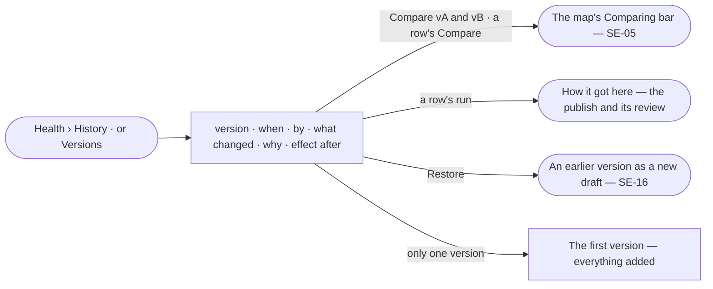

# SE-09 · Read a model's history

**As** a modeller **I want** a model's history — who changed what, why, and the effect after **so that** model
changes are auditable, and a change that hurt is found and undone.

Tasks: [task.md](task.md) · Feature: [SE-F10](../../feature.md)

## Who can

| Lens | Can | Otherwise sees |
|---|---|---|
| Admin | Read every version's history, compare two versions, and restore an earlier one as a draft | — |
| Operator | Read every version's history and compare two versions | *Restore* disabled — *Ask Priya (owner) to shape the model*. With *Can shape the model*: as Admin |

## Flow

## Acceptance criteria

| # | Given | When | Then |
|---|---|---|---|
| SE-09.1 | A model with published versions | the person opens History, or *Versions* on a model | a row per version, newest first: version · when · by · what changed · why · effect after |
| SE-09.2 | A version that touched kinds holding records | its row shows | effect after reads *1 kind now warns · 6 records* in the warning tone when any records fail, or *2 kinds hold* when none do — as stored when it published |
| SE-09.3 | A version that touched no kind holding records | its row shows | effect after reads the runs and tokens while it was published |
| SE-09.4 | A first version | its row shows | what changed reads every kind as added |
| SE-09.5 | History | the person picks *Compare vA and vB* or a row's *Compare* | the map opens with the Comparing bar on that pair |
| SE-09.6 | History at all models | it opens | every model's versions are listed newest first, with a model column |
| SE-09.7 | A version | the person opens *How it got here* from its row | it shows who published it, why, the review and its approver if it broke anything, and the runs that published it |
| SE-09.8 | A person with *Can shape the model* | they pick *Restore* on an earlier version | a new draft opens with that version's kinds, listing what returns and what goes (SE-16) |
| SE-09.9 | An Operator without *Can shape the model* | they open History | it reads; *Restore* is disabled with *Ask Priya (owner) to shape the model* |

## Screens

| Surface | Lens | First use | Empty after a filter | Loading | Has data | Failed | Agent working or proposing | No access |
|---|---|---|---|---|---|---|---|---|
| History | Admin | model.health · One version | model.health · No history in window | model.health · Loading | model.health · History | model.health · Could not load | — | — |
| History | Operator | model.health · One version | model.health · No history in window | model.health · Loading | model.health · History | model.health · Could not load | — | model.health · History read only |
| Compare | Admin | — | — | model.board · Comparing loading | model.board · Comparing | — | — | — |
| Compare | Operator | — | — | model.board · Comparing loading | model.board · Comparing | — | — | — |
