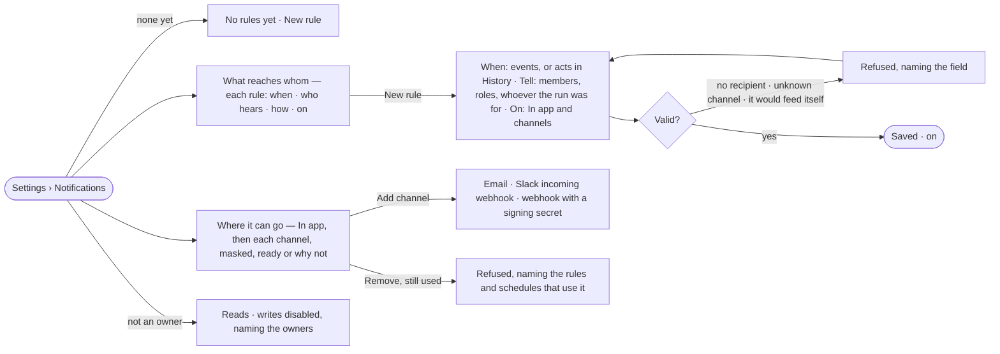

# IN-05 · Say which events reach whom, and where

**As** a Graph owner **I want** rules that say which events and which acts in History reach whom — in the Inbox, by
email, Slack or webhook **so that** failures and slowdowns find the right person without anyone watching.

Tasks: [task.md](task.md) · Feature: [IN-F01](../../feature.md)

## Who can

| Lens | Can | Otherwise sees |
|---|---|---|
| Admin | Read, write, switch off and delete rules and History alerts; add and remove channels | — |
| Operator | Read every rule, alert and channel | *New rule*, *Add channel*, each switch and *Remove* disabled, naming the owners; a row does not open for editing. *With Owner: as Admin* |

## Flow

## Acceptance criteria

| # | Given | When | Then |
|---|---|---|---|
| IN-05.1 | No rules | an owner opens Settings › Notifications | it reads *No rules yet*, with *New rule* |
| IN-05.2 | Rules | the list is read | one row each: *when* (the events and the status they match) · who hears · how (Inbox and each channel) · an on switch |
| IN-05.3 | *New rule* | the owner picks events, an optional status for a finished run (any · failed · succeeded), recipients and where it goes | the rule saves, on, and matches events written from then on |
| IN-05.4 | Recipients | a rule names them | they can be members by name, holders of Graph roles, or *whoever the run was for*; a member who left the Graph is skipped when it matches |
| IN-05.5 | A rule with no recipient, or naming a channel that does not exist | it is saved | it is refused, naming the field |
| IN-05.6 | The events offered | a rule is written | notifications, deliveries, reminders and rule and channel changes are not offered, so a rule cannot feed itself |
| IN-05.7 | A History alert | the owner writes one: what was done, what it touched, allowed or refused and why, optionally a count in a window, and who to tell | it tells those members in the Inbox when a new History row matches, and shows when it last fired |
| IN-05.8 | A new History alert | rows matching it were written before it existed | it does not fire for them; *Last fired* reads *never* until a new row matches |
| IN-05.9 | A matching event | a rule is on | each recipient gets an Inbox row within one tick, and each channel a delivery |
| IN-05.10 | A channel that is down | a delivery is sent | it is tried three times, then reads *failed* with the error; the Inbox row is there regardless |
| IN-05.11 | Channels | they are read | *In app* first, always on; then each channel: name · kind · its masked target · *ready* or why not (*email is not configured on this install*); Microsoft Teams listed *not connected*, with no act |
| IN-05.12 | *Add channel* | the owner adds an email, a Slack incoming-webhook URL, or a webhook URL with an optional signing secret | it saves; the secret is never shown again, only a masked target |
| IN-05.13 | A channel a rule or schedule uses | the owner presses *Remove* | it is refused, naming the rules and schedules that use it |
| IN-05.14 | A webhook channel with a signing secret | a delivery is sent | it carries a signature of its body the receiver can check |
| IN-05.15 | A rule or channel change | it is saved | it is a History row (IN-F03) |
| IN-05.16 | An Operator | they open Settings › Notifications | rules, alerts and channels read; *New rule*, *Add channel*, each switch and *Remove* are disabled, naming the owners |

## Screens

| Surface | Lens | First use | Empty after a filter | Loading | Has data | Failed | Agent working or proposing | No access |
|---|---|---|---|---|---|---|---|---|
| What reaches whom — rules and alerts | Admin | settings.notifications · No rules yet | — | settings.notifications · Loading | settings.notifications | settings.notifications · Could not load | — | — |
| What reaches whom — rules and alerts | Operator | settings.notifications · No rules yet · Read only | — | settings.notifications · Loading | settings.notifications · Read only | settings.notifications · Could not load | — | settings.notifications · Read only |
| A rule — new or edit | Admin | settings.notifications · New rule | — | — | settings.notifications · Rule | settings.notifications · Rule refused | — | — |
| A rule — new or edit | Operator | — | — | — | — | — | — | settings.notifications · Read only |
| Where it can go — channels | Admin | settings.notifications · In app only | — | settings.notifications · Loading | settings.notifications | settings.notifications · Channel failed | — | — |
| Where it can go — channels | Operator | settings.notifications · In app only | — | settings.notifications · Loading | settings.notifications · Read only | settings.notifications · Channel failed | — | settings.notifications · Read only |
