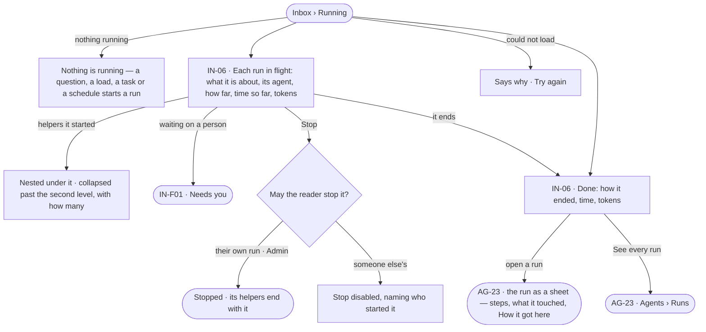
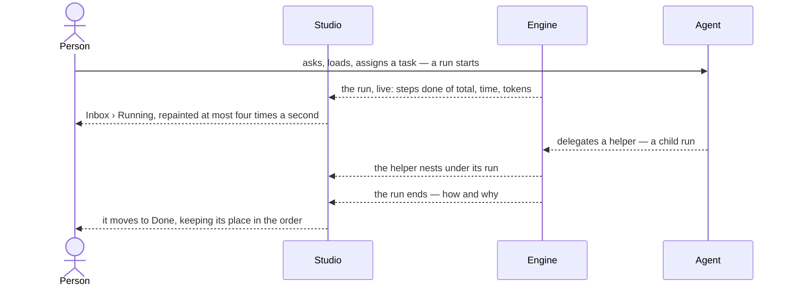

# Running — what runs and what ran

> Every load, question, link between models and enrichment is one run; the Inbox shows what is running now and what
> just ended, without first knowing which product started it. The decision it helps make: *is the work I am waiting
> for moving — and should I stop it, or look at why it ended the way it did?*

## User journey

## Stories

| ID | Story | Status |
|---|---|---|
| IN-06 | [See what is running and what just ran](stories/IN-06-see-what-is-running-and-what-just-ran/story.md) | idea |

## Access

| Act | Role (`.claude/team/TEAM.md` §7) | Everyone else sees |
|---|---|---|
| Read Running and Done — runs the reader can open | Operator — every member | A run the reader cannot open is not listed |
| Stop a run they started | Operator — every member | — |
| Stop anyone's run | Admin | *Stop* disabled, naming who started the run |
| Open a run's sheet and the full list | AG-F03 | As AG-23 says |

## States

| State | What the person sees |
|---|---|
| First use | *Nothing is running*, and what starts a run — a question, a load, a task or a schedule. Empty because nothing ran, not because something broke |
| Empty after a filter | *Mine* with none of the reader's runs: *Nothing of yours is running*, with *Show everyone's* |
| Loading | Running and Done drawn at once; rows load in place |
| Has data | Running — runs in flight, the reader's first, helpers nested; Done — runs ended today, newest first, each with how it ended |
| Failed | The runs could not load, saying why, with *Try again*. A run that failed reads *failed* with its reason, in Done |
| Agent working or proposing | A run in flight: its steps done of total, time so far and tokens climbing in place |
| No access | A run the reader cannot open is not listed; *Stop* on someone else's run is disabled, naming who started it |

## Rules

| Rule | Detail |
|---|---|
| One journal | There is one record of runs in a Graph. Agents › Runs (AG-23) is the full list; Inbox › Running and Done are readings of it, and Data's import history is the same journal filtered to loads — never a second record |
| Running is not History | A run is what executed — how it ended, what it spent; a History row is what a person or an agent did — who, on whose behalf. Neither is drawn from the other |
| Everything that runs is a run | A question, a typed query, a load, a link between models, an enrichment, a planner and a checker are each a run; a step is never a run of its own in a list |
| Helpers nest | A helper an agent delegated to, or a part a step fanned out, sits under the run that started it, never as a sibling; past the second level it collapses, showing how many it holds |
| A chain shows its worst | A run still going whose helper already failed shows that beside its own status; neither hides the other |
| Tokens add up the chain | A run's tokens include what its helpers spent. Tokens only, never currency |
| Interaction is hidden | Expanding a node on a board and a provider check are runs too, hidden unless *Show interactive runs* is on |
| A row leads with what was asked | The question as typed, the query, or the dataset and where it loads — then the agent, how far (*steps 4 of 9*, never a percentage), time so far, tokens |
| Live, but still | A run in flight updates in place and keeps its place in the order; a run that starts while the list is open joins the top; the list repaints at most four times a second |
| Stop is the one act | Running offers *Stop* while a run is going; nothing here retries, edits or re-runs — re-running is where the run was started (AG-32) |
| How it ended, in words | served · cannot answer · out of tokens · out of time · stopped · failed — the run's own reason, as AG-F03 words it |
| A number nobody recorded | Reads `—`, never `0` |
| What opened it | Each run names where it came from — Explore, a task, a schedule, a delegation, the API — and who started it |
| Leans on | Runs and the run's sheet (AG-F03) · asks a run waits on (IN-F01) · the task a run carries out (PJ-F01) · loads (DA-F02) |

## Data touched

| Record | Read or write |
|---|---|
| Runs — what it was about, kind, agent, who and what started it, status, how it ended, steps done and total, time, tokens, its parent | Read |
| A run's stop | Write — as a History row (IN-F03) |

## Decisions

| Decision | Detail |
|---|---|
| Running is the Inbox's, the list is Agents' | Inbox › Running answers *what is moving now*; Agents › Runs is where every run is found, filtered and opened. A run opens as one sheet wherever it is listed |
| Done is today | Done lists the runs that ended today, the reader's day; older runs are in Agents › Runs |
| Mine first | Running lists the reader's runs first, then everyone else's they can open |

## Open questions

| Question | Who answers |
|---|---|
| Does Done keep runs the reader did not start, or only theirs? Recommend: every run they can open, theirs first, as Running does | Ravi |

## Not building

| Item | Why not |
|---|---|
| A word for *job* | A run and its steps already name it |
| Retry or re-run from Running | A run is re-run where it was started, with its own inputs — a blind re-run of a load writes a graph twice |
| A step as a row of its own | Steps belong to their run and open inside it |
| Runs across Graphs | A Graph is the reasoning boundary |
| Alerting on a failed run here | A rule does that (IN-05) |
