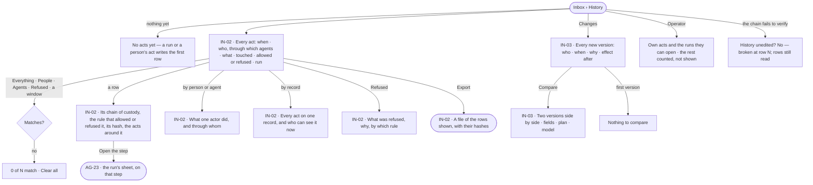
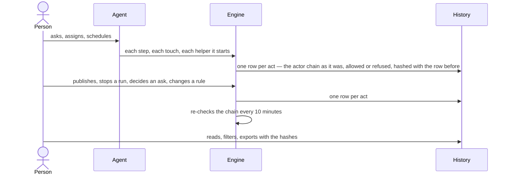

# History — what people and agents did, and every change

> Every act by a person or an agent in a Graph — who, through which agents, what it touched, allowed or refused — in
> one record nobody can edit, and every new version of anything versioned with why it changed and what happened after.
> The decision it helps make: *can I trust what happened here — who did it, was it allowed, and did the change make
> things better or worse?*

## User journey

## Stories

| ID | Story | Status |
|---|---|---|
| IN-02 | [Read what people and agents did, and prove it](stories/IN-02-read-what-people-and-agents-did-and-prove-it/story.md) | idea |
| IN-03 | [See every change and compare two versions](stories/IN-03-see-every-change-and-compare-two-versions/story.md) | idea |

## Access

| Act | Role (`.claude/team/TEAM.md` §7) | Everyone else sees |
|---|---|---|
| Read every row, the counts over the Graph, by actor, by record and refusals | Admin | — |
| Read their own acts and the rows of runs they can open | Operator — every member | The rest is counted, not shown — a line says how many |
| Export the rows the reader can see | Operator — every member — a read; carrying confidential or personal data, or made by a key or an agent, a send ([An export](../../../settings/product.md#decisions)) | — |
| Read every change and compare two versions of a record the reader can open | Operator — every member | A record in another Graph, or one the reader cannot open, reads as absent |
| Restore an earlier version | Not here — the record's own page, by its own role | — |

## States

| State | What the person sees |
|---|---|
| First use | *No acts yet — a run or a person's act writes the first row*. Changes with nothing versioned: *No changes yet* |
| Empty after a filter | *0 of N match*, with *Clear all*; *Export* disabled, *no rows match* |
| Loading | The head, filters and table drawn at once; rows load in place |
| Has data | Rows newest first, today unless a window is chosen; the head says History is unedited, when that was last checked and how long rows are kept |
| Failed | The rows could not load, saying why, with *Try again*. The chain failing to verify: *broken at row N*, in red; rows still read |
| Agent working or proposing | Rows arrive as acts happen; an agent's rows name the person it acted for |
| No access | An Operator reads their own acts and the rows of runs they can open, a line counting the rest; the counts over the Graph are not shown |

## Rules

| Rule | Detail |
|---|---|
| One row per act | A step an agent took, a touch it was refused, a helper it started or was refused, and every act of a person — publish, stop a run, decide an ask, change a rule, pause — is a row |
| Nothing is unrecorded | Every write in the product — graph, model, skill, rule, agent, task, load, connection — is in History; there is no silent write |
| Never edited | Rows are never edited or deleted one by one; a correction is a new row |
| Provably unedited | Each row is hashed with the one before; the chain is re-checked every 10 minutes and the head says when it last held. An export carries each row's hash and the previous one |
| The actor and on whose behalf | Who acted and for whom are two names, never one — *ravi ▸ Route analyst ▸ Hub checker*; names are as they were when the row was written |
| What caused what | A row links to the act that caused it, so a chain is followed up to the person who started it |
| Secrets never enter | A credential is removed before the row is written, not hidden when read |
| A row about a deleted record | Still reads, with the record's name as it was |
| A refusal names its reason and its rule apart | The reason — no grant · outside the lens · outside the view of the graph · over its limit · the site's robots.txt · an access rule — and the rule in words (*no grant for graph/Fare*) |
| Kept for a year | Rows are kept 365 days. Removing old rows removes a whole window, never chosen rows, and the removal is itself a row |
| Every number is the engine's | Counts, per-day bars and top lists are counted over the stored rows, over the whole window |
| A change is the act that made a version | Changes are History narrowed to the acts that made a new version of a skill, rule, plan, agent, model or dataset; the versions stay where they are kept |
| Why is never invented | A reason given when a version is made is kept (500 characters); none given reads empty, never inferred |
| Effect after is counted | Runs, failed runs and tokens on a version — what runs recorded they used; a model's is the Graph's runs while it was published, labelled *while published*, so nobody reads it as cause. Tokens only, never currency |
| A draft is not a version | Drafts never appear in Changes or a compare |
| One compare | Every product's History tab and *Compare* open the same compare; a dataset keeps its own, since it belongs to no Graph |
| Restore is not here | Restoring makes a new version from the record's own page; History only reads |
| Running is not History | History is what people and agents did; what executed is IN-F02 |
| Leans on | Runs and their steps (AG-F03) · asks and their decisions (IN-F01) · a record's own History tab — agents (AG-F01), skills (AG-F04), models (MO-F04), datasets (DS-F01) · access rules and views of the graph (ST-F02 · MO-F05) |

## Data touched

| Record | Read or write |
|---|---|
| History rows — when, the actor chain, the act, what it touched, allowed or refused and why, the rule, the run and step, where it ran, its hash and the previous one | Read |
| Writes and their causes — actor, on whose behalf, what, the act that caused it | Read |
| The chain's last check — when, whether it held, where it broke | Read |
| Exports — who, the filters, the format, how many rows | Write · read |
| Versions of skills, rules, plans, agents, models and datasets, and why each was made | Read |
| Runs on each version — runs, failed, tokens | Read |

## Decisions

| Decision | Detail |
|---|---|
| History is one place | People's acts, agents' acts, refusals and changes are filters of one History — *Everything · People · Agents · Changes · Refused* — not four pages |
| Rows read today | Until a window is chosen — today · last 24 hours · 7 days · 30 days · any time; an export takes the same window |
| A row opens beside the list | Its detail opens over the right of History; the list still takes clicks, so another row moves it |
| An Operator reads less, and is told | They see their own acts and the runs they can open; a line counts what they cannot see. Counts over the whole Graph are an Admin's |
| By an actor includes its helpers | Every row whose chain names the actor — helpers of one kind grouped as *Hub checker ×4*, a delegated agent its own row |
| Who can see a record now | Read from views of the graph and access rules, never from History |
| A change shows no percentage on an empty week | The change in acts against the 7-day daily mean is absent while that mean is under 10 acts a day |
| Compare carries tokens per run | The compare reads *Tokens per run* of one version against the other, as the engine counted it |
| A model's change names its datasets | A model version's effect lists the datasets it touched and how many rows fail |

## Open questions

| Question | Who answers |
|---|---|
| Does History read across every Graph the person is on, as the board's subtitle does? Recommend: per Graph — a Graph is the reasoning boundary; the Inbox question in IN-F01 settles both | Ravi |

## Not building

| Item | Why not |
|---|---|
| Editing or deleting a row | A correction is a new row |
| Scheduled exports and an archive to object storage | Both need an object store an install configures; an export on demand is the proof now |
| A History CLI | The export is the portable form |
| A change table or a copy of versions | The versions already exist; a copy drifts |
| Currency in effect after | Tokens only |
| Restore from History | A restore is the record's own write, which makes a new version |
| Filling in a reason or a diff for old versions | An empty field is honest; an inferred one is not |
| Versions of boards and reports | A frozen reading, not a change to a definition |
| A feed per person | History is per subject — a run, an agent, a record, the Graph |
| Sending History to an outside log tool | That belongs to the install's own platform |
