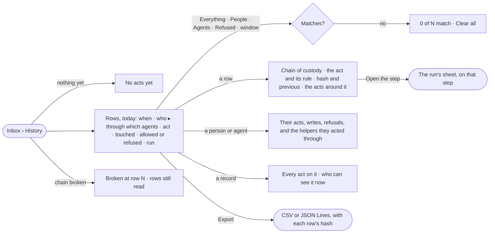

# IN-02 · Read what people and agents did, and prove it

**As** a Graph owner answering for what this Graph did **I want** every act by a person or an agent — by row, by
actor, by record and by refusal — in a record I can export and prove nobody edited **so that** access is proven, not
assumed, and an audit is a filter rather than a hunt.

Tasks: [task.md](task.md) · Feature: [IN-F03](../../feature.md)

## Who can

| Lens | Can | Otherwise sees |
|---|---|---|
| Admin | Read every row, the counts over the Graph, by actor, by record and refusals; export | — |
| Operator | Read their own acts and the rows of runs they can open, with the filters; export those rows | The rest is counted, not shown: *N rows today belong to runs you cannot open — counted, not shown*; the counts over the Graph are not shown |

## Flow

## Acceptance criteria

| # | Given | When | Then |
|---|---|---|---|
| IN-02.1 | Nothing has happened in the Graph | History opens | it reads *No acts yet — a run or a person's act writes the first row* |
| IN-02.2 | Acts today | History opens | rows read newest first: when · who, with the chain they acted through (*ravi ▸ Route analyst ▸ Hub checker*) · the act · what it touched · allowed, refused, waiting on an ask or held · the run |
| IN-02.3 | An agent acting for a person | its row is read | both are named, apart — never one name for both |
| IN-02.4 | A step an agent took, a touch it was refused, a helper it started, and a person who published, stopped a run or decided an ask | History is read | each is one row |
| IN-02.5 | A refused act | its row is read | it names the reason — no grant · outside the lens · outside the view of the graph · over its limit · the site's robots.txt · an access rule — and the rule in words |
| IN-02.6 | History | the reader picks *People*, *Agents* or *Refused*, or a window — today · last 24 hours · 7 days · 30 days · any time | only those rows list, the filter shown with a way to clear it; with no window chosen it reads today |
| IN-02.7 | Filters that match nothing | History is read | it reads *0 of N match*, with *Clear all* |
| IN-02.8 | A row | the reader opens it | its detail opens beside the list: who started it and each agent with how it got there, the function and its version, where it ran, the lens · the act, its arguments and the rule that allowed or refused it · its hash, the previous hash and whether the chain held · the acts around it |
| IN-02.9 | A row from a run | the reader presses *Open the step* | the run's sheet opens on that step |
| IN-02.10 | A person or an agent and a window | By actor is read | it counts their acts, writes, outside reads, secrets used and refusals, and lists the helpers they acted through, one kind grouped as *Hub checker ×4* |
| IN-02.11 | A record's address and a window | By record is read | it lists every act on that record, counts reads, writes, refusals, people and agents, and says who can see it now — views, people, agents, and who can write it |
| IN-02.12 | Refusals | they are read | refused today as a share of all acts, counts by reason, refused a day over 30 days, the most refused functions, and each rule that held |
| IN-02.13 | The rows shown | the reader presses *Export* and picks CSV or JSON Lines | a file of exactly those rows downloads, each with its hash and the previous one, and the export is listed with who made it |
| IN-02.14 | No rows match | *Export* is reached | it is disabled, reading *no rows match* |
| IN-02.15 | The head | it is read | it says History is unedited, when the chain was last checked, and that rows are kept 365 days |
| IN-02.16 | A row changed outside Invana | the chain is next checked | the head reads *broken at row N* in red; rows still read |
| IN-02.17 | A credential used by an act | its row is read | the secret is named, never its value; it never entered the record |
| IN-02.18 | A row about a record since deleted | it is read | it names the record as it was |
| IN-02.19 | Rows older than 365 days | they are removed | a whole window goes, never chosen rows, and the removal is itself a row |
| IN-02.20 | An Operator | they open History | they read their own acts and the rows of runs they can open; a line counts the rest, *counted, not shown*; the counts over the Graph are not shown |
| IN-02.21 | An Operator | they follow a link to a row they cannot see | it reads *not found* |
| IN-02.22 | The engine cannot read History | it opens | it says what it could not read, with *Try again* |
| IN-02.23 | An outside agent reading through a key | its row is read | it is named as outside, with the key's name |
| IN-02.24 | Rows arriving while History is open | the reader is on the first page | new rows join the top without moving the rows below |

## Screens

| Surface | Lens | First use | Empty after a filter | Loading | Has data | Failed | Agent working or proposing | No access |
|---|---|---|---|---|---|---|---|---|
| History — rows | Admin | inbox.history · No acts yet | inbox.history · Nothing matches | inbox.history · Loading | inbox.history · Everything | inbox.history · Chain broken | inbox.history · Agents | — |
| History — rows | Operator | inbox.history · No acts yet | inbox.history · Nothing matches | inbox.history · Loading | inbox.history · Counted, not shown | inbox.history · Chain broken | inbox.history · Agents | inbox.history · Counted, not shown |
| A row's detail | Admin | — | — | inbox.history · Loading | inbox.history · Row | inbox.history · Could not load | — | — |
| A row's detail | Operator | — | — | inbox.history · Loading | inbox.history · Row | inbox.history · Could not load | — | inbox.history · Not found |
| By actor · by record · refusals | Admin | inbox.history · No acts yet | inbox.history · Nothing matches | inbox.history · Loading | inbox.history · Refused | inbox.history · Could not load | — | — |
| By actor · by record · refusals | Operator | — | — | — | — | — | — | inbox.history · Counted, not shown |
| Export | Admin | — | inbox.history · Nothing to export | — | inbox.history · Export | inbox.history · Could not load | — | — |
| Export | Operator | — | inbox.history · Nothing to export | — | inbox.history · Export | inbox.history · Could not load | — | inbox.history · Export |
| The step a row opens | Admin | — | — | agents.run · Loading | agents.run · Step | agents.run · Failed | — | — |
| The step a row opens | Operator | — | — | agents.run · Loading | agents.run · Step | agents.run · Failed | — | agents.run · Not found |
