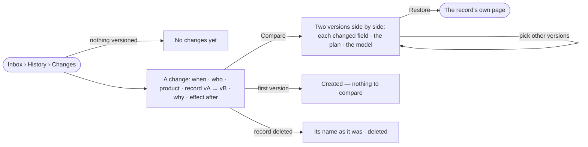

# IN-03 · See every change and compare two versions

**As** a Graph owner **I want** every new version of anything versioned — who made it, when, why, and what happened
after — and any two versions compared **so that** every change is accountable, and I can tell whether it made things
better or worse.

Tasks: [task.md](task.md) · Feature: [IN-F03](../../feature.md)

## Who can

| Lens | Can | Otherwise sees |
|---|---|---|
| Admin | Read every change and compare any two versions of a record in the Graph | — |
| Operator | Read every change and compare any two versions of a record they can open | A record they cannot open reads as absent. Restoring is on the record's own page, by its own role |

## Flow

## Acceptance criteria

| # | Given | When | Then |
|---|---|---|---|
| IN-03.1 | Nothing versioned yet | the reader picks *Changes* | it reads *No changes yet* |
| IN-03.2 | Changes | *Changes* is on | only the acts that made a new version of a skill, rule, plan, agent, model or dataset list, newest first: when · who · product · record `vA → vB` · why · effect after · *Compare* |
| IN-03.3 | A change | its product is shown | it is where the record lives — skills, agents and plans Agents; rules and models Model; datasets Data |
| IN-03.4 | A version made with a reason | its change is read | the reason shows; a version made without one shows none, never an inferred one |
| IN-03.5 | A version | its effect after is read | runs, failed runs and tokens on it — tokens only; a version nothing ran on reads *0 runs*, not blank |
| IN-03.6 | A model version | its effect after is read | it is the Graph's runs while it was published, labelled *while published*, and it names the datasets it touched and how many rows fail |
| IN-03.7 | A change | the reader presses *Compare* | the two versions show side by side: who · when · why · `vA → vB`, one card per changed field with before and after (text as changed lines), the plan's change or the model's change when there is one, and each side's effect as runs · failed · tokens per run |
| IN-03.8 | A compare | it is read | *Tokens per run* reads one version against the other as the engine counted it (`1.4×`), toned better or worse; nothing is divided in Studio |
| IN-03.9 | A compare | the reader picks two other versions from the record's history | they compare, from the first picked to the second |
| IN-03.10 | A record's first version | its change is read | it reads *created* and offers no *Compare* |
| IN-03.11 | A version compared with itself | it is read | it says nothing changed |
| IN-03.12 | A record since deleted | its change is read | it names the record as it was, what happened in words (*created* · *updated* · *published*) and a *deleted* badge — never a raw id |
| IN-03.13 | An agent version from before changes were recorded | it is compared | each changed field is named, with *not recorded* for before and after |
| IN-03.14 | A draft | Changes is read | it is not listed; drafts are never versions |
| IN-03.15 | A model's, agent's or skill's own History tab | *Compare* is pressed there | it opens this same compare |
| IN-03.16 | A compare | the reader wants an earlier version back | *Restore* is on the record's own page, makes a new version, and History keeps both |
| IN-03.17 | A record in another Graph, or one the reader cannot open | its compare is followed | it reads as absent, not forbidden |
| IN-03.18 | Changes filtered by product or person | nothing matches | it reads *0 of N match*, with *Clear all* |

## Screens

| Surface | Lens | First use | Empty after a filter | Loading | Has data | Failed | Agent working or proposing | No access |
|---|---|---|---|---|---|---|---|---|
| History › Changes | Admin | inbox.history · No changes yet | inbox.history · Nothing matches | inbox.history · Loading | inbox.history | inbox.history · Could not load | — | — |
| History › Changes | Operator | inbox.history · No changes yet | inbox.history · Nothing matches | inbox.history · Loading | inbox.history | inbox.history · Could not load | — | inbox.history |
| A compare | Admin | inbox.history · Nothing to compare | — | inbox.history · Loading | inbox.history · Compare | inbox.history · Not found | — | — |
| A compare | Operator | inbox.history · Nothing to compare | — | inbox.history · Loading | inbox.history · Compare | inbox.history · Not found | — | inbox.history · Not found |
