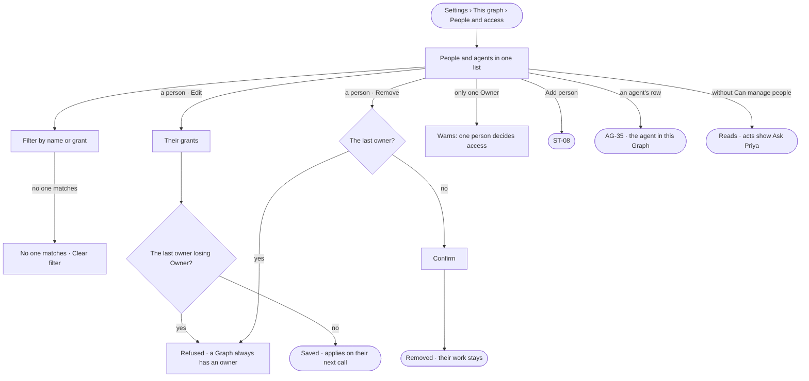

# ST-12 · See and change who is on this graph

**As** a Graph owner **I want** the people and agents on this Graph in one list, with what each may change **so that**
access is a list I can read, and an agent joins the Graph the way a person does.

Tasks: [task.md](task.md) · Feature: [ST-F01](../../feature.md)

## Who can

| Lens | Can | Otherwise sees |
|---|---|---|
| Admin | Read every member; change a person's grants; remove a person; add a person (ST-08); invite, pause, remove an agent and take an update (AG-35) | — |
| Operator | Read every member — people with their grants, agents with their version | *Edit* and *Remove* shown as *Ask Priya*, naming someone who can manage people. With *Can manage people*: every act here |

## Flow

## Acceptance criteria

| # | Given | When | Then |
|---|---|---|---|
| ST-12.1 | A member | they open *Settings › This graph › People and access* | people and agents read in one list: a person with their grants, an agent with its version and *Update available* when there is one |
| ST-12.2 | A Graph just created | its members are read | its creator is the only member, holding Owner |
| ST-12.3 | Someone who can manage people | they change a person's grants and save | the person holds exactly those grants from their next call; with none they are an Operator; giving or taking Owner or *Can manage people*, and widening their own grants, wait as ST-10.10 and ST-10.11 say |
| ST-12.4 | The Graph's only owner | someone removes them or takes Owner away | it is refused, saying a Graph always has an owner |
| ST-12.5 | Someone who can manage people | they remove a person, confirming | the person leaves the list; their work and authorship stay; their open tasks stay assigned and say who is gone |
| ST-12.6 | A person removed while working in the Graph | they make their next call | it is refused, and Studio says their access changed |
| ST-12.7 | An agent's row | it is opened | the agent in this Graph opens — its version, access, runs and spend (AG-35) |
| ST-12.8 | A filter that matches no one | it is applied | *No one matches* shows with *Clear filter* |
| ST-12.9 | An Operator without *Can manage people* | they open the list | every member reads; *Edit* and *Remove* are shown as *Ask Priya*, naming someone who can manage people |
| ST-12.10 | Any change to a person's grants or membership | it saves | History records who changed whom, and when (IN-F03) |
| ST-12.11 | A Graph with only one Owner | its members are read by someone who can manage people | a warning says only one person can decide access changes: an ask nobody else can decide fails closed, and a change that benefits that Owner takes effect only after 24 hours; *Edit* on a person offers giving them Owner |

## Screens

| Surface | Lens | First use | Empty after a filter | Loading | Has data | Failed | Agent working or proposing | No access |
|---|---|---|---|---|---|---|---|---|
| Members | Admin | settings.people · Only you | settings.people · No one matches | settings.people · Loading | settings.people | settings.people · Last owner | — | — |
| Members | Operator | settings.people · Only you | settings.people · No one matches | settings.people · Loading | settings.people · Read only | settings.people · Could not load | — | settings.people · Read only |
| One Owner warning | Admin | settings.people · One Owner | — | — | settings.people · One Owner | — | — | — |
| One Owner warning | Operator | — | — | — | — | — | — | — |
| A person's grants | Admin | — | — | — | settings.people · Edit grants | settings.people · Last owner | — | — |
| A person's grants | Operator | — | — | — | — | — | — | settings.people · Read only |
