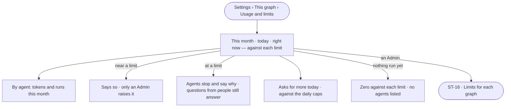

# ST-13 · Read what this graph spends against its limits

**As** a Graph owner **I want** this Graph's tokens and runs at once against the limits the install set, and who spent
them **so that** I see what we spend before agents stop, without being able to raise it myself.

Tasks: [task.md](task.md) · Feature: [ST-F01](../../feature.md)

## Who can

| Lens | Can | Otherwise sees |
|---|---|---|
| Admin | Read this Graph's usage; raise its limits from *Limits for each graph* (ST-16) | — |
| Operator | Read this Graph's usage against its limits, by agent | *Limits for each graph* is absent; the page says limits are set by an Admin |

## Flow

## Acceptance criteria

| # | Given | When | Then |
|---|---|---|---|
| ST-13.1 | A member | they open *Usage and limits* | tokens this month, tokens today and runs right now read, each against its limit |
| ST-13.2 | Runs this month | the usage is read | *By agent* lists each agent's tokens and runs this month, as the engine stored them when each run settled |
| ST-13.3 | A Graph with no runs yet | the usage is read | each meter reads zero against its limit and *By agent* says nothing has run |
| ST-13.4 | Spend near a limit | the usage is read | the meter says so, and that only an Admin raises a limit |
| ST-13.5 | A limit reached | an agent would run | it stops and says why; a question a person asks still answers |
| ST-13.6 | An Operator | they open *Usage and limits* | nothing on it can be changed, and *Limits for each graph* is absent |
| ST-13.7 | An Admin | they open *Usage and limits* | *Limits for each graph* reads below, where they raise one (ST-16) |
| ST-13.8 | The usage cannot load | the page opens | it says it could not load and offers to try again |
| ST-13.9 | A member | they open *Usage and limits* | the daily caps on asks for more read — per holder and for the Graph — with the asks made today against each, and each holder at its cap named; the Owner changes them in *This graph › General* (ST-14) |

## Screens

| Surface | Lens | First use | Empty after a filter | Loading | Has data | Failed | Agent working or proposing | No access |
|---|---|---|---|---|---|---|---|---|
| Usage | Admin | settings.usage · Nothing run yet | — | settings.usage · Loading | settings.usage | settings.usage · Could not load | — | — |
| Usage | Operator | settings.usage · Nothing run yet | — | settings.usage · Loading | settings.usage · Read only | settings.usage · Could not load | — | settings.usage · Read only |
| Near or at a limit | Admin | — | — | — | settings.usage · Near a limit | — | — | — |
| Near or at a limit | Operator | — | — | — | settings.usage · Near a limit | — | — | — |
