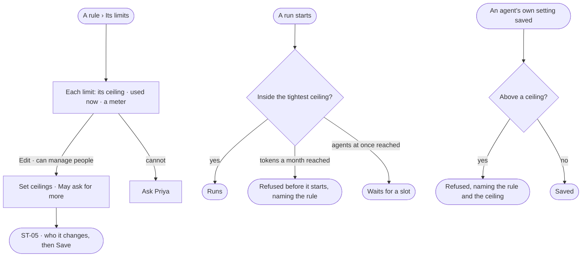

# ST-03 · Set limits on an access rule

**As** someone who can manage people **I want** limits on an access rule — tokens, agents at once, helpers, depth and
workers — beside what each holder uses now **so that** spend is governed like access, and nobody's agents can run the
Graph dry.

Tasks: [task.md](task.md) · Feature: [ST-F02](../../feature.md)

## Who can

| Lens | Can | Otherwise sees |
|---|---|---|
| Admin | Read and set a custom or for-everyone rule's limits | — |
| Operator | Read every rule's limits and what is used now | The fields read as values; *Edit* shown as *Ask Priya*, naming someone who can manage people |

## Flow

## Acceptance criteria

| # | Given | When | Then |
|---|---|---|---|
| ST-03.1 | A rule | *Its limits* is read | each limit reads label · per · ceiling · used now · a meter: *Tokens* a month · *Tokens* a run · *Agents at once* · *Helpers* a run · *Helper depth* · *Worker time* an hour · *Workers it may use* — and whether it *May ask for more* |
| ST-03.2 | Used now | it is shown | it is the engine's: tokens this month and a run's typical tokens over 30 days from finished runs, agents at once and helpers from running runs; Studio derives none |
| ST-03.3 | A holder with several rules that set the same limit | a run is checked | the tightest ceiling binds |
| ST-03.4 | An agent whose own setting is above a ceiling of a rule it holds | the setting is saved | it is refused, naming the rule and the ceiling |
| ST-03.5 | A holder at its tokens-a-month ceiling | a new run would start | it is refused before it starts, naming the rule |
| ST-03.6 | A holder at its agents-at-once ceiling | another run would start | it waits for a slot |
| ST-03.7 | A rule that *May ask for more* | its holder reaches a token ceiling mid-run | the run pauses and asks in the Inbox (IN-01) |
| ST-03.8 | A limit with no ceiling set | it is read | it reads *No limit* |
| ST-03.9 | An Operator | they open *Its limits* | the ceilings and used now read; editing is shown as *Ask Priya* |

## Screens

| Surface | Lens | First use | Empty after a filter | Loading | Has data | Failed | Agent working or proposing | No access |
|---|---|---|---|---|---|---|---|---|
| A rule — its limits | Admin | settings.access · No limit | — | settings.access · Loading | settings.access · Its limits | settings.access · Could not load | — | — |
| A rule — its limits | Operator | shell.locked · No limit | — | shell.locked · Loading | shell.locked · Its limits | shell.locked · Could not load | — | shell.locked |
