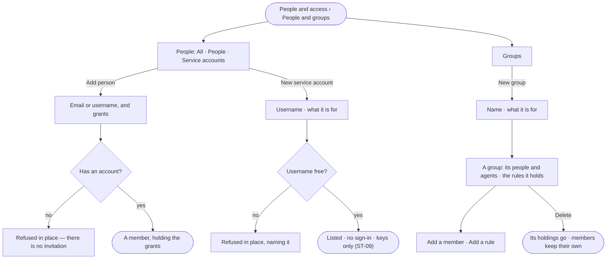

# ST-08 · Grant a team once, with people and groups

**As** the owner of a Graph **I want** its people, service accounts and groups in one place, with the access rules each
holds **so that** a team is granted once, and a script has an identity that is not a person's login.

Tasks: [task.md](task.md) · Feature: [ST-F02](../../feature.md)

## Who can

| Lens | Can | Otherwise sees |
|---|---|---|
| Admin | Add a person; make a service account; make, change and delete a group; add and remove its people and agents; add a rule to a group | — |
| Operator | Read people, service accounts, groups and what each holds | *Add person*, *New service account*, *New group* and a group's acts shown as *Ask Priya*, naming someone who can manage people |

## Flow

## Acceptance criteria

| # | Given | When | Then |
|---|---|---|---|
| ST-08.1 | A Graph | *People* is read | tabs *All · People · Service accounts* with the engine's counts; each row name · email · groups · access rules · keys · signs in with |
| ST-08.2 | A person's row | *Signs in with* is read | a person reads *password*; a service account reads *no sign-in · keys only* |
| ST-08.3 | Someone who can manage people | they *Add person* with an email or username and grants | the person is a member holding those grants; with none they are an Operator |
| ST-08.4 | *Add person* | the email or username has no account | it is refused in place — there is no invitation |
| ST-08.5 | Someone who can manage people | they make a *New service account* with a username and what it is for | it is listed as a member who is an Operator, with no password and no sign-in; only keys act as it |
| ST-08.6 | A service account | someone tries to sign in as it | it is refused as an unknown password |
| ST-08.7 | A username already taken anywhere on the install | a service account is made with it | it is refused in place, naming it |
| ST-08.8 | A Graph's groups | *Groups* is read | one row each: group · people · agents · access rules; a group with no members reads `—` |
| ST-08.9 | A group holding a rule, built in or custom | a person or an agent is in it | they hold what the group holds, at the next check |
| ST-08.10 | A group | a member is added or removed on its page | their access changes at the next check |
| ST-08.11 | A group | it is deleted | its holdings go; its members keep their own |
| ST-08.12 | A member | they are removed from the Graph | their groups and holdings in this Graph go with them |
| ST-08.13 | The keys column | it is read | it is the engine's count of the person's live keys that reach this Graph |
| ST-08.14 | An Operator | they open People or a group | everything reads; every act is shown as *Ask Priya* |

## Screens

| Surface | Lens | First use | Empty after a filter | Loading | Has data | Failed | Agent working or proposing | No access |
|---|---|---|---|---|---|---|---|---|
| People | Admin | settings.access · Only you | settings.access · Nothing matches | settings.access · Loading | settings.access · People and groups | settings.access · No account | — | — |
| People | Operator | shell.locked · Only you | shell.locked · Nothing matches | shell.locked · Loading | shell.locked · People and groups | shell.locked · Could not load | — | shell.locked · People and groups |
| Groups and a group | Admin | settings.access · No groups yet | settings.access · Nothing matches | settings.access · Loading | settings.access · A group | settings.access · Could not load | — | — |
| Groups and a group | Operator | shell.locked · No groups yet | shell.locked · Nothing matches | shell.locked · Loading | shell.locked · A group | shell.locked · Could not load | — | shell.locked · A group |
