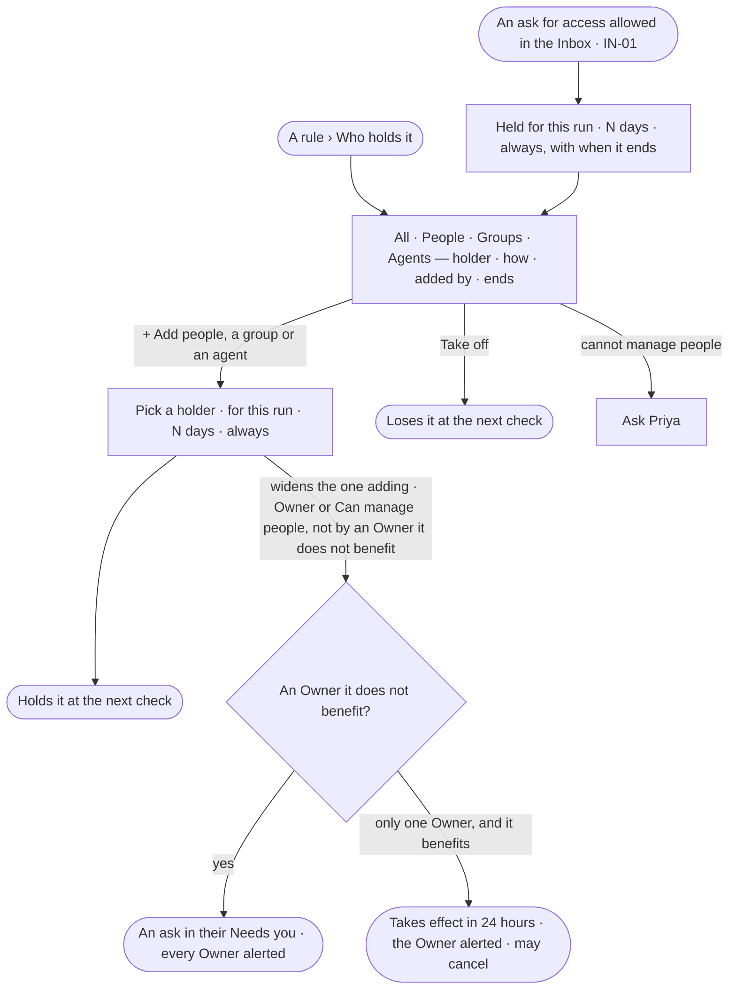

# ST-10 · See and change who holds an access rule

**As** someone who can manage people **I want** everyone who holds an access rule — people, groups, agents and keys —
and how, and to add or take them off in one place **so that** I see a rule's reach and change it on purpose.

Tasks: [task.md](task.md) · Feature: [ST-F02](../../feature.md)

## Who can

| Lens | Can | Otherwise sees |
|---|---|---|
| Admin | Read who holds a rule; add people, a group or an agent — for this run · N days · always; take a holder off. Widening their own access asks someone it does not benefit; Owner and *Can manage people* are given or taken only by an Owner it does not benefit | *Add* on Owner or *Can manage people*, for anyone but an Owner, raises an ask to the Owners |
| Operator | Read who holds a rule and how | *+ Add people, a group or an agent* and *Take off* shown as *Ask Priya*, naming someone who can manage people |

## Flow

## Acceptance criteria

| # | Given | When | Then |
|---|---|---|---|
| ST-10.1 | A rule | *Who holds it* is read | tabs *All · People · Groups · Agents*; each row holder · how (*directly · via a group · for run #N*) · added by · ends; groups first, then agents, people and keys, each by name |
| ST-10.2 | A person's row | its second line is read | it names the groups they are in, else their full name; a service account reads *service account* |
| ST-10.3 | Someone who can manage people | they add a person, a group or an agent, for this run · N days · always | the holder holds it at the next check, and the row says when it ends |
| ST-10.4 | A holding that ends | its end passes | the holder loses it at the next check |
| ST-10.5 | A holder | they are taken off | they lose it at the next check |
| ST-10.6 | A built-in rule | a person is added to it here | it is the same as giving them that grant |
| ST-10.7 | An ask for access allowed in the Inbox (IN-01) | *Who holds it* is read | the holder shows, *for run #N* or for the time allowed, with when it ends |
| ST-10.8 | A holding added or taken off | History is read | it shows who did it and when (IN-F03) |
| ST-10.9 | An Operator | they open *Who holds it* | every holder reads; adding and taking off are shown as *Ask Priya* |
| ST-10.10 | Owner or *Can manage people* | it is given or taken, by any path | it takes effect only from an Owner it does not benefit — at once when that Owner makes it, else as an ask routed to the Owners it does not benefit; every Owner is alerted and History records it. With only one Owner, whom it benefits, it takes effect after 24 hours, with an alert to that Owner and a History row, and the Owner may cancel it until then ([One Owner: a delay, not a second person](../../../../product.md#decisions)) |
| ST-10.11 | A person | their own change would widen what they hold — directly, through a group, or through an agent, service account or key of theirs | it is an ask, routed to someone it does not benefit, whatever the lines say, and they are told who it waits on ([No one widens their own access](../../../../product.md#decisions)) |

## Screens

| Surface | Lens | First use | Empty after a filter | Loading | Has data | Failed | Agent working or proposing | No access |
|---|---|---|---|---|---|---|---|---|
| Who holds it | Admin | settings.access · Nobody holds it | settings.access · Nothing matches | settings.access · Loading | settings.access | settings.access · Could not load | — | — |
| Who holds it | Operator | shell.locked · Nobody holds it | shell.locked · Nothing matches | shell.locked · Loading | shell.locked | shell.locked · Could not load | — | shell.locked |
| Add a holder | Admin | — | — | — | settings.access · Add a holder | settings.access · Could not add | — | — |
| A change that waits for an Owner | Admin | — | — | — | settings.access · Waits for an Owner | — | — | — |
| A change that waits for an Owner | Operator | — | — | — | — | — | — | shell.locked |
| Add a holder | Operator | — | — | — | — | — | — | shell.locked |
