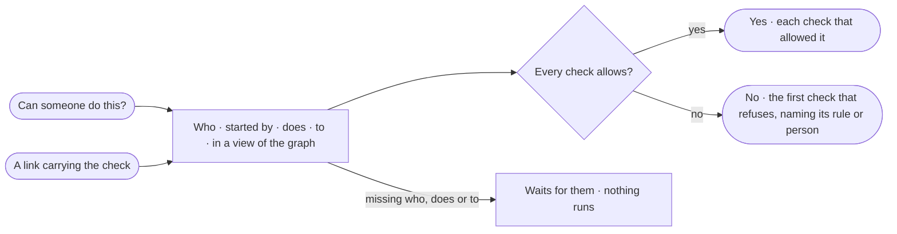

# ST-11 · Test whether someone can do something

**As** any member **I want** to ask whether a person, an agent or a key may do something to something — and which check
decides — without running anything **so that** access is proven, not guessed.

Tasks: [task.md](task.md) · Feature: [ST-F02](../../feature.md)

## Who can

| Lens | Can | Otherwise sees |
|---|---|---|
| Admin | Test any person, agent or key | — |
| Operator | Test any person, agent or key | — |

## Flow

## Acceptance criteria

| # | Given | When | Then |
|---|---|---|---|
| ST-11.1 | Any member | they open *Can someone do this?* from the rules list, a rule or a person | it takes who (a person, an agent or a key) · started by · does · to · in a view of the graph |
| ST-11.2 | A check every check allows | it is run | it reads *Yes*, with each check's verdict — skill needs · its rules · started by · the view · for everyone · a key's own rule |
| ST-11.3 | A check one check refuses | it is run | it reads *No*, naming the first check that refuses and its rule or person — *Analysts can ask lets it ask, not change data* |
| ST-11.4 | A check | it runs | it is the engine's own check, the one a run's steps pass, and it writes nothing |
| ST-11.5 | A link that carries who, does and to | it is opened | the check opens filled and runs once; closing it drops the check from the URL |
| ST-11.6 | Who, does or to missing | the check is read | it waits for them and runs nothing |
| ST-11.7 | An Operator | they test anyone | it works as for someone who can manage people |
| ST-11.8 | A check that could not run | it is read | it says why, with *Try again* |

## Screens

| Surface | Lens | First use | Empty after a filter | Loading | Has data | Failed | Agent working or proposing | No access |
|---|---|---|---|---|---|---|---|---|
| Can someone do this? | Admin | settings.access · Ask a check | — | settings.access · Checking | settings.access · No, names the rule | settings.access · Could not check | — | — |
| Can someone do this? | Operator | shell.locked · Ask a check | — | shell.locked · Checking | shell.locked · No, names the rule | shell.locked · Could not check | — | — |
