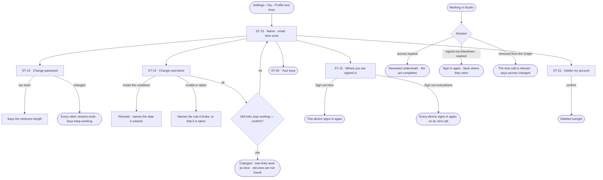
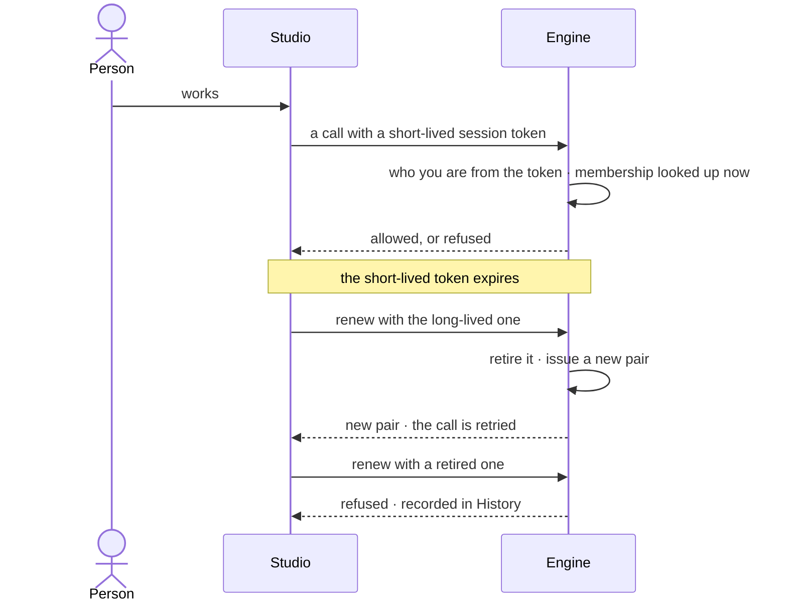

# You — account and sessions

> A person's own account: their name, password and username — the address every Graph link starts with — and the
> places they are signed in. The decision it helps make: *is my account mine, and is every place it is signed in one I
> trust?*

## User journey

## Stories

| ID | Story | Status |
|---|---|---|
| ST-15 | [Keep my account, username and sessions in order](stories/ST-15-keep-my-account-username-and-sessions-in-order/story.md) | idea |

## Access

| Act | Role (`.claude/team/TEAM.md` §7) | Everyone else sees |
|---|---|---|
| Read and change one's own name, password and username | The person themselves — any signed-in account | — |
| Sign out here · sign out everywhere | The person themselves | — |
| Delete one's own account | The person themselves, signed in — never with a key | — |
| Another person's account | No one in Studio; install administration only | — |

## States

| State | What the person sees |
|---|---|
| First use | The account as made at sign-up: name, email, username; one session — this one |
| Empty after a filter | — no filter on this surface |
| Loading | The section opens at once; fields fill in place |
| Has data | Profile, username and its rules, the places they are signed in, their keys |
| Failed | What could not save, in a sentence, naming the rule — the minimum length, the cooldown's end, a taken username |
| Agent working or proposing | — no agent acts on an account |
| No access | — every person reaches their own account; nobody reaches another's |

## Rules

| Rule | Detail |
|---|---|
| Email is how a person signs in | Unique, folded to lowercase; changing it is its own act |
| Errors never confirm an account | A failed sign-in or sign-up never says whether an email is in use |
| A username is an address | `/u/<username>/<graph>/…`; lowercase letters, digits and single hyphens, 2–64 characters, unique on the install. Only `u` is reserved |
| A username changes rarely | Once per cooldown — thirty days unless the install sets another |
| Old addresses do not forward | After a change, old links are not found; the change says so before it is confirmed |
| A session is short-lived and renewable | A short-lived token for every call, a long-lived one that renews it; renewing retires the old one |
| Reusing a retired session is a signal | It is refused and recorded |
| Membership is checked on every call | So removing someone from a Graph takes effect at once |
| A password change ends every other session | Keys keep working — a script should not break because a person changed their password |
| Managing credentials needs a session | Changing a password and deleting the account cannot be done with a key |
| Already signed in | Reaching the sign-in page with a live session resumes it and goes where the person was heading; only an address inside Studio is followed |
| Deletes are outright | There is no trash for an account |
| Leans on | Keys (ST-09) · signing in (SH-F01) · History (IN-F03) |

## Data touched

| Record | Read or write |
|---|---|
| The account — email, username, name, password, when the username last changed | Write · read |
| Sessions — the long-lived renewing token, retired or live | Write · read |
| Keys (ST-09) | Read |
| History rows of a password change, a username change and a refused reuse (IN-F03) | Write |

## Decisions

| Decision | Detail |
|---|---|
| You is a part of Settings | *Settings › You › Profile and keys* holds the profile, username, sessions and keys; there is no profile page of its own |
| One name, one address | The username is both what a person is called in links and their address; there is no separate display handle |
| Password rules are configuration | Minimum length and hashing cost are the install's, with sane defaults |
| Being Admin opens no Graph | The install Admin runs the install; it is never a way into a Graph's contents |

## Open questions

| Question | Who answers |
|---|---|
| Does *Where you are signed in* list each device, or only offer *Sign out here* and *Sign out everywhere*? The board draws neither yet. Recommend: the two acts only — a list needs device names the engine does not keep | Ravi |

## Not building

| Item | Why not |
|---|---|
| Email verification | Not what stands between a person and value yet |
| Password reset by email | Needs a mail path the product does not have |
| Avatars and bios | An account is an identity, not a profile page |
| Single sign-on | Later, once someone needs it |
| Redirects from old usernames | An address that forwards silently hides a rename |
| A list of reserved words | The `/u/` prefix makes them unneeded |
| Device fingerprinting | Signing out here or everywhere is enough to act on |
| Long sessions for convenience | A session stays short; a person who needs a long-lived credential mints a key (ST-09) |
