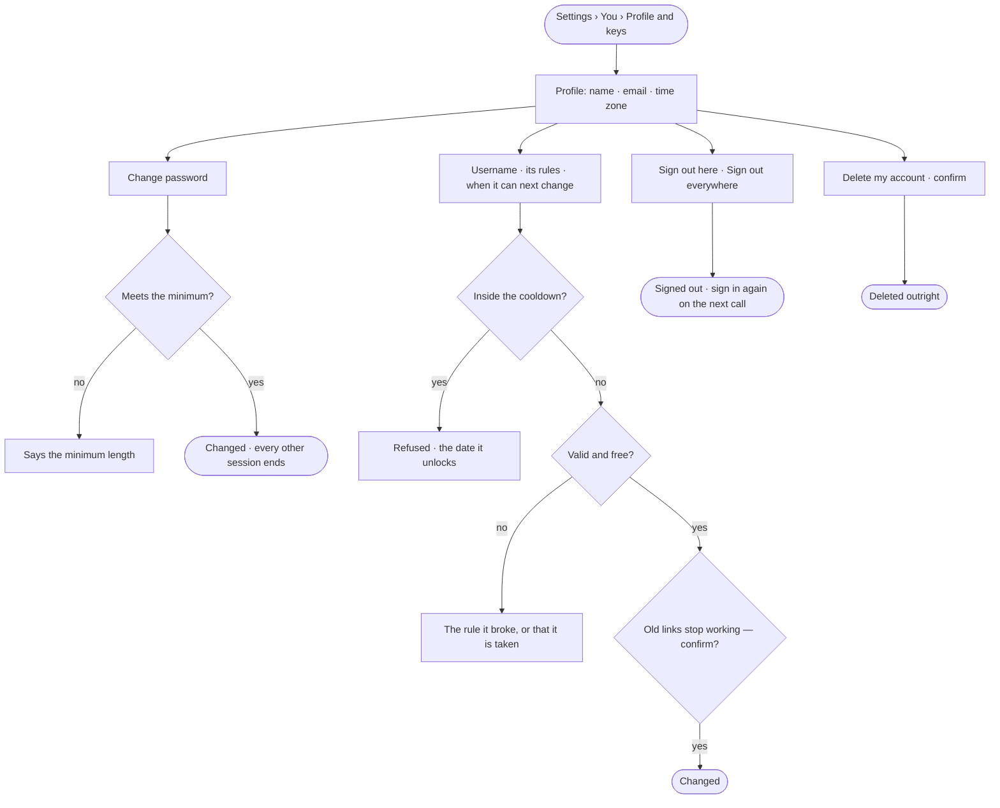

# ST-15 · Keep my account, username and sessions in order

**As** a member **I want** my name, password and username — the address my Graphs' links start with — in one place,
and to sign out a device I do not trust **so that** losing a laptop is not a password change and a prayer, and my
links mean something.

Tasks: [task.md](task.md) · Feature: [ST-F03](../../feature.md)

## Who can

| Lens | Can | Otherwise sees |
|---|---|---|
| Admin | Their own account: name, password, username, sign out here or everywhere, delete it | Another person's account is not in Studio |
| Operator | Their own account: name, password, username, sign out here or everywhere, delete it | Another person's account is not in Studio |

## Flow

## Acceptance criteria

| # | Given | When | Then |
|---|---|---|---|
| ST-15.1 | A signed-in person | they open *Settings › You › Profile and keys* | their name, email and time zone read, with their username, where they are signed in, and their keys (ST-09) |
| ST-15.2 | The profile | the person changes their first or last name | it saves; a first name is required, a last name is not |
| ST-15.3 | A new password shorter than the install's minimum | it is saved | it is refused, saying the minimum length |
| ST-15.4 | A password change | it saves | every other session ends on its next call; the person's keys keep working |
| ST-15.5 | A new username | it breaks a rule — not 2–64 characters, not lowercase letters, digits and single hyphens, a hyphen at either end, or `u` | it is refused, naming the rule |
| ST-15.6 | A new username typed with capitals | it is read | the field shows it folded to lowercase, as it will be saved |
| ST-15.7 | A username already taken on the install | it is saved | it is refused, saying it is taken |
| ST-15.8 | A username changed inside the cooldown | it is saved | it is refused, naming the date it unlocks |
| ST-15.9 | A valid, free username | the person confirms, after being told old links stop working | it changes; new links work at once; old ones are not found and never forward |
| ST-15.10 | A signed-in person | they press *Sign out everywhere* | every device returns to sign-in on its next call |
| ST-15.11 | A signed-in person | they press *Sign out here* | this device returns to sign-in; the others stay signed in |
| ST-15.12 | A session whose short-lived token expired mid-act | the person acts | it is renewed underneath and the act completes |
| ST-15.13 | A retired renewing token | it is used again | it is refused, and History records it (IN-F03) |
| ST-15.14 | A session that cannot be renewed | the person acts | they are told why, sign in again, and return where they were |
| ST-15.15 | A person with a live session | they reach the sign-in page | it says *Restoring your session…* and goes where they were heading — only to an address inside Studio — never asking for the password |
| ST-15.16 | A stored session that is not valid | the sign-in page opens | the stored session is dropped and the sign-in form shows |
| ST-15.17 | A person removed from a Graph while working in it | their next call is made | it is refused, and Studio says their access changed |
| ST-15.18 | A signed-in person | they delete their account, confirming | it is deleted outright; it cannot be done with a key |
| ST-15.19 | A failed sign-in or a sign-up with a used email | the message is read | it never says whether the account exists |

## Screens

| Surface | Lens | First use | Empty after a filter | Loading | Has data | Failed | Agent working or proposing | No access |
|---|---|---|---|---|---|---|---|---|
| Profile | Admin | settings.me | — | settings.me · Loading | settings.me | settings.me · Could not save | — | — |
| Profile | Operator | settings.me | — | settings.me · Loading | settings.me | settings.me · Could not save | — | — |
| Username | Admin | — | — | — | settings.me · Username | settings.me · Inside the cooldown | — | — |
| Username | Operator | — | — | — | settings.me · Username | settings.me · Inside the cooldown | — | — |
| Password and sessions | Admin | — | — | — | settings.me · Sessions | settings.me · Too short | — | — |
| Password and sessions | Operator | — | — | — | settings.me · Sessions | settings.me · Too short | — | — |
