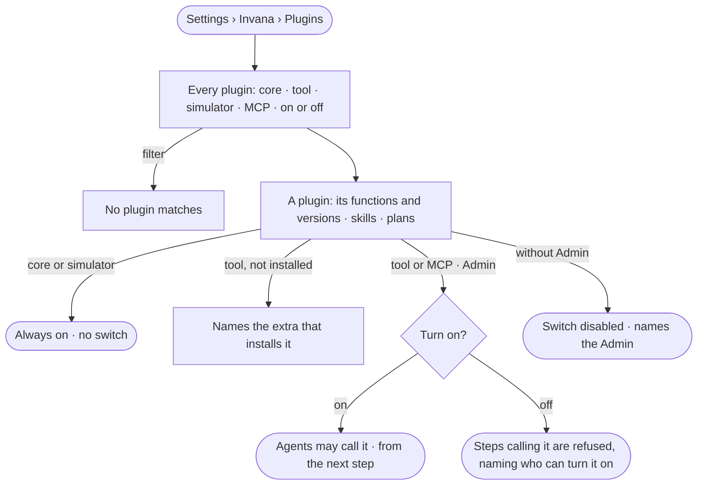

# ST-29 · See every plugin and turn a tool plugin on

**As** an install admin **I want** every plugin the install carries — its functions with their versions, its skills
and plans — and to turn a tool plugin on deliberately **so that** agents reach the web, mail or a science source only
when I have said they may.

Tasks: [task.md](task.md) · Feature: [ST-F04](../../feature.md)

## Who can

| Lens | Can | Otherwise sees |
|---|---|---|
| Admin | Read every plugin; turn a tool or MCP plugin on or off | — |
| Operator | Read every plugin, its functions, versions, skills and plans, and whether it is on | The switch is disabled, naming the Admin |

## Flow

## Acceptance criteria

| # | Given | When | Then |
|---|---|---|---|
| ST-29.1 | A member | they open *Plugins* | every plugin reads — core, tool, simulator and MCP — with its version and whether it is on |
| ST-29.2 | A plugin | it opens | its functions read with their versions and what each does, sends or reads, and its skills and plans |
| ST-29.3 | A core or simulator plugin | it is read | it is on and has no switch |
| ST-29.4 | A new install | Plugins opens | every tool plugin is off |
| ST-29.5 | A tool plugin whose extra is not installed | it is read | it says it is not installed, naming the extra; it cannot be turned on |
| ST-29.6 | An Admin | they turn a tool plugin on | agents may call its functions from the next step, with no restart; runs already waiting pick it up |
| ST-29.7 | A plugin turned off | a step calls one of its functions | the step is refused, saying the plugin is off and who can turn it on |
| ST-29.8 | A function that sends — `mail.send` — reached only by a starting line other than the Owner's | a step calls it | it is Ask: the run waits for a yes in Needs you (IN-01); a no fails the step as *not sent* |
| ST-29.9 | A tool step and no worker free | it waits past its allowance | it fails, saying no worker took it |
| ST-29.10 | A function needing a secret the workers do not hold | a step calls it | it is refused, naming the setting the workers need |
| ST-29.11 | A web page whose robots.txt disallows it | a web tool would read it | nothing is read, and the step says so with the address |
| ST-29.12 | A run | it records a step | it records the function's version it ran |
| ST-29.13 | An Operator | they open Plugins | everything reads; the switch is disabled, naming the Admin |
| ST-29.14 | A plugin turned on or off | it is done | History records who did it and when (IN-F03) |
| ST-29.15 | A plugin's functions | they are read | each shows its mode for this Graph — Allow · Ask · Deny — and who set it |

## Screens

| Surface | Lens | First use | Empty after a filter | Loading | Has data | Failed | Agent working or proposing | No access |
|---|---|---|---|---|---|---|---|---|
| Plugins | Admin | — | — | — | — | — | — | — |
| Plugins | Operator | — | — | — | — | — | — | — |
| A plugin | Admin | — | — | — | — | — | — | — |
| A plugin | Operator | — | — | — | — | — | — | — |
