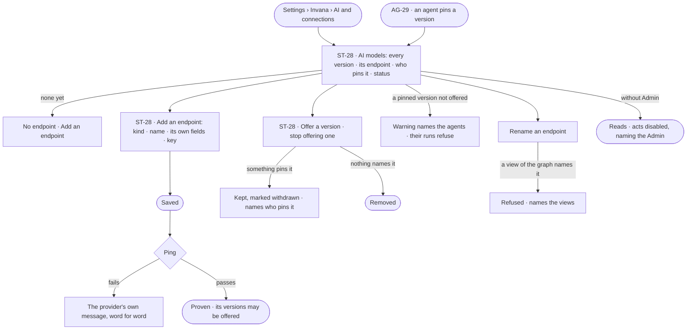

# AI models

> The model endpoints the install pays for and every model version they offer, each by its exact name, with who pins
> it. The decision it helps make: *which model versions do we offer, and can we stop offering one without breaking an
> agent?*

## User journey

Journeys this feature is a step of: [J01 · From an empty install to a first answer](../../../../journeys/J01-from-an-empty-install-to-a-first-answer.md)

## Stories

| ID | Story | Status |
|---|---|---|
| ST-28 | [Offer the model versions agents may pin](stories/ST-28-offer-the-model-versions-agents-may-pin/story.md) | idea |

## Access

| Act | Role (`.claude/team/TEAM.md` §7) | Everyone else sees |
|---|---|---|
| Read every endpoint, model version, status and who pins it | Operator — every member | — |
| Add, edit, rename or remove an endpoint · ping it · offer or stop offering a version | Admin | *Add a model* and each act disabled, naming the Admin; the key is never shown |
| Pin a version on an agent | As AG-29 | As AG-29 |

## States

| State | What the person sees |
|---|---|
| First use | No endpoint: *Add an endpoint*, and why a question cannot be answered without one |
| Empty after a filter | — no filter on this list |
| Loading | The section opens at once; rows fill in place |
| Has data | Every model version by its exact name — endpoint, pinned by, status — and each endpoint's last ping |
| Failed | A ping that failed, with the provider's own words; a removal or rename refused, naming who still names it |
| Agent working or proposing | — no agent changes the install's models |
| No access | Every row reads, never a key; each act is disabled, naming the Admin |

## Rules

| Rule | Detail |
|---|---|
| The install's, not a Graph's | An endpoint is set up once for the install by an Admin; every Graph resolves through it |
| An endpoint holds many versions | One endpoint is one address and one credential; its model versions are rows under it, each by the provider's exact name |
| Its name is an address | `llm/<endpoint>/<version>` is what an access rule, a view of the graph and History all carry; a person picks the name; lowercase letters, digits, hyphens and underscores |
| The form follows the provider | Anthropic · OpenAI · Google · Azure · Ollama · a local model · the Claude Agent SDK (which may use a local sign-in rather than a key) — only the fields that provider needs |
| Save, then ping | An endpoint is stored first and proven by a ping; the provider's own message is shown word for word, never reworded |
| Keys are encrypted and never read back | A blank key on edit keeps the stored one |
| There is no default model | A view of the graph decides which model answers; with none, the install's shipped choice answers |
| A version nothing names can go | Removing a version or renaming an endpoint that a view of the graph names is refused, naming the views |
| A pinned version stays listed | A version that something pins and is not offered reads *withdrawn*, naming who pins it; those agents' runs refuse rather than fall back |
| No release feed | Invana never says a newer version exists; an Admin offers the version they want |
| An endpoint has a clearance | The highest sensitivity it may receive. A new local or self-hosted endpoint starts at *personal*, an outside provider at *internal*; an Admin changes it, told how much unlabelled data it can reach; an endpoint counts as local only when the engine resolves it to loopback or a private network at each call, rebinding checked (ST-28); raising it writes a History row and alerts the Owners of each Graph that uses the endpoint (ST-28); a call carrying data above it is a send ([Which act a call is](../../product.md#decisions)) |
| Each model version shows its mode | Every model version reads its mode for this Graph — Allow · Ask · Deny ([the three modes](../../product.md#decisions)) — and who set it |
| Failures name the provider | A rate limit, a stopped local model or a rotated key fails naming the endpoint — never as *cannot answer* |
| Leans on | Agents pinning a version (AG-F01 · AG-29) · views of the graph (MO-F05) · access rules on AI models (ST-F02) · History (IN-F03) |

## Data touched

| Record | Read or write |
|---|---|
| Endpoints — name, kind, address, encrypted credential, clearance, last ping | Read · write |
| Model versions — exact name, what it can do, its rate, status | Read · write |
| Pins — agents, skill versions, eval judges (AG-F01 · AG-F04) | Read |
| A ping's run (AG-F03) and History rows (IN-F03) | Write |

## Decisions

| Decision | Detail |
|---|---|
| AI models are Settings › Invana | *AI and connections* lists AI models beside MCP servers and outside agents; an endpoint's detail and adding one are modals |
| A ping is a run | Who proved an endpoint worked, when, and what it said, is a run like any other |
| A model is ranked when offered | Cost and capability ranks come from the published rate; an install on a negotiated rate sets its own; a subscription endpoint ranks in the middle |
| One model per call | No automatic failover — a silent switch changes what produced an answer |

## Open questions

| Question | Who answers |
|---|---|
| `.claude/team/TEAM.md` §7 gives *AI providers* to a Graph's Owner; the docs make AI models the install Admin's. Recommend: Admin only — the spec follows that, and TEAM.md §7 is corrected (recommendation raised) | Ravi |

## Not building

| Item | Why not |
|---|---|
| A model picker when asking | A view of the graph decides the model; two places to choose is one too many |
| Automatic failover between endpoints | A silent switch changes what produced an answer |
| Quotas per endpoint | Spend is set per Graph (ST-F06) |
| A default model | The view of the graph answers *which model*; a second way would disagree |
| Fetching a provider's catalogue | A typed exact name is enough and does not move when a catalogue does |
