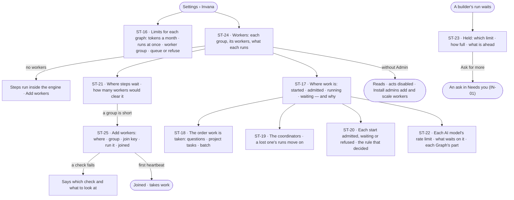
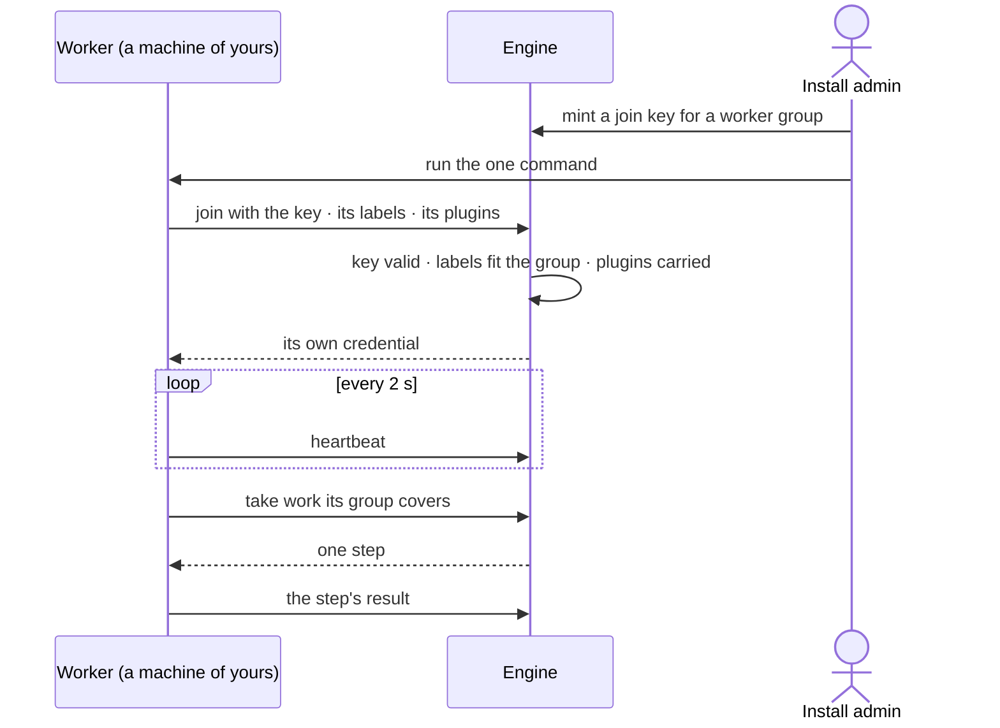

# Workers and limits

> The machines that run agents' work, how many runs each Graph may have going, and what each Graph may spend — set once
> by an install admin, read everywhere. The decision it helps make: *where is work waiting, and do we add workers, raise
> a Graph's limit, or let it queue?*

## User journey

## Stories

| ID | Story | Status |
|---|---|---|
| ST-16 | [Set each graph's tokens, runs at once and workers](stories/ST-16-set-each-graphs-tokens-runs-at-once-and-workers/story.md) | idea |
| ST-17 | [See where work is and why it waits](stories/ST-17-see-where-work-is-and-why-it-waits/story.md) | idea |
| ST-18 | [Questions go before batch work](stories/ST-18-questions-go-before-batch-work/story.md) | idea |
| ST-19 | [A lost coordinator costs seconds, not runs](stories/ST-19-a-lost-coordinator-costs-seconds-not-runs/story.md) | idea |
| ST-20 | [See why a run started, waits or was refused](stories/ST-20-see-why-a-run-started-waits-or-was-refused/story.md) | idea |
| ST-21 | [See how many workers each group needs](stories/ST-21-see-how-many-workers-each-group-needs/story.md) | idea |
| ST-22 | [See each AI model's rate limit and what waits on it](stories/ST-22-see-each-ai-models-rate-limit-and-what-waits-on-it/story.md) | idea |
| ST-23 | [Know why my run is held and ask for more](stories/ST-23-know-why-my-run-is-held-and-ask-for-more/story.md) | idea |
| ST-24 | [See every worker and what it is running](stories/ST-24-see-every-worker-and-what-it-is-running/story.md) | idea |
| ST-25 | [Add workers on my own machines with one command](stories/ST-25-add-workers-on-my-own-machines-with-one-command/story.md) | idea |

## Access

| Act | Role (`.claude/team/TEAM.md` §7) | Everyone else sees |
|---|---|---|
| Read Workers — groups, workers, where work waits, coordinators, rate limits | Operator — every member | — |
| Read this Graph's limits | Operator — every member (ST-13) | — |
| Set each Graph's tokens a month, runs at once, worker group and *queue or refuse* | Admin | *Limits for each graph* is absent |
| Add workers · make or change a worker group · mint and revoke join keys · drain a worker | Admin | Each act disabled — *Install admins add and scale workers* |
| Ask for a higher limit from a held run | The person who started the run | — |
| Allow that ask | Admin, in Needs you (IN-01) | As IN-F01 |

## States

| State | What the person sees |
|---|---|
| First use | No workers: *Steps run inside the engine on this install. Add workers to run tool steps on other machines.* and *Add workers*; every Graph on the default limits |
| Empty after a filter | Workers filtered to a state none has: *No worker matches* |
| Loading | The section opens at once; rows fill in place |
| Has data | Each worker group with its workers, what each runs, where steps wait and how many workers would clear it; each Graph's limits |
| Failed | A join that failed, naming the check; a lost worker, with how many steps were handed on; a step no group covers, naming the missing label |
| Agent working or proposing | A run held by a limit says which, how full, and what is ahead, with *Ask for more* |
| No access | Everything reads; every act is disabled — *Install admins add and scale workers* |

## Rules

| Rule | Detail |
|---|---|
| Limits are set once, read everywhere | An Admin sets each Graph's tokens a month, runs at once, worker group and *queue or refuse*; the Graph reads them in Usage and limits and never changes them |
| A run waiting is not a run running | It holds no slot, uses no worker and costs nothing |
| Questions go first | Work is taken in this order: a question someone waits on · a project task picked up · batch (schedules, sweeps, runs past twenty agents). Busy Graphs share the install equally; an idle Graph's share is lent |
| At the limit, the Graph's policy decides | *Queue* — the run waits, with its position and why; *refuse* — the firing is recorded as skipped, with the reason. The default is four at once, queue |
| An agent at its own limit is refused, not queued | And told about its own limit before the Graph's |
| Tokens are held before a call | The engine sets aside a call's most tokens before it runs and returns what it did not spend, so calls at once never pass a limit; Allow never passes one ([Allow never passes a limit](../../product.md#decisions)) |
| Helpers never make room | A helper an agent makes draws on the same runs at once as its parent |
| Waiting always says why | A waiting run names its position and what it waits behind — *a person is waiting* · *helper — counts as a run* · *schedule* — or the limit, the AI model's rate limit or the worker group |
| A rate limit is a wait, not a failure | Backed off and shown as waiting; a failure only when the wait runs out, naming the model |
| Agents never start machines | Workers are added and scaled by a person; Invana says where steps wait and how many workers would clear them |
| Work goes by labels | A step goes to a worker group whose labels cover what its function needs; a step no live group covers waits, naming the missing label, then fails |
| A worker dials out | Over HTTPS with its own credential; no inbound port, no database credential; it runs steps under the agent's access, never its own |
| A lost worker loses no work | No heartbeat for 30 s is lost; its steps go to another worker and run once |
| Join keys are shown once | Scoped to one worker group, with an expiry and a cap on how many may join; revoking stops new joins; draining stops a worker after what it holds |
| A library runs where it is installed | A library added in Agents (AG-F02) must be installed on the workers of the groups that run its functions; Workers shows which groups carry it |
| The engine counts | Every number on Workers and Usage — busy, waiting, oldest, suggested — is stored by the engine; Studio only shows it |
| Leans on | This Graph's usage (ST-F01) · access rules and asks (ST-F02 · IN-F01) · runs (AG-F03) · plugins and outside tools (ST-F04) |

## Data touched

| Record | Read or write |
|---|---|
| Each Graph's limits — tokens a month, runs at once, policy, worker groups | Read · write |
| Worker groups — name, runs on, labels, slots a worker, plugins, secret names, outbound domains | Read · write |
| Workers — state, what each runs, heartbeat | Read · write (drain) |
| Join keys | Write · read |
| Stored counts every 30 s — workers, busy, waiting, oldest, suggested | Read |
| Waiting and refused runs with their reasons (AG-F03) | Read |
| History rows of every limit, join, drain and revoke (IN-F03) | Write |

## Decisions

| Decision | Detail |
|---|---|
| Workers is Settings › Invana | One section with Workers · Where work waits · Join keys; a worker group or a worker opens in place, with a breadcrumb; Add workers is a modal |
| Limits for each graph sit with Usage | An Admin reads them under *Usage and limits*; nobody else sees the table |
| Worker groups are the install's | An Admin assigns each Graph the groups it may use; a heavy Graph gets its own, others share |
| Suggested is the engine's | Steps ready ÷ steps a worker took over the last ten minutes, every 30 s |
| Every group is scaled by hand | Docker, Python or Kubernetes; Invana never starts a machine and holds no cloud keys |

## Open questions

| Question | Who answers |
|---|---|
| ST-17 · ST-18 · ST-19 · ST-20 · ST-22 come from a scale-out proposal still under review (durable runs, coordinators, admission, the AI-model rate limiter). Recommend: keep them at `idea` until Ravi accepts the proposal; the rest of the feature stands without them | Ravi |
| Where does *Where work is* (ST-17) draw — a tab of Workers, or each run in Inbox › Running? Recommend: a tab of Workers for the install; a run's own wait on its run | Ravi |

## Not building

| Item | Why not |
|---|---|
| A Graph raising its own limits | The install controls cost and capacity |
| Budgets or runs at once set per agent by a Graph | Spend is per Graph; a Graph shapes its agents through access |
| Autoscaling, cloud APIs, a Helm chart | A person adds workers; Invana says how many |
| Agents asking for workers or starting machines | A person adds and scales workers |
| Pinning an agent or a run to a worker | Work goes per step, by labels |
| Priority weights per agent · stopping a running run to make room | A weight nobody can explain makes an order nobody can predict; a half-run agent leaves work nobody can account for |
| A limit per project | The Graph owns the database connection |
| One-shot containers, a Claude Code runtime | Claude Code reaches a Graph over its MCP server (ST-27) |
| Access rules on workers | Workers run any agent's steps; access belongs to the agent |
| Keeping workers near a cache | An optimisation for later |
