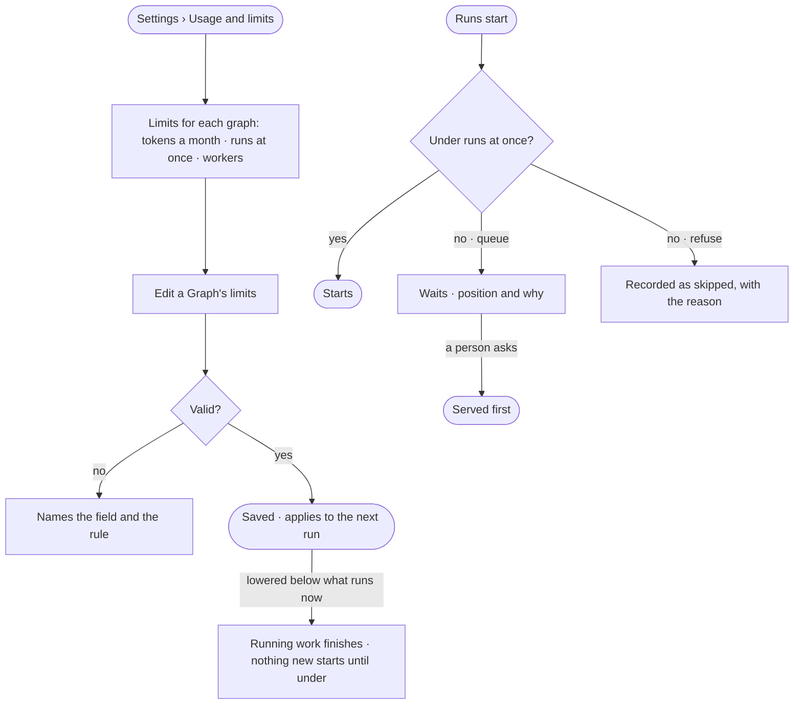

# ST-16 · Set each graph's tokens, runs at once and workers

**As** an install admin **I want** to set each Graph's tokens a month, how many runs it may have going, what happens at
that limit, and which workers it may use, in one place **so that** cost and capacity are controlled by the install, and
Monday at 08:00 is a queue I can read rather than a rate-limit error.

Tasks: [task.md](task.md) · Feature: [ST-F06](../../feature.md)

## Who can

| Lens | Can | Otherwise sees |
|---|---|---|
| Admin | Read and set every Graph's tokens a month, runs at once, *queue or refuse* and worker group | — |
| Operator | Read their Graph's limits in *Usage and limits* (ST-13) | *Limits for each graph* is absent |

## Flow

## Acceptance criteria

| # | Given | When | Then |
|---|---|---|---|
| ST-16.1 | An Admin | they open *Usage and limits* | *Limits for each graph* lists every Graph with its tokens a month, runs at once and worker group |
| ST-16.2 | An Admin | they edit a Graph's tokens a month, runs at once, *queue or refuse* or worker group and save | it applies from the next run, and the Graph reads it in Usage and limits |
| ST-16.3 | A new Graph | its limits are read | it runs four at once, and queues at that limit |
| ST-16.4 | A Graph at runs at once, set to *queue* | another run starts | it waits, showing its position and what it waits behind |
| ST-16.5 | A Graph at runs at once, set to *refuse* | a schedule fires | the firing is recorded as skipped, with the reason |
| ST-16.6 | Runs waiting behind schedules | a person asks a question | the question is served before the waiting schedules |
| ST-16.7 | Runs at once lowered below what is running | it is saved | running work finishes; nothing new starts until the count is under |
| ST-16.8 | A run that makes helpers | the helpers would pass the limit | they wait or are refused like any run, naming the limit and the parent |
| ST-16.9 | A Graph at its tokens a month | an agent would run | it stops and says why; a question a person asks still answers |
| ST-16.10 | An Operator | they open Usage and limits | *Limits for each graph* is absent |
| ST-16.11 | A limit changed | it saves | History records who changed which Graph's limit, and when (IN-F03) |

## Screens

| Surface | Lens | First use | Empty after a filter | Loading | Has data | Failed | Agent working or proposing | No access |
|---|---|---|---|---|---|---|---|---|
| Limits for each graph | Admin | settings.usage · Default limits | — | settings.usage · Loading | settings.usage | settings.usage · Could not save | — | — |
| Limits for each graph | Operator | — | — | — | — | — | — | settings.usage · Read only |
| Edit a Graph's limits | Admin | — | — | — | settings.usage · Edit limits | settings.usage · Could not save | — | — |
| Edit a Graph's limits | Operator | — | — | — | — | — | — | settings.usage · Read only |
