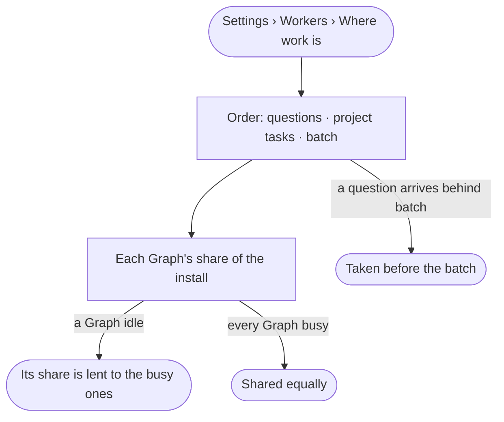

# ST-18 · Questions go before batch work

**As** an install admin **I want** to see the order workers take work in — a question someone waits on, then project
tasks, then batch — and each Graph's share **so that** a batch of agents never delays a question.

Tasks: [task.md](task.md) · Feature: [ST-F06](../../feature.md)

## Who can

| Lens | Can | Otherwise sees |
|---|---|---|
| Admin | Read the order work is taken in and each Graph's share | — |
| Operator | Read the order work is taken in and each Graph's share | — |

## Flow

## Acceptance criteria

| # | Given | When | Then |
|---|---|---|---|
| ST-18.1 | Work waiting of several kinds | the order is read | a question someone waits on reads first, then project tasks picked up, then batch — schedules, sweeps and runs past twenty agents |
| ST-18.2 | Batch waiting | a person asks a question | the question is taken before the batch |
| ST-18.3 | Several Graphs busy | their shares are read | each has an equal share of the install |
| ST-18.4 | One Graph idle | its share is read | it is lent to the busy Graphs, and says so |
| ST-18.5 | A Graph's work waiting | its row is read | how many wait, of which kind, and the oldest |

## Screens

| Surface | Lens | First use | Empty after a filter | Loading | Has data | Failed | Agent working or proposing | No access |
|---|---|---|---|---|---|---|---|---|
| The order and each Graph's share | Admin | settings.workers · Nothing running | — | settings.workers · Loading | settings.workers · Order | settings.workers · Could not load | — | — |
| The order and each Graph's share | Operator | settings.workers · Nothing running | — | settings.workers · Loading | settings.workers · Order | settings.workers · Could not load | — | — |
