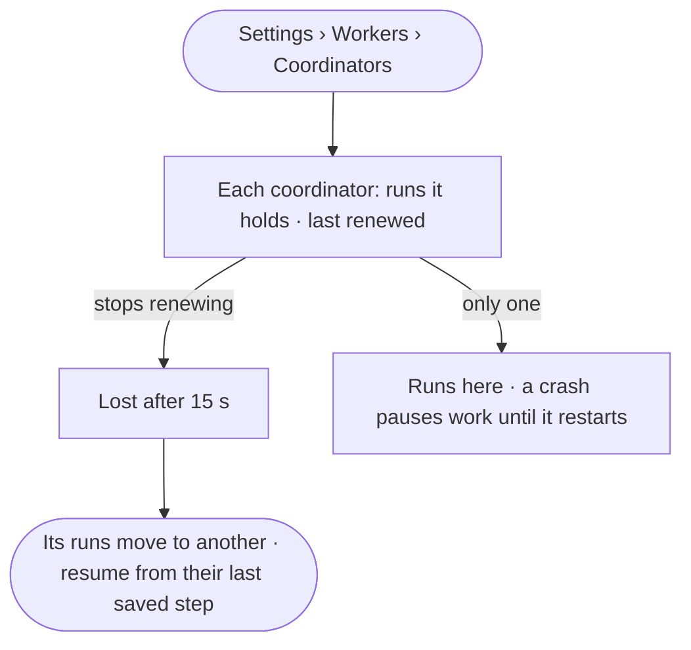

# ST-19 · A lost coordinator costs seconds, not runs

**As** an install admin **I want** to see the coordinators that hand out work and which runs each holds, and a lost
one's runs move on by themselves **so that** a crash costs seconds, not runs.

Tasks: [task.md](task.md) · Feature: [ST-F06](../../feature.md)

## Who can

| Lens | Can | Otherwise sees |
|---|---|---|
| Admin | Read every coordinator, the runs it holds and when it last renewed | — |
| Operator | Read every coordinator, the runs it holds and when it last renewed | — |

## Flow

## Acceptance criteria

| # | Given | When | Then |
|---|---|---|---|
| ST-19.1 | A member | they open *Coordinators* | each reads with the runs it holds and when it last renewed them |
| ST-19.2 | A coordinator that stops renewing | 15 s pass | it reads lost, and its runs move to another coordinator, resuming from their last saved step |
| ST-19.3 | A moved run | it resumes | no step it finished runs again, and the run says it moved |
| ST-19.4 | A run waiting on a person, an ask or a limit | it is read | no coordinator holds it |
| ST-19.5 | An install with one coordinator | the list is read | it says a crash pauses work until it restarts |

## Screens

| Surface | Lens | First use | Empty after a filter | Loading | Has data | Failed | Agent working or proposing | No access |
|---|---|---|---|---|---|---|---|---|
| Coordinators | Admin | settings.workers · One coordinator | — | settings.workers · Loading | settings.workers · Coordinators | settings.workers · Coordinator lost | — | — |
| Coordinators | Operator | settings.workers · One coordinator | — | settings.workers · Loading | settings.workers · Coordinators | settings.workers · Coordinator lost | — | — |
