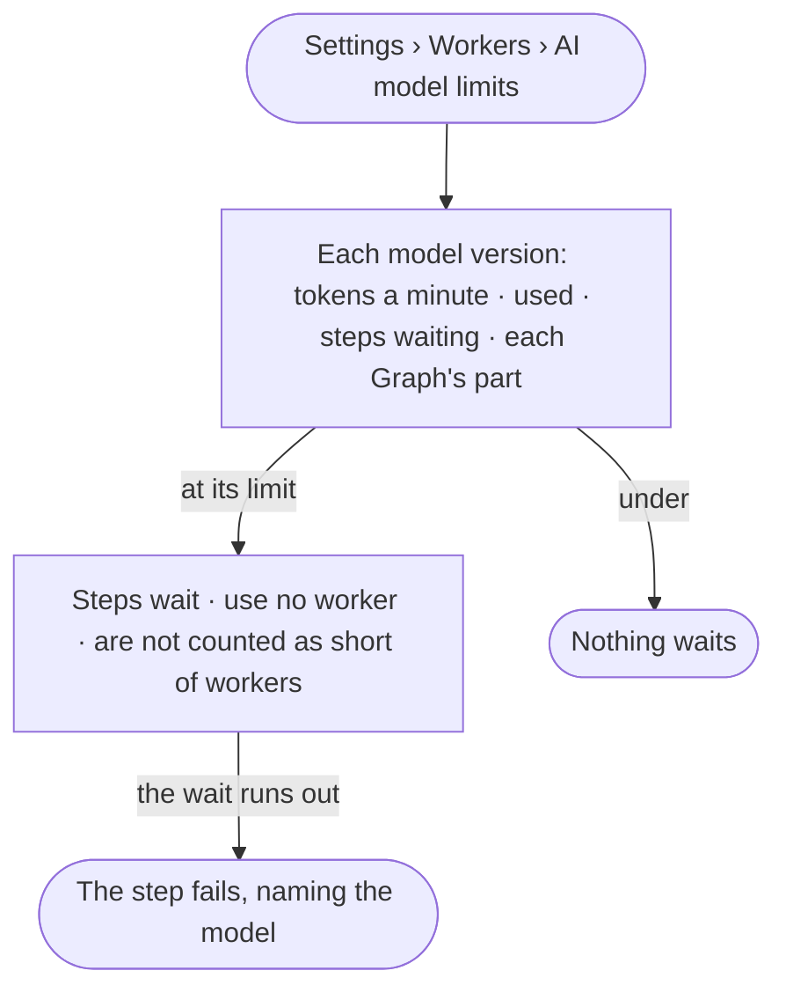

# ST-22 · See each AI model's rate limit and what waits on it

**As** an install admin **I want** each AI model's tokens-a-minute limit, what waits on it, and each Graph's part
**so that** I do not add workers that would only wait on a model.

Tasks: [task.md](task.md) · Feature: [ST-F06](../../feature.md)

## Who can

| Lens | Can | Otherwise sees |
|---|---|---|
| Admin | Read each AI model's rate limit, use, what waits and each Graph's part | — |
| Operator | Read each AI model's rate limit, use, what waits and each Graph's part | — |

## Flow

## Acceptance criteria

| # | Given | When | Then |
|---|---|---|---|
| ST-22.1 | A member | they open *AI model limits* | each offered model version reads its tokens a minute, how much is used, steps waiting on it and each Graph's part |
| ST-22.2 | A model at its limit | a step needs it | the step waits, holds no worker, and is not counted toward workers suggested (ST-21) |
| ST-22.3 | A step waiting on a model | its wait runs out | it fails, naming the model — never as *cannot answer* |
| ST-22.4 | A model shared by several Graphs | its row is read | each Graph's part of its use reads |
| ST-22.5 | No AI model offered | the view opens | it says so and links to AI models (ST-28) |

## Screens

| Surface | Lens | First use | Empty after a filter | Loading | Has data | Failed | Agent working or proposing | No access |
|---|---|---|---|---|---|---|---|---|
| AI model limits | Admin | settings.workers · No AI model | — | settings.workers · Loading | settings.workers · AI model limits | settings.workers · Could not load | — | — |
| AI model limits | Operator | settings.workers · No AI model | — | settings.workers · Loading | settings.workers · AI model limits | settings.workers · Could not load | — | — |
