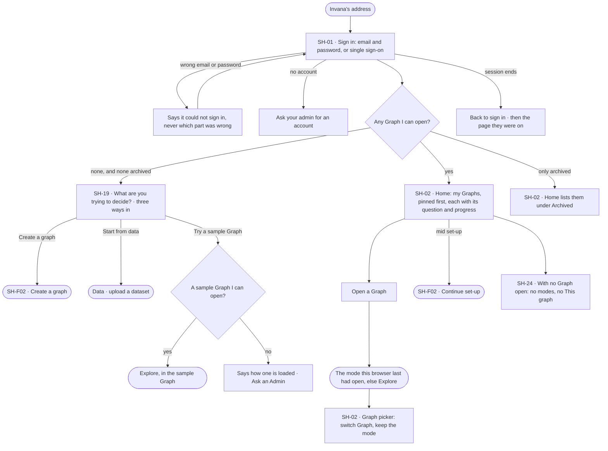

# Sign in and start

> Sign in, land on Home off any Graph, and open the Graph your work is in — or, on an empty install, start from the
> question you are deciding. The decision it helps make: *where do I start — which Graph, or which way in?*

## User journey

Journeys this feature is a step of: [J01 · From an empty install to a first answer](../../../../journeys/J01-from-an-empty-install-to-a-first-answer.md) · [J02 · Ask and trust the answer](../../../../journeys/J02-ask-and-trust-the-answer.md) · [J05 · Join a Graph someone set up](../../../../journeys/J05-join-a-graph-someone-set-up.md)

## Stories

| ID | Story | Status |
|---|---|---|
| SH-01 | [Sign in](stories/SH-01-sign-in/story.md) | idea |
| SH-02 | [Open a Graph I can reach](stories/SH-02-open-a-graph-i-can-reach/story.md) | idea |
| SH-19 | [Start an empty install from a question](stories/SH-19-start-an-empty-install-from-a-question/story.md) | idea |
| SH-24 | [See only what works with no Graph open](stories/SH-24-see-only-what-works-with-no-graph-open/story.md) | idea |

## Access

| Act | Role (`.claude/team/TEAM.md` §7) | Everyone else sees |
|---|---|---|
| Sign in | Anyone with an account | *Ask your admin for an account* — there is no sign-up form |
| See a Graph on Home and in the Graph picker · open it | Operator — every member of that Graph; an Admin reaches every Graph | A Graph they are not a member of is never listed |
| Pin a Graph | Operator — every member, for themselves | — |
| Create a graph | Anyone signed in — they become its Owner (SH-F02) | — |
| Start from data | As DS-F01 | As DS-F01 |
| Try a sample Graph | Operator — a member of the sample Graph | *No sample Graph here yet*; an Admin reads how one is loaded, everyone else *Ask an Admin* |
| Restore an archived Graph | `owner` · shown as *Owner* (ST-14) | The archived Graph reads; *Unarchive* shown as *Ask Priya (owner)* |

## States

| State | What the person sees |
|---|---|
| First use | No Graph to open: *What are you trying to decide?* and three ways in |
| Empty after a filter | The Graph picker's search matches nothing: *No Graph matches* and *Clear* |
| Loading | Sign in shows its card at once and the button says it is signing in; Home draws its regions and fills the Graph cards in place |
| Has data | Home lists the Graphs I can open, pinned first, each with its question, my access, progress and what needs me |
| Failed | Sign in says it could not sign in; Home names what it could not read and offers *Try again* |
| Agent working or proposing | A Graph card names the agent working on its question and what waits on me |
| No access | A Graph I am not on is never listed; a person without an account reads *Ask your admin for an account* |

## Rules

| Rule | Detail |
|---|---|
| Every sign-in lands on Home | Off any Graph, even on an install with one Graph |
| Membership is checked on every call | Removing a person takes effect on their next call; a Graph they lose leaves Home and the picker on the next read |
| A session ends cleanly | When it ends, the person signs in again and returns to the page they were on |
| The Graph's own address | `/u/:user/:graph` opens the mode this browser last had open there, else Explore. With storage blocked, Explore |
| Switching Graph keeps the mode | The Graph picker opens the same mode in the other Graph, at its landing |
| Home shows numbers the engine counts | Progress, counts and what needs me come from the engine; Home never derives them |
| A sample Graph is a Graph | It is opened, searched and asked like any other; it is never written into a person's own database |
| Leans on | Creating a Graph (SH-F02) · archiving and restoring a Graph (ST-14) · keys and sessions (ST-F03) · Data (DS-F01) |

## Data touched

| Record | Read or write |
|---|---|
| Accounts and sessions (ST-F03) | Read · write a session |
| Graphs I am a member of — name, question, archived, set-up progress | Read |
| My pins and the last mode per Graph (this browser) | Read · write |
| What needs me per Graph (IN-F01) | Read |

## Decisions

| Decision | Detail |
|---|---|
| Home is off any Graph | Plain *Invana* in the wordmark, no Graph picker crumb, no modes |
| The Graph picker replaces a Graphs page | Every Graph I can open is one click from the header; Home is the place to read them, the picker the place to switch |
| No sign-up form | Accounts are made by an Admin; the sign-in card says whom to ask |
| Three ways in, one question | An empty install asks *What are you trying to decide?* and offers Create a graph · Start from data · Try a sample Graph |
| Off a Graph, only what works install-wide | No modes, no Inbox, no *This graph*; Data, Agents and Settings stay, each as its own access allows |
| Archived is not first run | A person whose only Graphs are archived sees them under *Archived*, where an Owner restores them |

## Open questions

| Question | Who answers |
|---|---|
| Does Home carry the assistant — a brief across my Graphs, acting in each and answering from one? Recommend: no for now; the assistant's sessions are a Graph's, and Home names what waits on me per Graph with a link to its Inbox | Ravi |

## Not building

| Item | Why not |
|---|---|
| A sign-up form | Accounts are made by an Admin |
| A product launcher | The person works in a mode; everything else is summoned |
| A tour or coach marks | Each empty state names the one step that fills it |
| Writing sample data into a person's database | Their database is theirs; sample data lives in a sample Graph |
| Metrics on Home | Home is where a person picks up their decisions, not a dashboard |
