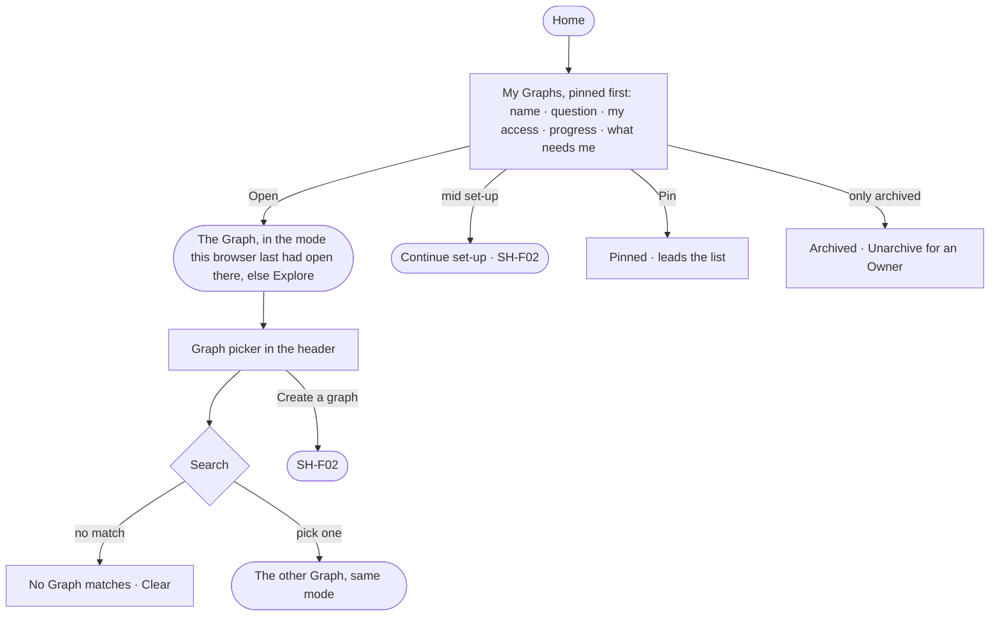

# SH-02 · Open a Graph I can reach

**As** an analyst **I want** to see the Graphs I can open, each with the question it helps decide, and switch between
them without losing my place **so that** I start where my work is.

Tasks: [task.md](task.md) · Feature: [SH-F01](../../feature.md)

## Who can

| Lens | Can | Otherwise sees |
|---|---|---|
| Admin | See and open every Graph of the install; pin; switch Graph from the picker | — |
| Operator | See and open the Graphs they are a member of; pin; switch Graph from the picker | A Graph they are not on is never listed. An archived Graph reads; *Unarchive* shown as *Ask Priya (owner)* |

## Flow

## Acceptance criteria

| # | Given | When | Then |
|---|---|---|---|
| SH-02.1 | A person on several Graphs | Home opens | one card per Graph they can open — name, its question, their access as a sentence, set-up progress or what it holds, what needs them — pinned first, then last opened |
| SH-02.2 | A Graph card | the person opens it | the Graph opens in the mode this browser last had open there, else Explore |
| SH-02.3 | A Graph mid set-up | its card draws | it shows its progress and *Continue set-up* (SH-03) |
| SH-02.4 | A Graph with something waiting on the person | its card draws | it says how many and links to its Inbox's *Needs you* |
| SH-02.5 | A person who is not a member of a Graph | Home or the picker draws | that Graph is never listed; an Admin sees every Graph |
| SH-02.6 | A Graph open | the person picks another in the Graph picker | it opens in the same mode, at that mode's landing |
| SH-02.7 | The picker's search | nothing matches | it says *No Graph matches* with *Clear* |
| SH-02.8 | A person whose only Graphs are archived | Home opens | they see them under *Archived*, never the first run; an Owner restores one with *Unarchive* (ST-14) |
| SH-02.9 | A person removed from a Graph | Home or the picker reads again | that Graph is gone, and opening its address says it is not there |
| SH-02.10 | Home | the engine cannot be read | Home names what it could not read and offers *Try again* |

## Screens

| Surface | Lens | First use | Empty after a filter | Loading | Has data | Failed | Agent working or proposing | No access |
|---|---|---|---|---|---|---|---|---|
| Home | Admin | — | — | start.home · Loading | start.home | start.home · Could not load | start.home · An agent on it | — |
| Home | Operator | — | — | start.home · Loading | start.home | start.home · Could not load | start.home · An agent on it | start.home · Archived |
| Graph picker | Admin | — | start.graph_picker · No match | start.graph_picker · Loading | start.graph_picker | start.graph_picker · Could not load | — | — |
| Graph picker | Operator | — | start.graph_picker · No match | start.graph_picker · Loading | start.graph_picker | start.graph_picker · Could not load | — | — |
