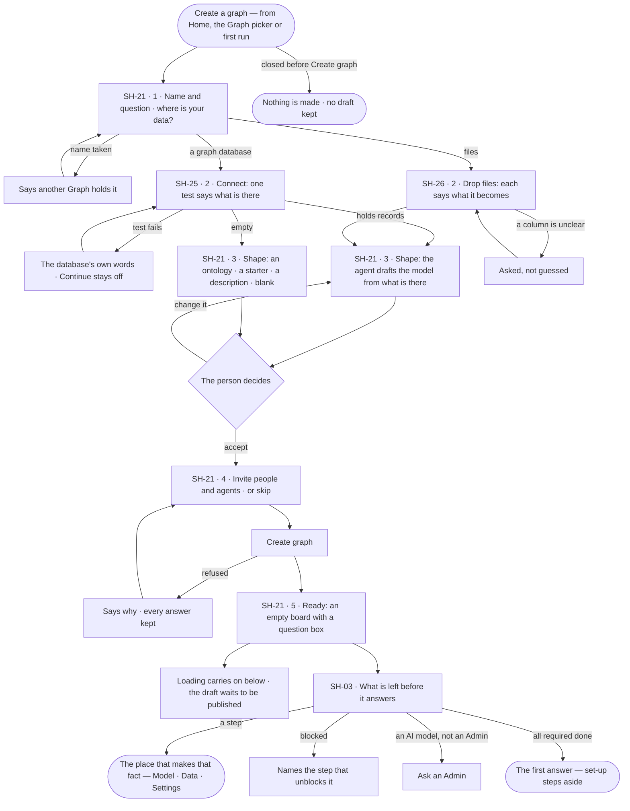
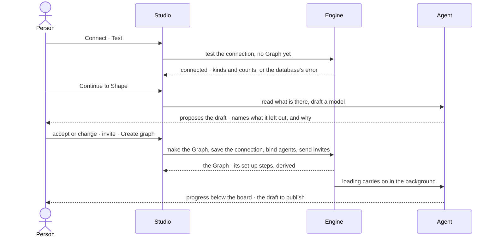

# Create a graph

> A new Graph made in one modal of steps — a name and the question it helps decide, its data (a graph database, or
> files), the model the agent reads from that data, the people and agents who work in it — then the steps still
> standing between it and a first answer. The decision it helps make: *is this the model my data describes, and who
> works on it?*

## User journey

Journeys this feature is a step of: [J01 · From an empty install to a first answer](../../../../journeys/J01-from-an-empty-install-to-a-first-answer.md) · [J05 · Join a Graph someone set up](../../../../journeys/J05-join-a-graph-someone-set-up.md)

## Stories

| ID | Story | Status |
|---|---|---|
| SH-21 | [Create a graph in one modal of steps](stories/SH-21-create-a-graph-in-one-modal-of-steps/story.md) | idea |
| SH-25 | [Start from a graph database that already holds data](stories/SH-25-start-from-a-graph-database-that-already-holds-data/story.md) | idea |
| SH-26 | [Start from files with an empty database](stories/SH-26-start-from-files-with-an-empty-database/story.md) | later |
| SH-03 | [See what is left before the Graph answers](stories/SH-03-see-what-is-left-before-the-graph-answers/story.md) | idea |

## Access

| Act | Role (`.claude/team/TEAM.md` §7) | Everyone else sees |
|---|---|---|
| Create a graph — every step | Anyone signed in; they become the new Graph's Owner | — |
| Test a connection before the Graph exists | Anyone signed in, inside Create a graph | — |
| Invite people into the new Graph | The creator, as its Owner | — |
| Invite agents into the new Graph | The creator, as AG-35 allows | As AG-35 |
| Read the set-up steps | Operator — every member | — |
| Do a set-up step | The role that owns the fact: the connection *Owner* (ST-14) · the model *Can shape the model* (MO-F01) · data *Can shape the model* (DS-F02) · AI models Admin (ST-F05) | The step reads; its act is shown as *Ask Priya (owner)*, naming who holds that role, or *Ask an Admin* |
| Skip or bring back an optional step | `owner` · shown as *Owner* | The step reads; *Skip* shown as *Ask Priya (owner)* |

## States

| State | What the person sees |
|---|---|
| First use | Step 1 with the question carried in from first run, if any |
| Empty after a filter | — no step filters |
| Loading | A test says it is testing; Shape says the agent is reading the database; Ready shows the board at once with loading carrying on below |
| Has data | Each step filled in, the step strip marking what is done; the set-up steps with each done one checked |
| Failed | A test failed in the database's own words; a name another Graph holds; *Create graph* refused with the reason — every answer kept |
| Agent working or proposing | The agent reading the data and drafting the model; the draft shown for a decision before anything is loaded |
| No access | Inside Create a graph, none — the creator is the Owner. A set-up step whose fact needs another role reads with *Ask Priya (owner)* or *Ask an Admin* |

## Rules

| Rule | Detail |
|---|---|
| One modal, five steps | Name and question · Data · Shape · Invite · Ready, on a step strip; never a page, never a modal on a modal |
| Nothing is made until *Create graph* | Closing before it keeps no Graph and no draft; a failed test or a refused create keeps every answer |
| The question is the Graph's | *What will this Graph help you decide?* is saved as its instructions, which every agent reads before it plans |
| A test gates the database step | *Continue* opens only once the test passes; it reports what the database holds — kinds and counts, or empty |
| Create a graph branches on the data | A database with records defaults to *Draft from what is there*; an empty one offers drafting disabled, saying why, and the other starting points |
| The agent proposes the model | The shape step shows the draft before anything is loaded; nothing is published until the person publishes it in Model |
| A draft names what it left out | Every kind not drafted is listed with why — nothing is dropped silently (MO-04) |
| Files say what they become | Each file names the kind it becomes; a column the agent cannot place is asked, never guessed |
| Agents arrive with the Graph | The core assistants and the query skills for the connector's languages are included; install agents are offered unticked (AG-35) |
| Set-up is derived, never ticked | A step is done because its fact exists — whoever made it, from Studio, the command line or the API |
| Set-up names four required steps | The database connects · a model is published · the Graph holds records · an AI model answers. Progress counts these four and nothing else |
| Records already there count | A database that holds records satisfies the data step on arrival |
| Set-up owns no forms | Each step opens the place that already makes its fact: Settings › This graph, Model, Data, Settings › Invana |
| Four gates, each a lock | *Connected* — the last test passed: opens the canvas, the console's queries and reading the database · *Modelled* — a published model: opens loading data and links between models · *Grounded* — the database holds records: data on the canvas and answers that cite a record · *Answering* — the default AI model's last check passed: opens asking, the assistant and every agent run. A surface waits on the one gate it needs, never on the whole sequence |
| Knowing and deciding are independent | An AI model may answer before a database is connected; the order between them is a preference |
| Two ways in, the same import | Data arrives from the browser or from the command line; both land as an import run, checked the same way, and every dialog shows its command-line twin |
| The command line runs where the person works | Installed on a laptop and signed in with a key from Settings › You; it never needs a shell on the engine's host |
| A blocked step names its blocker | Bringing data in waits on a published model, and says so |
| Every shut surface names the step that opens it | *Ask opens when an AI model answers* — never a blank or a dead act |
| A step can be done from the terminal | The step shows the exact command, filled in for this Graph and model |
| Set-up ends at the first answer | What comes after it — rules, views, schedules, agents — is offered where it is useful (*Schedule this* on an answer), never owed |
| A step's lesson | Every step carries its name · why · what it opens · two or three moves · the command · how to tell it worked; a required step adds the one idea it rests on |
| Set-up belongs to the Graph | A member joining a ready Graph never sees it; there is no per-person checklist |
| Leans on | Drafting a model (MO-F01) · uploading and loading data (DS-F02 · DS-F03) · inviting agents (AG-35) · the connection and the setup timeline in General (ST-14) · AI models (ST-F05) · adding people (ST-08) |

## Data touched

| Record | Read or write |
|---|---|
| The Graph — name, address, question as instructions, owner | Write |
| The Graph's connection — connector, address, database, encrypted credentials, read-only | Write |
| The drafted model (MO-F01) | Write — a draft, never published here |
| Members — invited people and their grants; bound agents and skills | Write |
| Set-up steps — derived from the facts; only a skip is stored | Read · write a skip |
| Import runs started from files (DS-F02) | Write |

## Decisions

| Decision | Detail |
|---|---|
| Create a graph is a modal of steps | It shows a person's own data back to them and asks for a decision at each step; a page would have nothing behind it to return to |
| The model is shaped in step 3 | The agent reads the data and proposes the model before anything is loaded |
| The creator is the Owner | The Graph's address is `/u/<creator>/<graph>` |
| Set-up lives in General | After Ready, the set-up steps lead *Settings › This graph › General* while required steps are unfinished (ST-14), and Home shows the Graph's progress with *Continue set-up* |
| One idea per required step | Each required step says the one idea it rests on, where it is about to be used: a Graph is a question, not a database · the model is the shared vocabulary · answers are grounded, or refused · your key, your provider |
| Four groups, one sentence | Steps are grouped by what a Graph is: it runs on a graph database · it knows a curated context · it decides by reasoning · it acts within what it may do |
| An action step is done when it has run | A schedule is done when it has fired, not when it is saved |

## Open questions

| Question | Who answers |
|---|---|
| Does creating a Graph also give the creator *Can manage people* there, so the invite step adds people as ST-08 does? Recommend: yes — the creator is the only person who can staff a new Graph | Ravi |
| *An AI model answers* is a required step, but AI models are an Admin's (ST-F05). Recommend: keep it required; a creator who is not an Admin reads *Ask an Admin*, and an install with a working default model satisfies it for every Graph | Ravi |
| The set-up steps after Ready have no board of their own; the spec names them on `start.new_graph.ready`, `start.home` and `settings.people`. Recommend: the designer draws `start.setup` as a peek from Ready and Home | Ravi |

## Not building

| Item | Why not |
|---|---|
| A page for creating a Graph | Steps stay in one modal |
| A Graph with a name and no data | A Graph with nothing to read answers nothing |
| A tour, coach marks or a primer | Each step says the one idea it rests on, where it is used |
| A "set-up complete" screen | The first answer is the celebration |
| Progress that counts optional steps | An optional step that drags the number down turns an offer into a debt |
| A dismiss-forever flag | Set-up steps aside once the required steps are done |
| Writing sample data into a person's database | Sample data lives in a sample Graph |
| A separate onboarding product or address | Set-up is the Graph's, shown where its facts are made |
| A set-up command of its own | Each step already has its command; a wrapper would be a second sequence to keep true |
