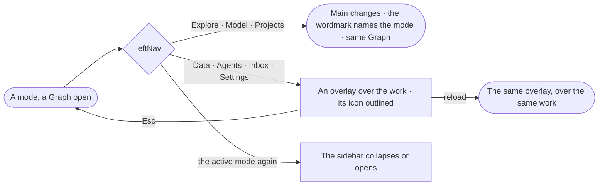

# SH-04 · Switch mode and keep the open Graph

**As** an analyst **I want** to move between exploring, modelling and projects — and summon data, agents, the inbox or
settings over my work — without losing the Graph I am in **so that** I change job without losing my place.

Tasks: [task.md](task.md) · Feature: [SH-F03](../../feature.md)

## Who can

| Lens | Can | Otherwise sees |
|---|---|---|
| Admin | Switch between the three modes; open every summoner | — |
| Operator | Switch between the three modes; open every summoner | Each mode and overlay reads; its acts follow its own feature's Access table |

## Flow

## Acceptance criteria

| # | Given | When | Then |
|---|---|---|---|
| SH-04.1 | A Graph open | the leftNav draws | Explore, Model and Projects above the line; Data, Agents and Inbox below; Settings and Help at the bottom — each icon with its label underneath |
| SH-04.2 | A mode | the person picks another | main changes to that mode at its landing, in the same Graph, and the wordmark names it |
| SH-04.3 | A mode | the person picks a summoner | its overlay opens over the work and its icon is outlined until it closes |
| SH-04.4 | An overlay open | the person presses Esc | it closes and the work behind it is as it was |
| SH-04.5 | An overlay open | the person reloads or shares its address | the same overlay opens over the same mode |
| SH-04.6 | The active mode | the person picks it again | its sidebar collapses or opens |
| SH-04.7 | An old page address | it is opened | it opens its overlay over the last workspace |
| SH-04.8 | Projects not yet launched | the leftNav draws | Projects carries an *Experimental* badge, never hidden |

## Screens

| Surface | Lens | First use | Empty after a filter | Loading | Has data | Failed | Agent working or proposing | No access |
|---|---|---|---|---|---|---|---|---|
| Explore mode | Admin | — | — | explore.board · Loading | explore.board | — | — | — |
| Explore mode | Operator | — | — | explore.board · Loading | explore.board | — | — | explore.board |
| Model mode | Admin | — | — | model.board · Loading | model.board | — | — | — |
| Model mode | Operator | — | — | model.board · Loading | model.board | — | — | model.board · Read only |
| Projects mode | Admin | — | — | projects.list · Loading | projects.list | — | — | — |
| Projects mode | Operator | — | — | projects.list · Loading | projects.list | — | — | projects.list · Read only |
