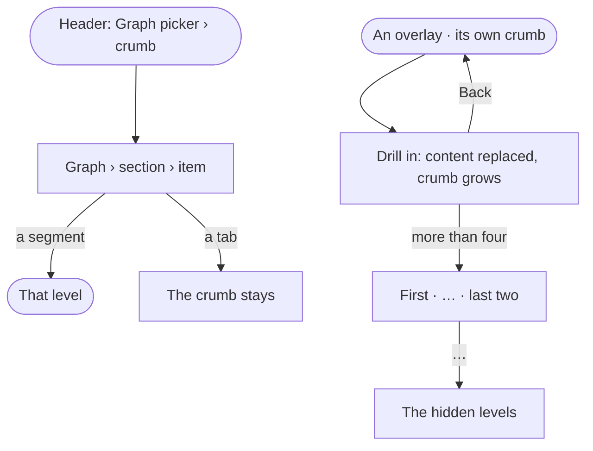

# SH-05 · Know where I am and step back up

**As** an analyst **I want** a crumb that shows where I am and steps back a level **so that** I never get lost in deep
pages or overlays.

Tasks: [task.md](task.md) · Feature: [SH-F03](../../feature.md)

## Who can

| Lens | Can | Otherwise sees |
|---|---|---|
| Admin | Read and follow every crumb | — |
| Operator | Read and follow every crumb | — |

## Flow

## Acceptance criteria

| # | Given | When | Then |
|---|---|---|---|
| SH-05.1 | Any page in a Graph | the header draws | the Graph picker, then the crumb: section › item › drill-in, never repeating the mode |
| SH-05.2 | A crumb | the person picks a segment | they go to that level; the last segment is plain text |
| SH-05.3 | A page with tabs | the person switches tab | the crumb does not change |
| SH-05.4 | A sheet or modal | it opens | it carries its own crumb; drilling in replaces its content and grows the crumb |
| SH-05.5 | Inside an overlay | the person presses Back | it steps up one level of the overlay's crumb |
| SH-05.6 | More than four segments | the crumb draws | it reads first · … · last two, and … lists the hidden levels |
| SH-05.7 | A long name | it is in the crumb | it truncates with an ellipsis and shows in full on hover |
| SH-05.8 | A page | it draws | it has no in-page back link; the crumb is the way up |

## Screens

| Surface | Lens | First use | Empty after a filter | Loading | Has data | Failed | Agent working or proposing | No access |
|---|---|---|---|---|---|---|---|---|
| The header crumb | Admin | — | — | explore.board · Loading | explore.board | — | — | — |
| The header crumb | Operator | — | — | explore.board · Loading | explore.board | — | — | explore.board |
| A sheet's crumb | Admin | — | — | agents.agent · Loading | agents.agent | — | — | — |
| A sheet's crumb | Operator | — | — | agents.agent · Loading | agents.agent · Read only | — | — | agents.agent · Read only |
