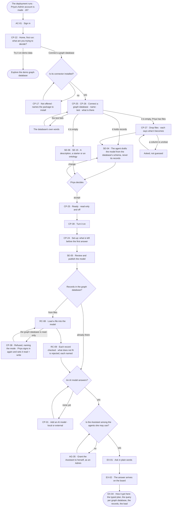

# From a fresh deployment to a first answer

> **Priya**, the first Admin of a fresh deployment, has a decision to make; she wants her graph database connected
> and a first answer from it, every claim citing its record, without an engineer.

## The journey

## Steps

| # | Step | Product · surface | Story | Board |
|---|---|---|---|---|
| 0 | The deployment is readied and Priya's Admin account made | Access Plane · Directory | [J07](J07-ready-a-deployment.md) | — |
| 1 | Sign in | Access Plane · Sign in, account and sessions | AC-01 | `access.signin` |
| 2 | Say what she is deciding; pick *Connect a graph database* | Control Plane · Graph databases — Home, first run | CP-22 | `start.home` |
| 3 | Name and connect the graph database — offered only if its connector is installed; the test says what is there | Control Plane · Graph databases | CP-25 · CP-26 · CP-17 | `settings.databases.connect` |
| 4 | Or, with an empty database: drop files; each says what it becomes | Control Plane · Graph databases | CP-27 | `settings.databases.connect.files` |
| 5 | The agent drafts the model; Priya accepts or changes it | Ontology · Start a model | SE-04 · SE-06 · SE-15 | `settings.databases.connect.shape` |
| 6 | Connect it — saved read-only and off — and turn it on | Control Plane · Graph databases | CP-25 · CP-39 | `settings.databases.connect.ready` · `settings.databases` |
| 7 | See what is left before the first answer | Control Plane · Graph databases › Set-up | CP-24 | `start.setup` |
| 8 | Review and publish the model | Ontology · Change and publish | SE-05 | `model.board.draft.publish` |
| 9 | Load records, when the database had none | Intelligence · Bring records in | RC-08 · RC-09 | `data.upload` |
| 10 | Ask the first question, through the Assistant | Evidence · Ask a question | EX-01 | `explore.ask` |
| 11 | Read the answer and how it got here | Evidence · The answer | EX-02 · EX-04 | `explore.board` · `explore.board.why` |

## Branches

| When | What happens | Story | Board |
|---|---|---|---|
| It needs permission | Priya is an Admin: every set-up act is hers. An Operator reaching set-up reads it, each step naming the role it needs | CP-24 | `start.setup` |
| It fails | A failed test names the database's own error; records that do not fit are rejected, each named | CP-26 · RC-09 | `settings.databases.connect` · `data.upload` |
| The person has no access | Without an account, the sign-in card reads *Ask your admin for an account* | AC-01 | `access.signin` |
| Her database's connector is not installed | It is not offered; the step names the package that adds it, installed on the engine's machine | CP-17 | `settings.databases.connect` |
| The database is empty | Drafting is offered disabled with its reason; a description, a starter or an ontology starts the model | CP-26 · SE-06 · SE-15 | `settings.databases.connect.shape` |
| The graph database is read-only | Loading files is refused, naming the mode; an Admin signs in again and sets it read + write, recorded in History | RC-08 · CP-38 | `data.upload` · `access.sign_in_again` |
| No AI model is offered | Asking is disabled with its reason; an Admin adds one, marked local or external | CP-01 | `settings.ai` |
| The Assistant is not among her agents | Asking names it; as an Admin she grants it | AG-35 | — |
| A property is sensitive and the AI model external | The call is refused before it leaves, naming the property; the answer says what it could not use | EX-04 | `explore.board.why` |
| She only wants to look | *Try it on demo data* opens Explore on the demo graph database | CP-22 | `start.home` |

## Done when

- The deployment answers Priya's first question on the board, and *How it got here* shows the typed plan, the query sent to each graph database, the records and the load behind them.
- Set-up reads every step done and steps aside.
