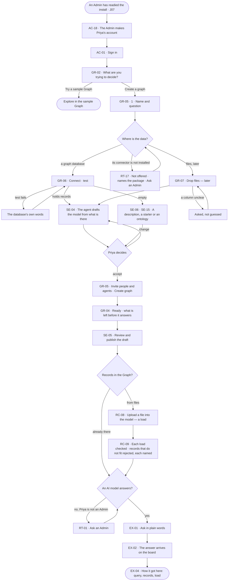

# From an empty install to a first answer

> **Priya**, a Graph owner, has a new install and a question she must decide; she wants her data to answer it, every
> claim citing its record, without an engineer.

## The journey

## Steps

| # | Step | Product · surface | Story | Board |
|---|---|---|---|---|
| 0 | The install Admin makes Priya's account | Access · `invana users create` | AC-18 | — |
| 1 | Sign in | Access · sign in | AC-01 | `access.signin` |
| 2 | Say what she is deciding; pick *Create a graph* | Graph · Home, first run | GR-02 | `graphs.home` |
| 3 | Name the Graph and its question; say where the data is | Graph · Create a graph | GR-05 | `graphs.new_graph` |
| 4a | Connect the graph database — offered only if its connector is installed; the test says what is there | Graph · Create a graph | GR-06 · RT-17 | `graphs.new_graph.connect` |
| 4b | Later: or drop files; each says what it becomes | Graph · Create a graph | GR-07 | `graphs.new_graph.files` |
| 5 | The agent drafts the model; Priya accepts or changes it | Graph · Create a graph | SE-04 · SE-06 · SE-15 | `graphs.new_graph.shape` |
| 6 | Invite people and agents; create the Graph | Graph · Create a graph | GR-05 | `graphs.new_graph.invite` |
| 7 | Land on an empty board; see what is left | Graph · Ready | GR-04 | `graphs.new_graph.ready` |
| 8 | Review and publish the draft | Model | SE-05 | `model.board.draft.publish` |
| 9 | Bring records in, when the database had none | Records | RC-08 · RC-09 | `data.upload` |
| 10 | Ask the first question | Explore | EX-01 | `explore.ask` |
| 11 | Read the answer and how it got here | Explore | EX-02 · EX-04 | `explore.board` · `explore.board.why` |

## Branches

| When | What happens | Story | Board |
|---|---|---|---|
| It needs permission | An AI model is the install's: Priya, not an Admin, reads *Ask an Admin*; an Admin offers one in Settings › Invana | RT-01 | `settings.ai` |
| It fails | A failed test names the database's own error; records that do not fit are rejected, each named | GR-06 · RC-09 | `graphs.new_graph.connect` · `data.upload` |
| The person has no access | Inside Create a graph none — Priya is the Owner; a set-up step needing another role names who holds it | GR-04 | `graphs.new_graph.ready` |
| The database is empty | Drafting is offered disabled with its reason; a description, a starter or an ontology starts the model | GR-06 · SE-06 · SE-15 | `graphs.new_graph.shape` |
| Her database's connector is not installed | It is not offered; the step names the package that would add it, and an Admin installs it on the engine's machine | RT-17 | `graphs.new_graph.connect` |
| She has no account | The sign-in card reads *Ask your admin for an account*; an Admin makes one | AC-01 · AC-18 | `access.signin` |
| She only wants to look | *Try a sample Graph* opens Explore in it | GR-02 | `graphs.home` |

## Done when

- Priya's Graph answers her first question on the board, and *How it got here* shows the query, the records and the load behind them.
- Set-up reads 4 of 4 and steps aside.
