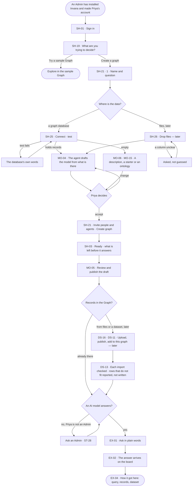

# From an empty install to a first answer

> **Priya**, a Graph owner, has a new install and a question she must decide; she wants her data to answer it, every
> claim citing its record, without an engineer.

## The journey

## Steps

| # | Step | Product · surface | Story | Board |
|---|---|---|---|---|
| 1 | Sign in | Shell · sign in | SH-01 | `start.signin` |
| 2 | Say what she is deciding; pick *Create a graph* | Shell · Home, first run | SH-19 | `start.home` |
| 3 | Name the Graph and its question; say where the data is | Shell · Create a graph | SH-21 | `start.new_graph` |
| 4a | Connect the graph database; the test says what is there | Shell · Create a graph | SH-25 | `start.new_graph.connect` |
| 4b | Later: or drop files; each says what it becomes | Shell · Create a graph | SH-26 | `start.new_graph.files` |
| 5 | The agent drafts the model; Priya accepts or changes it | Shell · Create a graph | MO-04 · MO-06 · MO-15 | `start.new_graph.shape` |
| 6 | Invite people and agents; create the Graph | Shell · Create a graph | SH-21 | `start.new_graph.invite` |
| 7 | Land on an empty board; see what is left | Shell · Ready | SH-03 | `start.new_graph.ready` |
| 8 | Review and publish the draft | Model | MO-05 | `model.board.draft.publish` |
| 9 | Later: bring records in, when the database had none | Datasets | DS-16 · DS-11 · DS-13 | `data.upload` |
| 10 | Ask the first question | Explore | EX-01 | `explore.ask` |
| 11 | Read the answer and how it got here | Explore | EX-02 · EX-04 | `explore.board` · `explore.board.why` |

## Branches

| When | What happens | Story | Board |
|---|---|---|---|
| It needs permission | An AI model is the install's: Priya, not an Admin, reads *Ask an Admin*; an Admin offers one in Settings › Invana | ST-28 | `settings.ai` |
| It fails | A failed test names the database's own error; rows that do not fit are reported, not written | SH-25 · DS-13 | `start.new_graph.connect` · `data.upload` |
| The person has no access | Inside Create a graph none — Priya is the Owner; a set-up step needing another role names who holds it | SH-03 | `start.new_graph.ready` |
| The database is empty | Drafting is offered disabled with its reason; a description, a starter or an ontology starts the model | SH-25 · MO-06 · MO-15 | `start.new_graph.shape` |
| She only wants to look | *Try a sample Graph* opens Explore in it | SH-19 | `start.home` |

## Done when

- Priya's Graph answers her first question on the board, and *How it got here* shows the query, the records and the dataset behind it.
- Set-up reads 4 of 4 and steps aside.
