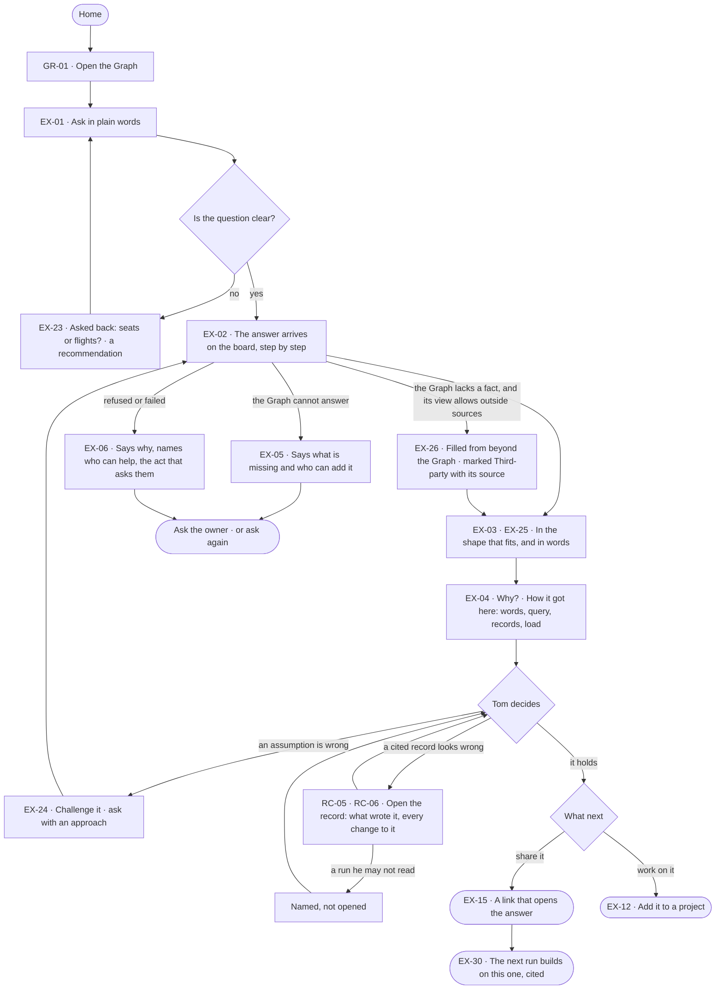

# Ask and trust the answer

> **Tom**, an analyst, asks his Graph a question in plain words and needs an answer he can defend — or to be told
> plainly that the Graph cannot answer it.

## The journey

## Steps

| # | Step | Product · surface | Story | Board |
|---|---|---|---|---|
| 1 | Open the Graph | Graph · Home | GR-01 | `graphs.home` |
| 2 | Ask in plain words | Explore · empty board | EX-01 | `explore.ask` |
| 3 | Answer a question asked back, when his was unclear | Explore · the assistant | EX-23 | `explore.board` |
| 4 | Watch the answer arrive on the board | Explore · board | EX-02 | `explore.board` |
| 5 | Read it in the shape that fits, and in words | Explore · board | EX-03 · EX-25 | `explore.board.chart` |
| 6 | Open *Why?* on a citation | Explore · peek | EX-04 | `explore.board.why` |
| 6a | When a cited record looks wrong: open it — what wrote it, and every change to it | Data · a record | RC-05 · RC-06 | `data.record` |
| 7 | Share it, or add it to a project | Explore | EX-15 · EX-12 | `explore.share` |
| 8 | Ask again later; the run recalls the last, cited | Explore | EX-30 | `explore.board` |

## Branches

| When | What happens | Story | Board |
|---|---|---|---|
| It needs permission | A view of the graph narrows what the agent may see; the answer says so, and the act asks its owner | EX-06 | `explore.board.cannot` |
| It fails | A failed run says why in a sentence, with the act that tries again | EX-06 | `explore.board.cannot` |
| The person has no access | Tom asks and reads as an Operator; acts beyond it name who can | EX-06 | `explore.board.cannot` |
| The Graph cannot answer | It says what is missing — never an invented answer | EX-05 | `explore.board.cannot` |
| The Graph lacks a fact, and its view of the graph allows outside sources | The agent fills it from the web or the model's own knowledge, each claim marked *Third-party ·* its source; a refused source is skipped and named | EX-26 | `explore.board` |
| An assumption is wrong | *Challenge this* asks again with Tom's approach | EX-24 | `explore.board.why` |
| A cited record's run is one he may not read | The record's lineage names the run, without opening it; a change by a member he cannot see reads *a member you cannot see* | RC-05 · RC-06 | `data.record` |

## Done when

- Tom has an answer on the board whose every claim opens its query, records and the load they came from — or a plain *cannot answer* naming what is missing and who can add it.
