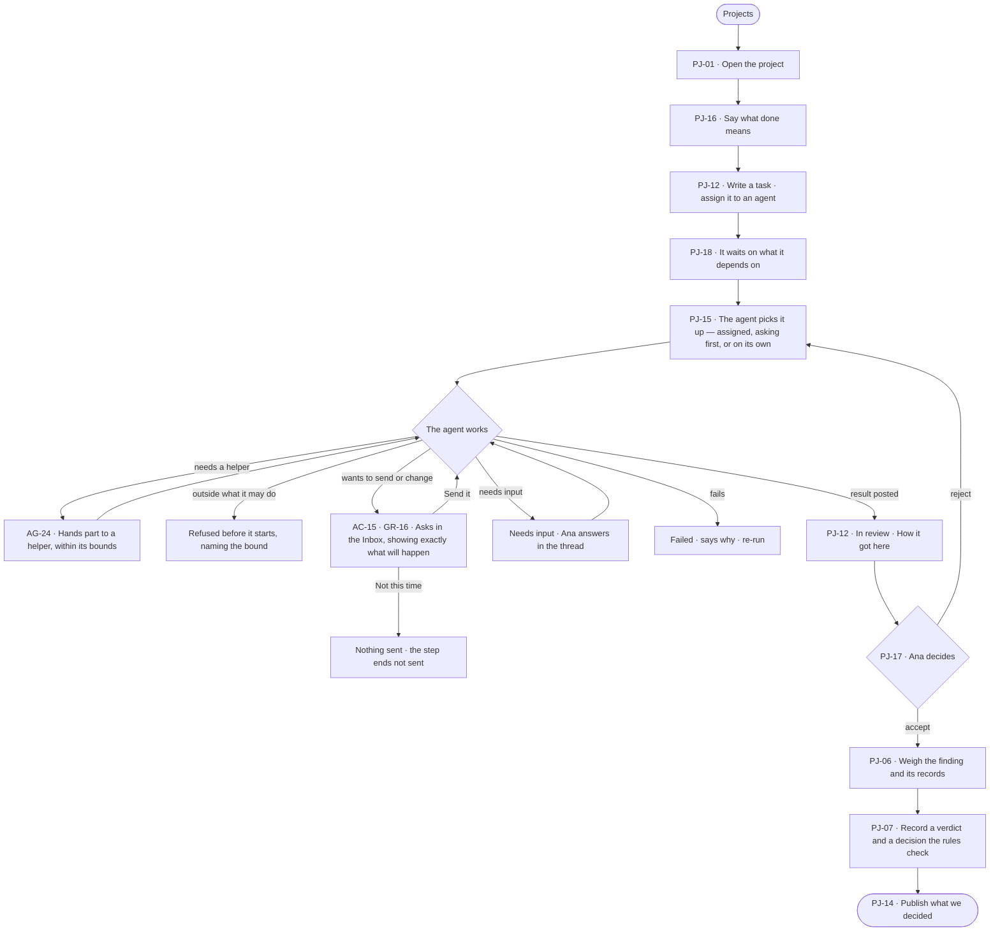

# Give an agent work and decide on the result

> **Ana**, a decision maker, hands a piece of her inquiry to an agent and wants to decide on what it brings back —
> never to find it acted without her.

## The journey

## Steps

| # | Step | Product · surface | Story | Board |
|---|---|---|---|---|
| 1 | Open the project | Projects · list | PJ-01 | `projects.list` |
| 2 | Say what done means | Projects · project | PJ-16 | `projects.project` |
| 3 | Write a task and assign it to an agent | Projects · task | PJ-12 · PJ-18 | `projects.task` |
| 4 | The agent picks it up and works, handing parts to helpers | Projects · task thread | PJ-15 · AG-24 | `projects.task.thinking` |
| 5 | Decide what the agent asks before it acts | Graph · Inbox · Needs you | AC-15 · GR-16 | `inbox` |
| 6 | Review the result | Projects · task | PJ-12 · PJ-17 | `projects.task` |
| 7 | Weigh the finding | Projects · finding | PJ-06 | `projects.finding` |
| 8 | Record the decision | Projects · decide | PJ-07 | `projects.decide` |
| 9 | Publish it | Projects · report | PJ-14 | `projects.report` |

## Branches

| When | What happens | Story | Board |
|---|---|---|---|
| It needs permission | The agent asks in the Inbox and waits; *Not this time* sends nothing | AC-15 | `inbox` |
| It fails | The task reads *Failed* with why; a re-run starts it again | PJ-12 | `projects.task` |
| The person has no access | Without *Can work on projects*, Ana reads the project; writing, assigning and deciding name who can | PJ-12 · PJ-07 | `projects.task` |
| Outside what the agent may do | Refused before it starts, naming the bound; nothing is spent | AG-24 | `projects.task.thinking` |
| The agent needs input | The task reads *Needs input*; Ana answers in its thread | PJ-12 | `projects.task.thinking` |

## Done when

- The agent never marks its own task done: Ana accepted its result, and the decision is recorded with its evidence and published.
