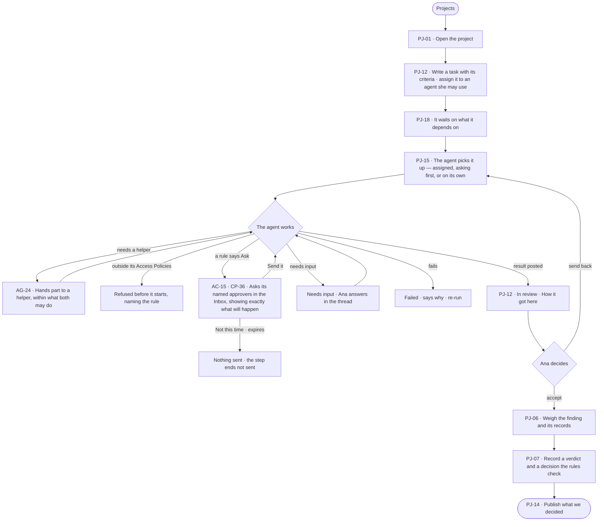

# Give an agent work and decide on the result

> **Ana**, a decision maker, hands a piece of her inquiry to an agent and wants to decide on what it brings back —
> never to find it acted without her.

## The journey

## Steps

| # | Step | Product · surface | Story | Board |
|---|---|---|---|---|
| 1 | Open the project | Evidence · Projects and tasks | PJ-01 | `projects.list` |
| 2 | Write a task with its criteria and assign it to an agent she may use | Evidence · Projects and tasks | PJ-12 · PJ-18 | `projects.task` |
| 3 | The agent picks it up and works, handing parts to helpers | Evidence · Projects and tasks · Agents · Delegation | PJ-15 · AG-24 | `projects.task.thinking` |
| 4 | A named approver decides what the agent asks before it acts | Access Plane · Asks and approvals · Control Plane · Inbox | AC-15 · CP-36 | `inbox` |
| 5 | Review the result: accept or send back | Evidence · Projects and tasks | PJ-12 | `projects.task` |
| 6 | Weigh the finding | Evidence · Branches, findings and decisions | PJ-06 | `projects.finding` |
| 7 | Record the decision | Evidence · Branches, findings and decisions | PJ-07 | `projects.decide` |
| 8 | Publish it | Evidence · Reports | PJ-14 | `projects.report` |

## Branches

| When | What happens | Story | Board |
|---|---|---|---|
| It needs permission | The agent asks its named approvers in the Inbox and waits; *Not this time* sends nothing; unanswered, it reminds, escalates, then expires refused | AC-15 | `inbox` |
| It fails | The task reads *Failed* with why; a re-run starts it again | PJ-12 | `projects.task` |
| The person has no access | An agent she may not use is not offered for the task; acts her role does not hold name the role they need | PJ-12 · PJ-07 | `projects.task` |
| Outside what the agent may do | Refused before it starts, naming the rule; nothing is spent | AG-24 | `projects.task.thinking` |
| The agent needs input | The task reads *Needs input*; Ana answers in its thread | PJ-12 | `projects.task.thinking` |

## Done when

- The agent never marks its own task done: Ana accepted its result, and the decision is recorded with its evidence — citing the runs and steps in the thinking graph behind it — and published.
