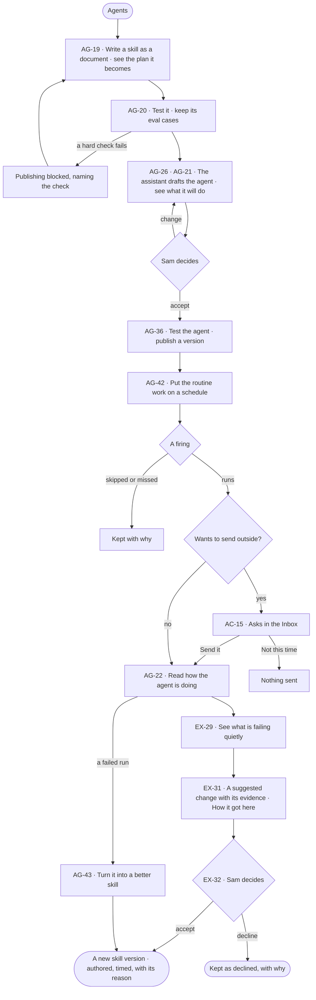

# Build an agent and improve it from what runs teach

> **Sam**, an agent builder, wants routine work done by an agent on a schedule, and wants it to get better from what
> its runs show — through changes a person accepts, never on its own.

## The journey

## Steps

| # | Step | Product · surface | Story | Board |
|---|---|---|---|---|
| 1 | Write a skill and read the plan it becomes | Agents · skill sheet | AG-19 | `agents.skill` |
| 2 | Test it and keep its eval cases | Agents · skill sheet | AG-20 | `agents.skills` |
| 3 | Let the assistant draft the agent; see what it will do | Agents · new agent | AG-26 · AG-21 | `agents.new` |
| 4 | Test the agent and publish a version | Agents · agent sheet | AG-36 | `agents.agent` |
| 5 | Put the work on a schedule | Agents · Schedules | AG-42 | `agents.schedules` |
| 6 | Decide what it asks before sending | Inbox · Needs you | AC-15 | `inbox` |
| 7 | Read how it is doing | Agents · Runs | AG-22 | `agents.runs` |
| 8 | Accept or decline a change its runs suggest | Explore · memory · Agents · run | EX-29 · EX-31 · EX-32 · AG-43 | `agents.run` |

## Branches

| When | What happens | Story | Board |
|---|---|---|---|
| It needs permission | A firing that would send outside asks in the Inbox; *Not this time* sends nothing | AC-15 | `inbox` |
| It fails | A failed run reads why; *Turn it into a better skill* drafts the fix for Sam to accept | AG-43 | `agents.run` |
| The person has no access | Without *Can build agents*, Sam reads every agent and skill; building names who can | AG-21 | `agents.agent` |
| A hard check fails | Publishing the skill is blocked, naming the check | AG-20 | `agents.skills` |
| A firing is missed or skipped | It is kept with why | AG-42 | `agents.schedules` |

## Done when

- The agent runs on its schedule, asks before anything leaves Invana, and every change to its skills is a version a person accepted, with its evidence and *How it got here*.
