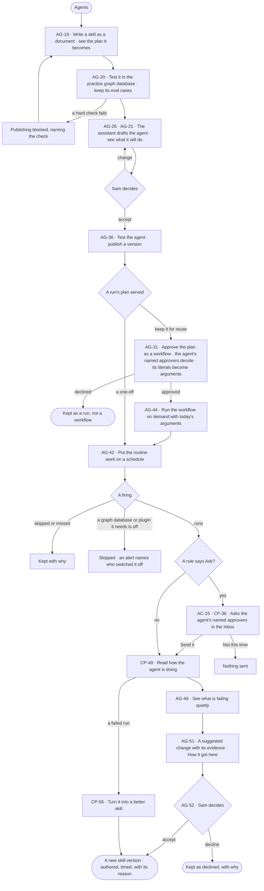

# Build an agent and improve it from what runs teach

> **Sam**, an agent builder, wants routine work done by an agent on a schedule, a plan that served kept as a workflow
> for reuse, and the agent to get better from what its runs show — through changes a person accepts, never on its own.

## The journey

## Steps

| # | Step | Product · surface | Story | Board |
|---|---|---|---|---|
| 1 | Write a skill and read the plan it becomes | Agents · Skills | AG-19 | `agents.skill` |
| 2 | Test it in the practice graph database and keep its eval cases | Agents · Skills · Test an agent and a skill | AG-20 | `agents.skills` |
| 3 | Let the assistant draft the agent; see what it will do | Agents · Build an agent | AG-26 · AG-21 | `agents.new` |
| 4 | Test the agent and publish a version | Agents · Build an agent · Test an agent and a skill | AG-36 | `agents.agent` |
| 5 | Approve a plan that served as a workflow | Agents · Plans and workflows | AG-31 | `agents.run` |
| 6 | Run the workflow on demand with today's arguments | Agents · Plans and workflows | AG-44 | `agents.run` |
| 7 | Put the work on a schedule | Agents · Schedules | AG-42 | `agents.schedules` |
| 8 | A named approver decides what it asks before sending | Access Plane · Asks and approvals · Control Plane · Inbox | AC-15 · CP-36 | `inbox` |
| 9 | Read how it is doing | Control Plane · Runs | CP-49 | `agents.runs` |
| 10 | Accept or decline a change its runs suggest | Agents · Thinking graph and memory · Control Plane · Runs | AG-49 · AG-51 · AG-52 · CP-56 | `agents.run` |

## Branches

| When | What happens | Story | Board |
|---|---|---|---|
| It needs permission | A firing that would send outside asks the agent's named approvers in the Inbox; *Not this time* sends nothing. Approving a plan as a workflow is theirs too; Sam, who asked, becomes its first owner | AC-15 · AG-31 | `inbox` |
| It fails | A failed run reads why; *Turn it into a better skill* drafts the fix for Sam to accept | CP-56 | `agents.run` |
| The person has no access | Without the role building needs, Sam reads every agent, skill and workflow; building names the role it needs | AG-21 | `agents.agent` |
| A hard check fails | Publishing the skill is blocked, naming the check | AG-20 | `agents.skills` |
| A firing is missed or skipped | It is kept with why; one that needs a switched-off graph database or plugin also raises an alert | AG-42 | `agents.schedules` |
| A workflow changes | A change is a new version; runs keep the version they started on | AG-31 | `agents.run` |

## Done when

- The agent runs on its schedule, asks before anything leaves Invana, a plan that served is a workflow its named approvers approved, and every change to its skills is a version a person accepted, with its evidence and *How it got here*.
