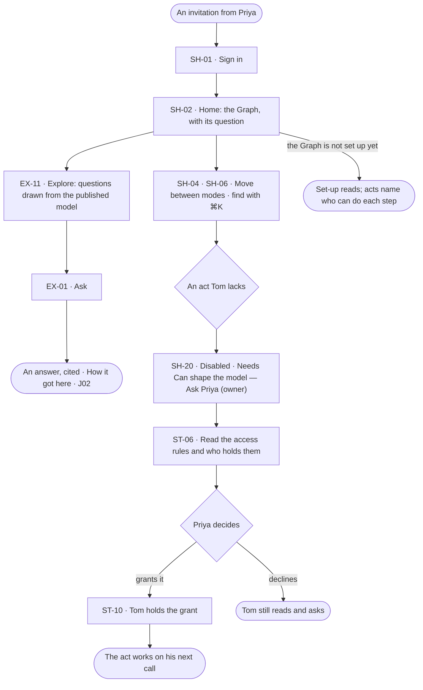

# Join a Graph someone set up

> **Tom**, an analyst, is invited to a Graph Priya set up; he wants to ask it straight away and, when he reaches
> something he cannot change, to know whom to ask.

## The journey

## Steps

| # | Step | Product · surface | Story | Board |
|---|---|---|---|---|
| 1 | Sign in from the invitation | Shell · sign in | SH-01 | `start.signin` |
| 2 | Open the Graph from Home | Shell · Home | SH-02 | `start.home` |
| 3 | See what asking opens and the suggested questions | Explore · empty board | EX-11 | `explore.ask` |
| 4 | Ask | Explore · board | EX-01 | `explore.board` |
| 5 | Move between modes; find with ⌘K | Shell · leftNav · ⌘K | SH-04 · SH-06 | `shell.command` |
| 6 | Reach an act he lacks; see who can | Model · read only | SH-20 | `model.board` |
| 7 | Read the access rules and who holds them | Settings › People and access | ST-06 | `shell.locked` |
| 8 | Priya grants it | Settings › People and access | ST-10 | `settings.access` |

## Branches

| When | What happens | Story | Board |
|---|---|---|---|
| It needs permission | Tom's ask reaches Priya; she grants or declines | ST-10 | `settings.access` |
| It fails | Home names what it could not read and offers *Try again* | SH-02 | `start.home` |
| The person has no access | Every surface reads; each act he lacks names its role and who holds it | SH-20 · ST-06 | `shell.locked` |
| The Graph is not set up yet | Set-up reads, and each step names who can do it | SH-03 | `start.home` |

## Done when

- Tom has asked his first question within one click of signing in, and every act he cannot take names whom to ask.
