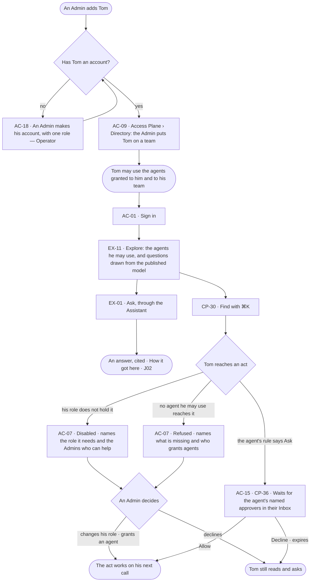

# Join a team

> **Tom**, an analyst, joins a team on a deployment someone else readied; he wants to ask straight away through the
> agents his team may use and, when he reaches something he cannot do, to know who can.

## The journey

## Steps

| # | Step | Product · surface | Story | Board |
|---|---|---|---|---|
| 0 | An Admin makes Tom's account with one role | Access Plane · Directory · `invana users create` | AC-18 | — |
| 1 | An Admin puts Tom on a team; the team holds the agents it may use | Access Plane · Directory | AC-09 | `settings.access` |
| 2 | Sign in | Access Plane · Sign in, account and sessions | AC-01 | `access.signin` |
| 3 | See the agents he may use and the suggested questions | Evidence · Ask a question | EX-11 | `explore.ask` |
| 4 | Ask | Evidence · Ask a question | EX-01 | `explore.board` |
| 5 | Find with ⌘K | Control Plane · Find your way | CP-30 | `shell.command` |
| 6 | Reach an act his role lacks; see the role it needs and who can | Access Plane · Access Policies | AC-07 | `access.locked` |
| 7 | An act set to Ask waits for the agent's named approvers | Access Plane · Asks and approvals · Control Plane · Inbox | AC-15 · CP-36 | `inbox` |

## Branches

| When | What happens | Story | Board |
|---|---|---|---|
| Tom has no account | An Admin makes it first; putting him on a team before then is refused in place | AC-18 · AC-09 | `settings.access` |
| It needs permission | An act an agent's rule sets to Ask waits for its named approvers; unanswered, it reminds, goes to the agent's owners and the Admins, then expires refused | AC-15 · CP-36 | `inbox` |
| It fails | Explore names what it could not read and offers *Try again* | EX-11 | `explore.ask` |
| The person has no access | Every surface his role reaches reads; each act it does not hold names the role it needs and the Admins | AC-07 | `access.locked` |
| No agent he may use reaches it | Refused, naming what is missing and who grants agents; nothing runs | AC-07 | `access.locked` |
| A rule names a team he is not on | That rule does not apply to his runs; the refusal names it | AC-07 | `access.locked` |

## Done when

- Tom has asked his first question within one click of signing in, through an agent his team may use, and every act he cannot take names the role it needs or the approver who decides.
