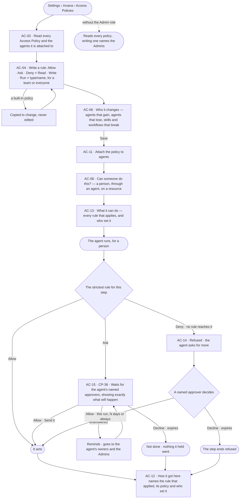
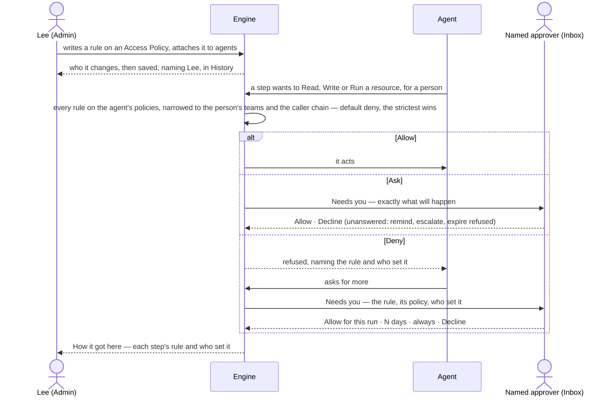

# Set what an agent may touch

> **Lee**, an Admin, decides with Access Policies what an agent may Read, Write and Run on its own, what it must ask
> about and what it is denied — and wants every run to show which rule applied and who set it.

## The journey

## Steps

| # | Step | Product · surface | Story | Board |
|---|---|---|---|---|
| 1 | Read every Access Policy and what it is attached to | Access Plane · Access Policies | AC-03 | `settings.access` |
| 2 | Write a rule — effect, verb, resource, and a team when it holds for one | Access Plane · Access Policies | AC-04 | `settings.access` |
| 3 | See who it changes before saving | Access Plane · Access Policies | AC-06 | `settings.access` |
| 4 | Attach the policy to agents | Access Plane · Access Policies | AC-11 | `settings.access` |
| 5 | Check whether a person, through an agent, may do something | Access Plane · Access Policies | AC-08 | `settings.access` |
| 6 | Read what an agent can do, every rule at once | Access Plane · What an agent may touch | AC-13 | `settings.access` |
| 7 | The agent meets Ask; a named approver decides | Access Plane · Asks and approvals · Control Plane · Inbox | AC-15 · CP-36 | `inbox` |
| 8 | The agent meets Deny and asks for more | Access Plane · What an agent may touch | AC-14 | `inbox` · `agents.run` |
| 9 | Read which rule applied and who set it | Control Plane · Runs › How it got here | AC-12 · AC-14 | `agents.run` |

## Branches

| When | What happens | Story | Board |
|---|---|---|---|
| It needs permission | Ask waits for the agent's named approvers — never the person it benefits; Deny refuses and the agent asks for more | AC-15 · AC-14 | `inbox` |
| It fails | A rule naming a resource that does not exist, or a built-in policy edited in place, is refused, naming why | AC-04 | `settings.access` |
| The person has no access | Every policy and rule reads; writing, attaching and deciding name the Admins or the named approvers | AC-03 · AC-13 | `settings.access` |
| Nobody decides the ask | It reminds, goes to the agent's owners and the Admins, then expires refused; the step ends not done, and *How it got here* says so | AC-15 · AC-14 | `inbox` |
| A rule names a team | It applies only to runs whose person is on that team | AC-04 · AC-12 | `settings.access` |
| The agent delegates | The helper runs with what both agents may do and what the person's teams allow, never more | AC-13 | `settings.access` |

## Done when

- Every step of the agent's run names in *How it got here* the rule that applied, its Access Policy and who set it, and nothing a rule set to Ask went without a named approver's yes.
