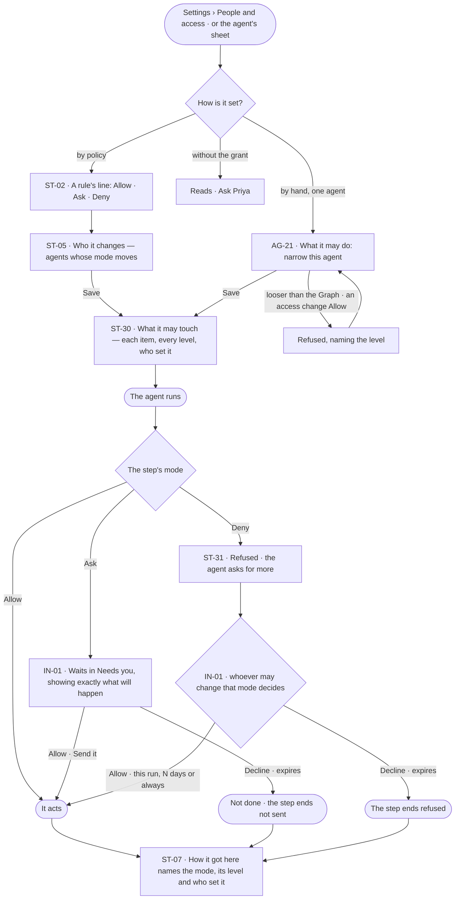
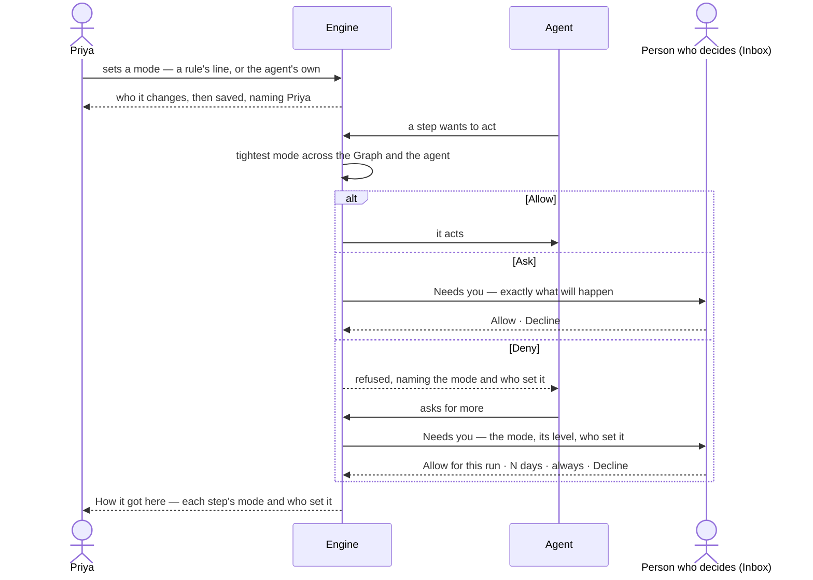

# Set what an agent may touch

> **Priya**, a Graph owner, decides what an agent may do on its own, what it must ask about, and what it is denied
> — and wants every run to show which of those applied and who set it.

## The journey

## Steps

| # | Step | Product · surface | Story | Board |
|---|---|---|---|---|
| 1 | Set a mode by policy on a rule's line | Settings · People and access | ST-02 | `settings.access` |
| 2 | See who it changes before saving | Settings · People and access | ST-05 | `settings.access` |
| 3 | Narrow one agent by hand | Agents · the agent's sheet | AG-21 | `agents.agent` |
| 4 | Read what the agent may touch, every level at once | Settings · People and access › Agents | ST-30 | `settings.access` |
| 5 | The agent hits Ask and asks | Inbox · Needs you | IN-01 | `inbox` |
| 6 | The agent hits Deny and asks for more | Inbox · Needs you · the run | ST-31 | `inbox` · `agents.run` |
| 7 | Read which mode applied and who set it | The run · How it got here | ST-07 · ST-31 | `agents.run` |

## Branches

| When | What happens | Story | Board |
|---|---|---|---|
| It needs permission | Ask waits in Needs you; Deny refuses and the agent asks for more | IN-01 · ST-31 | `inbox` |
| It fails | A mode looser than the Graph, or an access change set to Allow, is refused in place, naming the level | AG-21 · ST-02 | `agents.agent` · `settings.access` |
| The person has no access | Every mode reads; setting one is shown as *Ask Priya*, naming who can | ST-30 · AG-21 | `settings.access` · `agents.agent` |
| Nobody decides the ask | It expires; the step ends not done, and *How it got here* says so | IN-01 · ST-31 | `inbox` |

## Done when

- Every step of the agent's run names in *How it got here* the mode that applied, its level and who set it, and nothing set to Ask went without a person's yes.
