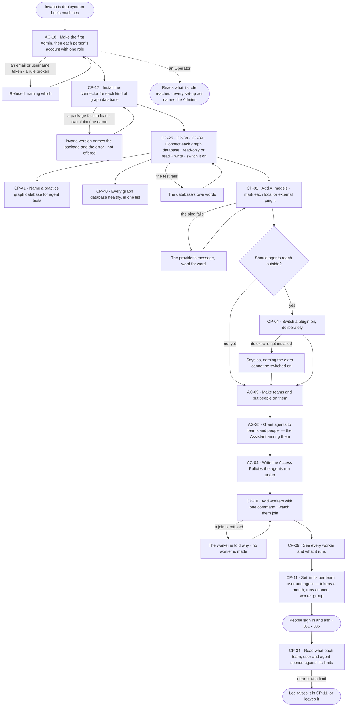

# Ready a deployment

> **Lee**, an Admin, has just deployed Invana; Lee wants every person to sign in, ask and run agents on the first
> day — on the graph databases, AI models, plugins and workers the deployment chose, through the agents each team may
> use, inside the Access Policies and limits Lee set.

## The journey

## Steps

| # | Step | Product · surface | Story | Board |
|---|---|---|---|---|
| 1 | Make the first Admin and each person's account, with one role | Access Plane · Directory · `invana users create` | AC-18 | — |
| 2 | Install the connector package for each kind of graph database; read it in `invana version` | Control Plane · Graph databases · the engine's machine | CP-17 | — |
| 3 | Connect each graph database, set its mode, switch it on and name a practice one | Control Plane · Graph databases | CP-25 · CP-38 · CP-39 · CP-41 | `settings.databases.connect` · `settings.databases.database` |
| 4 | Add AI models, each marked local or external | Control Plane · AI models | CP-01 | `settings.ai` |
| 5 | Switch on the plugins agents may use | Control Plane · Plugins and MCP | CP-04 | — |
| 6 | Make teams and put people on them | Access Plane · Directory | AC-09 | `settings.access` |
| 7 | Grant agents to teams and people | Agents · The agents catalogue | AG-35 | — |
| 8 | Write the Access Policies and attach them to agents | Access Plane · Access Policies | AC-04 | `settings.access` |
| 9 | Add workers on Lee's own machines and watch them join | Control Plane · Workers and the queue | CP-10 | `settings.workers` |
| 10 | See every worker and where steps wait | Control Plane · Workers and the queue | CP-09 | `settings.workers` |
| 11 | Set limits per team, user and agent | Control Plane · Limits | CP-11 | `settings.usage` |
| 12 | Read what each spends against its limits | Control Plane · Limits | CP-34 | `settings.usage` |

## Branches

| When | What happens | Story | Board |
|---|---|---|---|
| It needs permission | Every set-up act is an Admin's; a person near a limit reads that an Admin sets it, and Lee raises it | CP-34 · CP-11 | `settings.usage` |
| It fails | A failed connection test names the database's error; a failed ping shows the provider's message word for word; a refused join tells the worker why; a connector that fails to load is listed as failed, naming the package | CP-25 · CP-01 · CP-10 · CP-17 | `settings.databases.connect` · `settings.ai` · `settings.workers` |
| The person has no access | An Operator reads AI models, plugins, workers and graph databases; every act is disabled, naming the Admins; secrets never show | CP-01 · CP-04 · CP-09 · CP-10 · CP-40 | `settings.ai` · `settings.workers` |
| A connector is not installed | Its kind of graph database cannot be connected; the step names the package that adds it | CP-17 | — |
| A graph database or plugin stays off | Work that needs it is refused before it starts, naming who switched it off | CP-39 · CP-04 | — |
| No agent is granted | A person who signs in can read but not ask; asking names the Admins who grant agents | AG-35 | — |

## Done when

- Every person who needs Invana has an account with one role, and no account has a default password.
- Every graph database is connected in the mode Lee chose and switched on, an AI model answers, every team holds the agents it needs under Access Policies Lee wrote, workers take every step, and each team, user and agent runs inside the limits Lee set.
