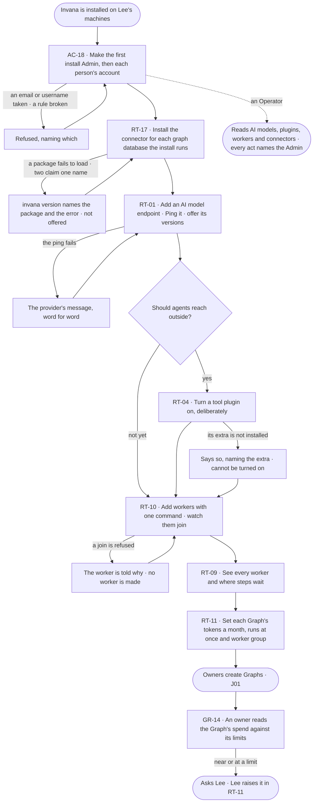

# Ready an install for its Graphs

> **Lee**, an install admin, has just installed Invana; Lee wants every Graph owner to connect, ask and run agents
> on the first day — on the databases, AI models, tools and workers the install chose, inside each Graph's limits.

## The journey

## Steps

| # | Step | Product · surface | Story | Board |
|---|---|---|---|---|
| 1 | Make the first install Admin and each person's account | Access · `invana users create` | AC-18 | — |
| 2 | Install the connector package for each graph database; read it in `invana version` | Runtime · the engine's machine · `invana version` | RT-17 | — |
| 3 | Add an AI model endpoint, ping it, offer its versions | Runtime · Settings › AI models | RT-01 | `settings.ai` |
| 4 | Turn on the tool plugins agents may use | Runtime · Settings › Plugins | RT-04 | — |
| 5 | Add workers on Lee's own machines and watch them join | Runtime · Settings › Workers · Add workers | RT-10 | `settings.workers` |
| 6 | See every worker and where steps wait | Runtime · Settings › Workers | RT-09 | `settings.workers` |
| 7 | Set each Graph's limits | Runtime · Settings › Usage and limits | RT-11 | `settings.usage` |
| 8 | An owner reads what the Graph spends against them | Graph · Settings › Usage | GR-14 | `settings.usage` |

## Branches

| When | What happens | Story | Board |
|---|---|---|---|
| It needs permission | An owner near a limit cannot raise it; the page says limits are set by an Admin, and Lee raises it | GR-14 · RT-11 | `settings.usage` |
| It fails | A failed ping shows the provider's message word for word; a refused join tells the worker why; a connector that fails to load is listed as failed, naming the package | RT-01 · RT-10 · RT-17 | `settings.ai` · `settings.workers` |
| The person has no access | An Operator reads AI models, plugins, workers and connectors; every act is disabled, naming the Admin; keys never show | RT-01 · RT-04 · RT-09 · RT-10 | `settings.ai` · `settings.workers` |
| A connector is not installed | No Graph is offered it; the connect step names the package that would add it | RT-17 | — |
| A tool plugin stays off | A step that calls it is refused, saying the plugin is off and who can turn it on | RT-04 | — |

## Done when

- Every person who needs Invana has an account, and no account has a default password.
- A Graph owner creating a Graph is offered only installed connectors, an AI model answers the first question, workers take every step, and each Graph runs inside the limits Lee set.
