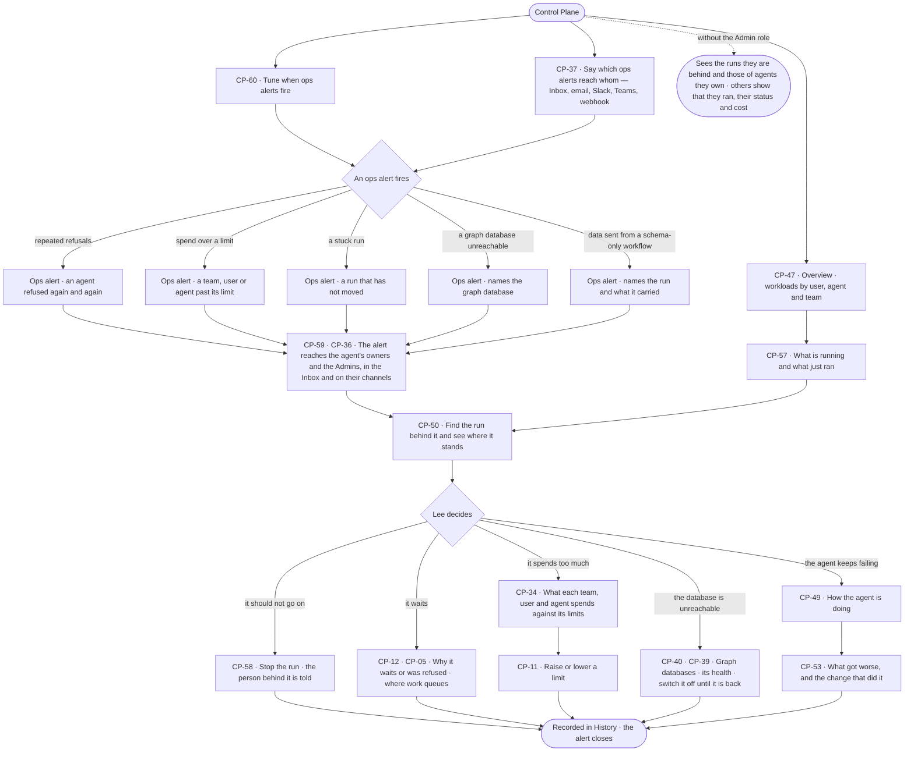

# Watch agent workloads and act on an alert

> **Lee**, an Admin, wants to see what every agent is doing across the deployment — by user, agent and team — and,
> when something goes wrong, to be told, find the run behind it and act before it costs more.

## The journey

## Steps

| # | Step | Product · surface | Story | Board |
|---|---|---|---|---|
| 1 | Read workloads by user, agent and team | Control Plane · Overview | CP-47 | `control.overview` |
| 2 | Say which ops alerts reach whom, and on which channels | Control Plane · Inbox and notifications | CP-37 | `inbox` |
| 3 | An ops alert fires and reaches the agent's owners and the Admins | Control Plane · Ops alerting · Inbox | CP-59 · CP-36 | `control.alerts` · `inbox` |
| 4 | See what is running and what just ran | Control Plane · Runs | CP-57 | `agents.runs` |
| 5 | Find the run behind the alert | Control Plane · Runs | CP-50 | `agents.run` |
| 6 | Stop the run | Control Plane · Runs | CP-58 | `agents.run` |
| 7 | See why a run waits or was refused, and where work queues | Control Plane · Limits · Workers and the queue | CP-12 · CP-05 | `settings.workers` |
| 8 | Read spend against limits; raise or lower one | Control Plane · Limits | CP-34 · CP-11 | `settings.usage` |
| 9 | Read a graph database's health; switch it off | Control Plane · Graph databases | CP-40 · CP-39 | `settings.databases` |
| 10 | Read how the agent is doing and what got worse | Control Plane · Runs | CP-49 · CP-53 | `agents.runs` |

## Branches

| When | What happens | Story | Board |
|---|---|---|---|
| It needs permission | Stopping a run is for the person behind it, the agent's owners and the Admins; changing a limit or switching a graph database off is an Admin's | CP-58 · CP-11 | `agents.run` · `settings.usage` |
| It fails | A run that cannot be stopped in time says what it finished; an unreachable graph database is named, and its runs are refused before they start | CP-58 · CP-59 | `agents.run` |
| The person has no access | An Operator sees the runs they are behind and those of agents they own; any other run shows only that it ran, its status and its tokens | CP-57 · CP-50 | `agents.runs` |
| A graph database is switched off | Schedules that need it skip the firing and raise an alert; workflows that depend on it are flagged and their runs refused, naming who switched it off | CP-39 · CP-59 | `settings.databases` · `control.alerts` |
| No channel is set | The alert still waits in the Inbox | CP-36 | `inbox` |

## Done when

- Every ops alert reaches the agent's owners and the Admins, opens the run behind it, and the act taken on it — a stop, a limit, a switch — is a row in History.
