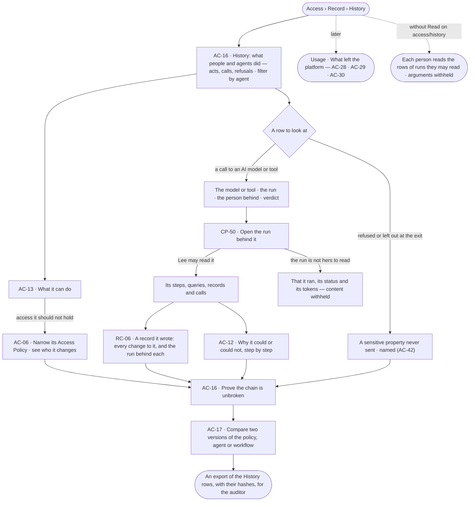

# Audit what an agent touched and what left the platform

> **Lee**, an Admin, must answer an auditor: what has this agent read, written and run, for whom — and what went to
> which AI model or tool, carrying what — with proof nobody altered the record. *Access › Record* is History: every
> act, call and refusal is a row there. Usage and *What left the platform* as pages of their own (AC-28 · AC-29 ·
> AC-30) are `later`; the dotted steps below are theirs.

## The journey

## Steps

| # | Step | Product · surface | Story | Board |
|---|---|---|---|---|
| 1 | Read what the agent did — its acts, calls and refusals, for whom | Access Plane · History | AC-16 | `settings.history` |
| 2 | Read what it can do | Access Plane · What an agent may touch | AC-13 | `settings.agent_access` |
| 3 | Narrow access it should not hold, seeing who it changes | Access Plane · Access Policies | AC-06 | `settings.policies` |
| 4 | Open the run behind a call | Control Plane · Runs | CP-50 | `agents.runs · Detail` |
| 5 | Open a record the agent wrote and every change to it | Intelligence · Provenance | RC-06 | `data.records · Detail` |
| 6 | Read why each step could or could not act | Access Plane · What an agent may touch | AC-12 | `agents.runs · Detail` |
| 7 | Prove the History chain is unbroken | Access Plane · History | AC-16 | `settings.history` |
| 8 | Compare two versions of what changed | Access Plane · History | AC-17 | `settings.history` |
| later | Usage beside access, access never used, every call that left as its own page | Access Plane · Access usage · What left the platform | AC-28 · AC-29 · AC-30 | — |

## Branches

| When | What happens | Story | Board |
|---|---|---|---|
| It needs permission | Run content is readable by the person behind it and, for a project's run, by anyone whose default agent may see its sources — a permission alone adds nothing; everyone else sees that it ran, its status and its tokens | CP-50 | `agents.runs · Detail` |
| It fails | A History chain that does not verify names the first row that breaks it | AC-16 | `settings.history` |
| The person has no access | An Operator or a Modeller reads the History rows of runs they may read, arguments withheld; only an Admin reads every row | AC-16 | `settings.history` |
| A sensitive property met an external model | The call was refused before it left, naming the property; the refusal is a History row | AC-16 | `settings.history` |
| A schema-only workflow sent data | An ops alert names the run and what it carried | — | — |

## Done when

- For one agent, Lee can show the auditor, from History, every act, every call that left the platform and every refusal, and the run and person behind each — and History proves none of it was altered.
