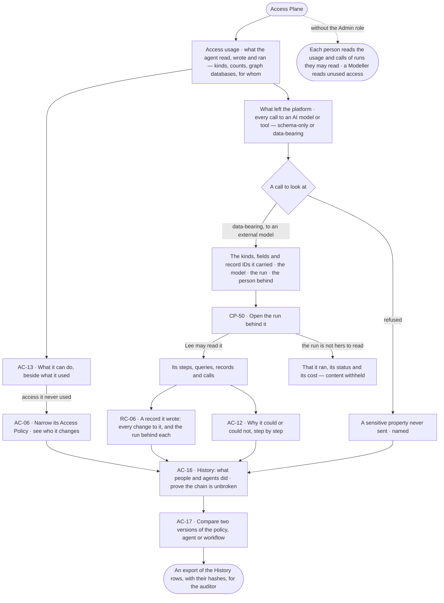

# Audit what an agent touched and what left the platform

> **Lee**, an Admin, must answer an auditor: what has this agent read, written and run, for whom — and what went to
> which AI model or tool, carrying what — with proof nobody altered the record.

## The journey

## Steps

| # | Step | Product · surface | Story | Board |
|---|---|---|---|---|
| 1 | Read what the agent read, wrote and ran, for whom | Access Plane · Access usage | — | — |
| 2 | Compare what it can do with what it used | Access Plane · What an agent may touch | AC-13 | `settings.access` |
| 3 | Narrow access it never used, seeing who it changes | Access Plane · Access Policies | AC-06 | `settings.access` |
| 4 | Read every call to an AI model or tool, schema-only or data-bearing | Access Plane · What left the platform | — | — |
| 5 | Open the run behind a call | Control Plane · Runs | CP-50 | `agents.run` |
| 6 | Open a record the agent wrote and every change to it | Intelligence · Provenance | RC-06 | `data.record` |
| 7 | Read why each step could or could not act | Access Plane · What an agent may touch | AC-12 | `agents.run` |
| 8 | Prove the History chain is unbroken | Access Plane · History | AC-16 | `settings.access` |
| 9 | Compare two versions of what changed | Access Plane · History | AC-17 | `settings.access` |

## Branches

| When | What happens | Story | Board |
|---|---|---|---|
| It needs permission | Run content is readable by the person behind it and, for a project's run, by anyone whose default agent may see its sources — a role adds nothing; everyone else sees that it ran, its status and its tokens | CP-50 | `agents.run` |
| It fails | A History chain that does not verify names the first row that breaks it | AC-16 | `settings.access` |
| The person has no access | An Operator or a Modeller reads the usage and calls of runs they may read; only an Admin reads every run's | AC-13 | `settings.access` |
| A sensitive property met an external model | The call was refused before it left, naming the property; the refusal is in the ledger and History | — | — |
| A schema-only workflow sent data | An ops alert names the run and what it carried | — | — |

## Done when

- For one agent, Lee can show the auditor every read, write and run, every call that left the platform with what it carried, and the run and person behind each — and History proves none of it was altered.
