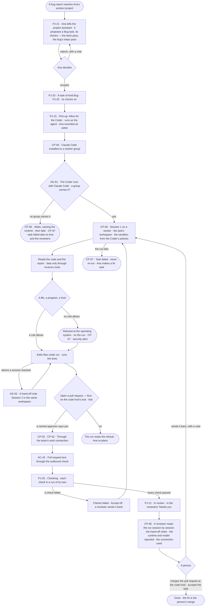
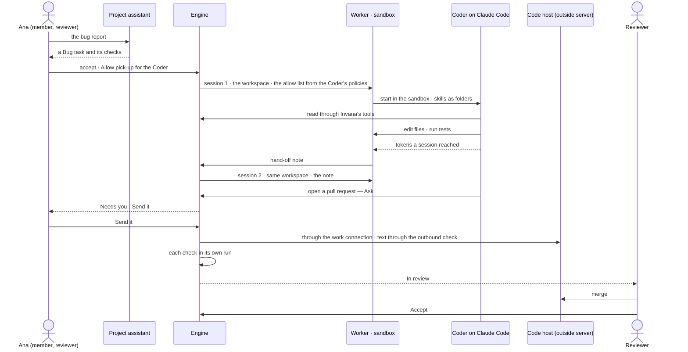

# Fix a reported bug with an agent

> **Ana**, an agent builder, gets a bug report on her team's product. She hands it to the project's assistant, which
> turns it into a task with its checks; a coding agent that runs with Claude Code picks it up on a worker, inside the
> sandbox its Access Policies set, and opens a pull request through the team's code host — and a person merges it.
> **Lee**, an Admin, installed the runtime and owns nothing on the way: every slot has a fallback.

## The journey

## Steps

| # | Step | Product · surface | Story | Board |
|---|---|---|---|---|
| 1 | Hand the bug report to the project assistant; accept the task and its checks | Projects · the project assistant | [PJ-21](../capabilities/projects/features/PJ-F01-projects-and-tasks/stories/PJ-21-ideate-with-the-project-assistant/story.md) · [PJ-20](../capabilities/projects/features/PJ-F01-projects-and-tasks/stories/PJ-20-give-a-project-its-kinds-of-task/story.md) · [PJ-25](../capabilities/projects/features/PJ-F01-projects-and-tasks/stories/PJ-25-gate-a-task-on-its-checks/story.md) | `projects.assistant` |
| 2 | Let the Coder pick it up | Projects · a project › Pick-up | [PJ-15](../capabilities/projects/features/PJ-F01-projects-and-tasks/stories/PJ-15-let-agents-pick-up-tasks-by-hand-by-asking-or-on-their-own/story.md) | `projects.task` |
| 3 | The Coder runs with Claude Code, installed on a worker group | Agents · an agent › Setup · Settings › Plugins | [AG-61](../capabilities/agents/features/AG-F01-build-an-agent/stories/AG-61-choose-what-an-agent-runs-with/story.md) · [CP-64](../os/control/features/CP-F02-plugins-and-outside-tools/stories/CP-64-install-an-agent-runtime/story.md) | `agents.agent` · `settings.plugins` |
| 4 | It works on a worker, in the task's workspace, inside the sandbox | Control Plane · Workers · a run | [CP-65](../os/control/features/CP-F03-workers-and-the-queue/stories/CP-65-run-an-outside-runtime-safely-on-a-worker/story.md) | `settings.workers` · `agents.run` |
| 5 | It continues in a fresh session from a hand-off note | Control Plane · a run | [AG-62](../capabilities/agents/features/AG-F05-delegation-and-outside-agents/stories/AG-62-continue-in-a-fresh-session-from-a-hand-off-note/story.md) | `agents.run` |
| 6 | It opens a pull request through the team's work connection; its text passes the outbound check | Control Plane · Plugins · Inbox | [CP-02](../os/control/features/CP-F02-plugins-and-outside-tools/stories/CP-02-add-an-outside-mcp-server-and-let-agents-call-its-tools/story.md) · [CP-62](../os/control/features/CP-F02-plugins-and-outside-tools/stories/CP-62-make-a-work-connection-and-attach-it-to-agents/story.md) · [AC-42](../os/access/features/AC-F09-what-left-the-platform/stories/AC-42-stop-sensitive-data-at-every-exit/story.md) | `inbox` · `agents.run` |
| 7 | Its checks run, each in a run of its own | Projects · a task | [PJ-25](../capabilities/projects/features/PJ-F01-projects-and-tasks/stories/PJ-25-gate-a-task-on-its-checks/story.md) | `projects.task` |
| 8 | A reviewer reads the run session by session | Control Plane · a run › Sessions | [CP-66](../os/control/features/CP-F10-runs-and-how-the-agents-are-doing/stories/CP-66-read-a-run-session-by-session-with-its-hand-off-notes/story.md) | `agents.run` |
| 9 | A person merges the pull request at the code host and accepts the task | Inbox › Needs you · a task | [PJ-12](../capabilities/projects/features/PJ-F01-projects-and-tasks/stories/PJ-12-write-a-task-hand-it-on-and-accept-the-result/story.md) | `inbox` · `projects.task` |

## Branches

| When | What happens | Story | Board |
|---|---|---|---|
| No worker group carries Claude Code | The session waits, naming the runtime, then the task fails and a task failed alert reaches Ana and the reviewers | CP-65.3 · CP-67 | `agents.run` · `control.alerts` |
| The Coder touches a file, program or host no rule allows | The sandbox refuses it at the operating system; the run names the rule and a security alert reaches the Coder's named approvers and the Admins | CP-65.6 · CP-67 | `agents.run` · `control.alerts` |
| The pull request is an Ask and the approver says no | The step is refused, named on the run; nothing leaves | CP-02 · AC-42 | `inbox` · `agents.run` |
| The pull-request text carries a confidential value | It leaves without it, naming what was left out | AC-42.5 | `agents.run` |
| The work connection to the code host cannot sign in | The session fails, naming the connection; a connection failed alert reaches the Coder's named approvers and the Admins | CP-65.9 · CP-67 | `control.alerts` |
| A check fails | *Checks failed* · *Accept* off · a reviewer sends it back; the next result runs every check again | PJ-25 | `projects.task` |
| The run fails | The task closes *Failed* and is never re-run; Ana makes a fix task from it | CP-65.12 · CP-67 | `projects.task` · `control.alerts` |
| A reviewer's agent may not read a source a hand-off note cites | The note reads *Withheld*, naming the resource | CP-66 | `agents.run` |
| No reviewer is left | The successor reviews, with an alert | PJ-22 | `projects.task` |

## Done when

- The Bug task is *Done*: every check passed in a run of its own, the run reads session by session with its hand-off
  notes, runtime, model reported and connection used, the pull request left through the outbound check, and a person —
  never the agent — merged it and accepted the task.
</content>
</invoke>
<invoke name="TaskUpdate">
<parameter name="taskId">3</parameter>
<parameter name="status">completed</parameter>
</invoke>
<invoke name="TaskUpdate">
<parameter name="taskId">5</parameter>
<parameter name="status">in_progress</parameter>
</invoke>
