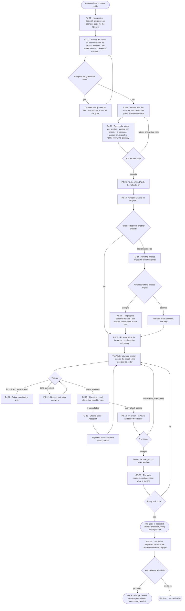
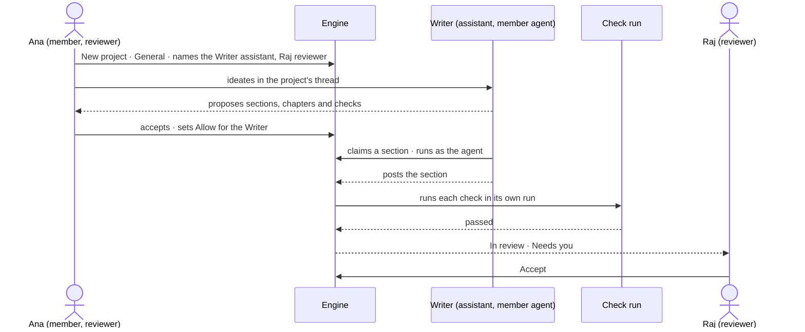

# Ideate and run a project with its assistant

> **Ana**, an agent builder, needs an operator guide written for a new release. She starts a General docs project,
> shapes the work with its assistant, lets a writing agent pick up the tasks, and accepts each section only once its
> checks passed — while **Raj**, a reviewer, accepts what she does not.

## The journey

## Steps

| # | Step | Product · surface | Story | Board |
|---|---|---|---|---|
| 1 | Start a General project with the guide as its purpose | Projects · New project | [PJ-02](../capabilities/projects/features/PJ-F01-projects-and-tasks/stories/PJ-02-start-a-project-of-its-type/story.md) | `projects.new` |
| 2 | Name the assistant, a second reviewer and the member agents | Projects · a project › People | [PJ-22](../capabilities/projects/features/PJ-F01-projects-and-tasks/stories/PJ-22-name-the-project-assistant-and-its-reviewers/story.md) | `projects.project` |
| 3 | Ideate: who reads it, what done means | Projects · the project assistant | [PJ-21](../capabilities/projects/features/PJ-F01-projects-and-tasks/stories/PJ-21-ideate-with-the-project-assistant/story.md) | `projects.assistant` |
| 4 | Accept the proposed sections, chapters and checks | Projects · the project assistant · Inbox | [PJ-21](../capabilities/projects/features/PJ-F01-projects-and-tasks/stories/PJ-21-ideate-with-the-project-assistant/story.md) · [PJ-20](../capabilities/projects/features/PJ-F01-projects-and-tasks/stories/PJ-20-give-a-project-its-kinds-of-task/story.md) | `projects.assistant` · `inbox` |
| 5 | Chapter 2 waits on chapter 1 | Projects · a project › Order | [PJ-18](../capabilities/projects/features/PJ-F01-projects-and-tasks/stories/PJ-18-order-tasks-by-what-they-wait-on/story.md) | `projects.project` |
| 6 | Ask the release project for its change list | Projects · Ask another project | [PJ-24](../capabilities/projects/features/PJ-F01-projects-and-tasks/stories/PJ-24-ask-another-project-for-help/story.md) · [PJ-23](../capabilities/projects/features/PJ-F01-projects-and-tasks/stories/PJ-23-relate-a-project-to-another-or-start-one-from-it/story.md) | `projects.ask_help` · `projects.project` |
| 7 | Let the Writer pick up sections on its own | Projects · a project › Pick-up | [PJ-15](../capabilities/projects/features/PJ-F01-projects-and-tasks/stories/PJ-15-let-agents-pick-up-tasks-by-hand-by-asking-or-on-their-own/story.md) | `projects.project` |
| 8 | A section is written and checked in runs of their own | Projects · a task | [PJ-12](../capabilities/projects/features/PJ-F01-projects-and-tasks/stories/PJ-12-write-a-task-hand-it-on-and-accept-the-result/story.md) · [PJ-25](../capabilities/projects/features/PJ-F01-projects-and-tasks/stories/PJ-25-gate-a-task-on-its-checks/story.md) | `projects.task` · `projects.task.thinking` |
| 9 | A reviewer accepts each section | Inbox › Needs you · a task | [PJ-12](../capabilities/projects/features/PJ-F01-projects-and-tasks/stories/PJ-12-write-a-task-hand-it-on-and-accept-the-result/story.md) | `inbox` · `projects.task` |
| 10 | See where the guide stands | Projects · a project › Map | [GP-08](../os/graph/features/GP-F02-memory/stories/GP-08-see-a-project-as-a-map-and-what-is-moving-on-it/story.md) | `graph.memory.project_map` |
| 11 | What the Writer learned is promoted for every writing agent | Memory › Org knowledge | [GP-09](../os/graph/features/GP-F02-memory/stories/GP-09-promote-a-learning-to-org-knowledge/story.md) | `graph.memory.org_knowledge` |

## Branches

| When | What happens | Story | Board |
|---|---|---|---|
| An agent is not granted to Ana | It is disabled in the pickers — *Not granted to you*; an Admin grants it | PJ-22.4 | `projects.project` |
| Ana rejects a proposal | It stays in the thread, rejected with her note; the assistant proposes again | PJ-21.6 | `projects.assistant` |
| The release project declines the ask | Her task reads declined, by whom and why | PJ-24.6 | `projects.task` |
| The Writer's policies refuse a read | The task reads *Failed*, naming the rule; the project grants nothing | PJ-12.33 | `projects.task` |
| A check fails | *Checks failed* · *Accept* off · a reviewer sends it back; the next result runs every check again | PJ-25.5 · PJ-25.7 | `projects.task` |
| Raj is not a member and opens a proposal | *Accept* and *Reject* disabled — *Members only* | PJ-21.9 | `projects.assistant` |
| Someone who is not a reviewer opens a section in review | *Accept* and *Send back* disabled — *Reviewers only* | PJ-12.34 | `projects.task` |
| Raj leaves the organisation | Ana reviews alone; with no reviewer left, the successor reviews, with an alert | PJ-22.8 | `projects.project` |
| An Operator opens the Writer's org-knowledge proposal | *Promote* disabled — *Modellers and Admins only* | GP-09.6 | `graph.memory.org_knowledge` |
| A reader's default agent may not Read the project | Its head only, the rest *Withheld* | PJ-01.3 | `projects.project` |

## Done when

- Every section task of the docs project is *Done*, each accepted by a reviewer after every one of its checks passed in
  a run of its own; the map shows every group done; the Writer's learning is promoted or declined by a Modeller or an
  Admin, with who and when in History.
