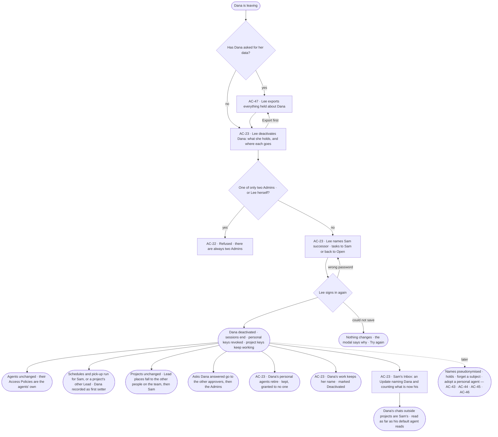

# A person leaves and the team keeps working

> **Lee**, an Admin, deactivates **Dana**, an analyst who is leaving, and names **Sam** her successor. Every agent,
> schedule and project goes on as before; Sam takes what was Dana's; Dana's personal agents retire. Everything is kept
> — retention, holds, pseudonymising names, forgetting a subject and adopting a personal agent are `later` (AC-43 ·
> AC-44 · AC-45 · AC-46); the dotted steps below are theirs.

## The journey

## Steps

| # | Step | Product · surface | Story | Board |
|---|---|---|---|---|
| 1 | Export everything held about Dana, when she asks | Access Plane · Leaving and keeping | AC-47 | `settings.people · Export their data` |
| 2 | Deactivate Dana: what she holds and where each goes | Access Plane · Directory | AC-23 | `settings.people · Deactivate` |
| 3 | Name Sam successor; tasks to Sam or back to *Open*; sign in again | Access Plane · Directory | AC-23 | `settings.people · Deactivated` |
| 4 | Sam reads what is now his and Dana's chats | Access Plane · Directory | AC-23 | `inbox` |
| later | Names pseudonymised, holds, forgetting a subject, adopting a personal agent | Access Plane · Leaving and keeping · Ownership | AC-43 · AC-44 · AC-45 · AC-46 | — |

## Branches

| When | What happens | Story | Board |
|---|---|---|---|
| Dana is one of only two Admins | Deactivating her is refused until another Admin is made | AC-22 · AC-23 | `settings.people · Two Admins` |
| Lee names no successor | Refused — an active person must take over | AC-23 | `settings.people · Deactivate` |
| It needs permission | Not here — deactivating is an Admin's act, confirmed by signing in again | AC-23 | `settings.people` |
| It fails | Nothing changes — no hand-over, no fallback, no retirement — and the modal says why | AC-23 | `settings.people · Deactivate · Could not save` |
| The person has no access | An Operator or a Modeller reads who left and who succeeded them; *Deactivate* is disabled, naming the Admins | AC-23 | `settings.people · Locked · A person` |

## Done when

- Dana signs in to nothing; every agent, schedule, pick-up and project runs as it did; every place she held is Sam's or
  has fallen back; her personal agents are retired and her work keeps her name; History records each act.
