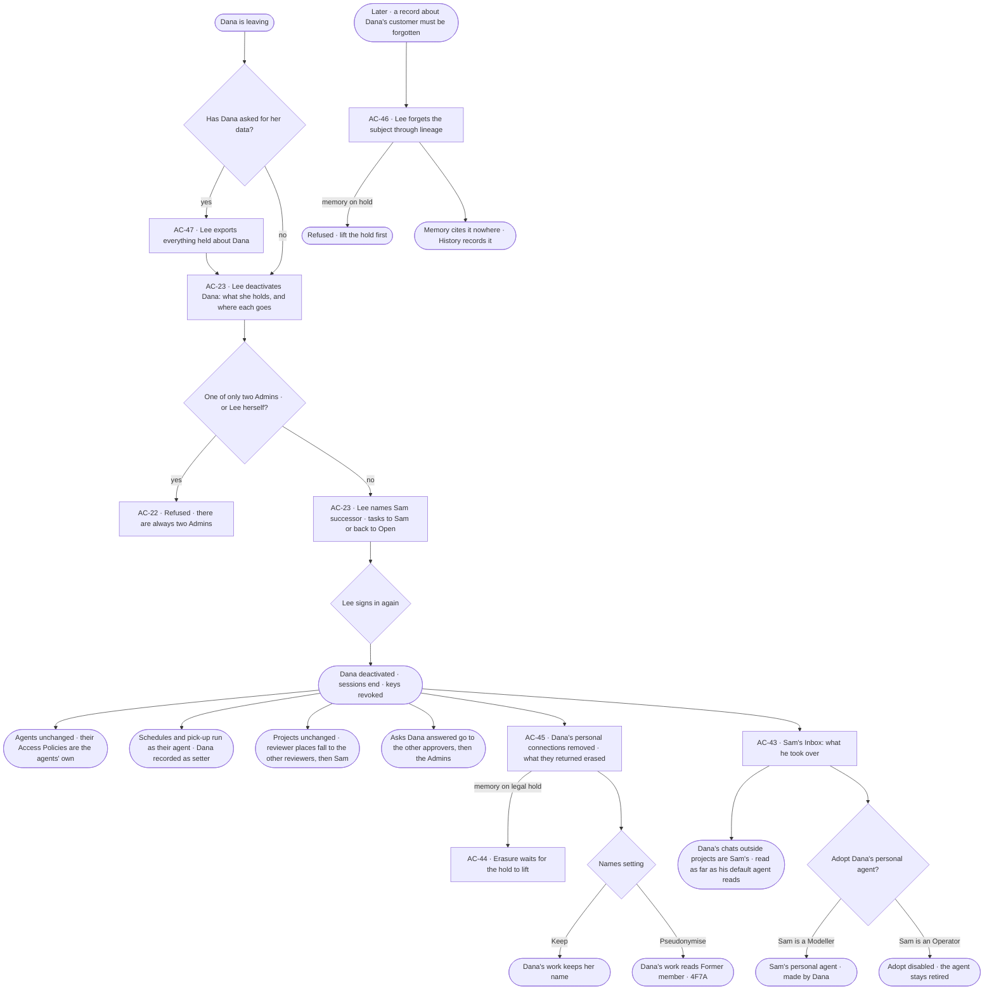

# A person leaves and the team keeps working

> **Lee**, an Admin, deactivates **Dana**, an analyst who is leaving, and names **Sam** her successor. Every agent,
> schedule and project goes on as before; Sam takes what was Dana's; what was only Dana's own goes.

## The journey

## Steps

| # | Step | Product · surface | Story | Board |
|---|---|---|---|---|
| 1 | Export everything held about Dana, when she asks | Access Plane · Leaving and keeping | AC-47 | `access.subject_export` |
| 2 | Deactivate Dana: what she holds and where each goes | Access Plane · Directory | AC-23 | `settings.people` |
| 3 | Name Sam successor; tasks to Sam or back to *Open*; sign in again | Access Plane · Directory | AC-23 | `settings.people` |
| 4 | Dana's personal connections removed and what they returned erased; her name kept or pseudonymised | Access Plane · Leaving and keeping | AC-45 | `settings.people` |
| 5 | Sam reads what he took over and Dana's chats | Access Plane · Ownership | AC-43 | `settings.me` |
| 6 | Sam adopts Dana's personal agent | Access Plane · Ownership | AC-43 | `access.owners` |
| 7 | Forget a subject later asked for | Access Plane · Leaving and keeping | AC-46 | `access.forget` |

## Branches

| When | What happens | Story | Board |
|---|---|---|---|
| Dana is one of only two Admins | Deactivating her is refused until another Admin is made | AC-22 · AC-23 | `settings.people` |
| Lee names no successor | Refused — an active person must take over | AC-23 | `settings.people` |
| It needs permission | Not here — deactivating is an Admin's act, confirmed by signing in again | AC-23 | `settings.people` |
| It fails | Nothing changes — no hand-over, no fallback, no erasure — and the modal says why | AC-23 | `settings.people` |
| Memory is on legal hold | Dana's personal-connection copies wait for the hold to lift; forgetting a subject is refused | AC-44 · AC-45 · AC-46 | `settings.keeping` |
| Sam is an Operator | He takes the chats; *Adopt* is disabled and the agent stays retired | AC-43 | `access.locked` |
| The person has no access | An Operator or a Modeller reads who left and who succeeded them; *Deactivate* is disabled, naming the Admins | AC-23 | `access.locked` |

## Done when

- Dana signs in to nothing; every agent, schedule, pick-up and project runs as it did; every place she held is Sam's or
  has fallen back; her personal-connection data is erased and her name reads as the setting says; History records each
  act.
